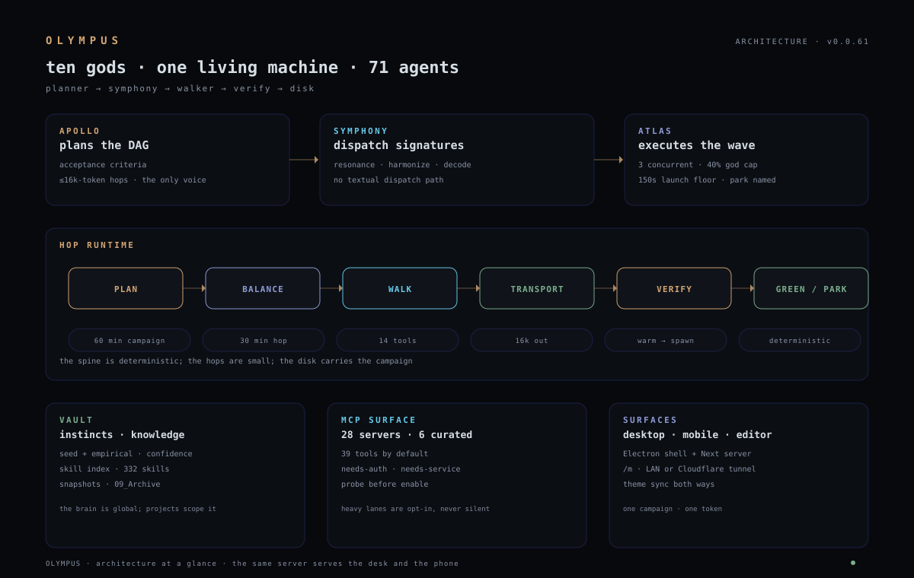
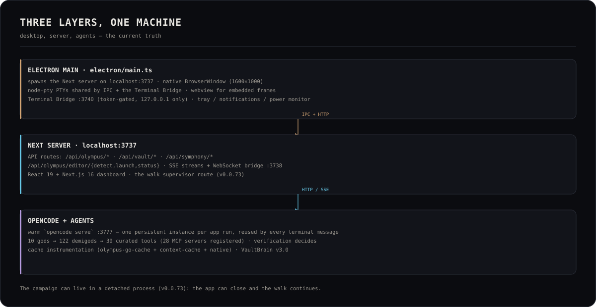
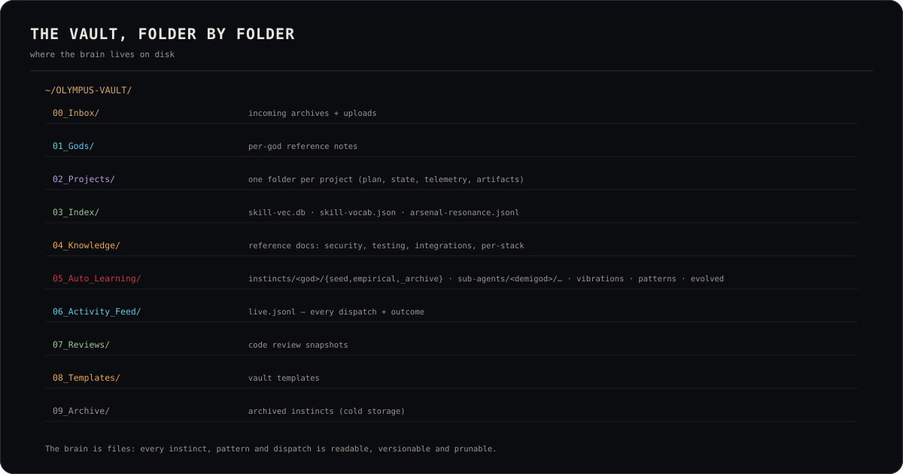

# OLYMPUS Architecture

> OLYMPUS v0.1.5 — multi-agent AI workspace on OpenCode, packaged as a standalone Electron desktop app. 10 gods · 61 demigods · Symphony v1.0 · VaultBrain v3.0 · AGPL-3.0-or-later.
>
> Counts in this document are the v0.1.5 truth: 71 agents (10 gods incl. Atlas + 61 demigods), 332 top-level skills / 378 indexed skill docs, 28 MCP servers, 6 curated / 39 tools by default. The context indicator reads OpenCode's `session_v2` SQLite tables.



## Overview

OLYMPUS is a multi-agent AI workspace built on OpenCode. It runs as a standalone Electron desktop app with a built-in terminal (shared live with your IDE via the Terminal Bridge), an Editor Bridge launchpad (replaces the built-in Monaco editor — see [EDITORS.md](EDITORS.md)), and a 3D brain atlas that visualizes the entire agent fleet.

```
┌─────────────────────────────────────────────────────────┐
│                    Electron Window                      │
│  ┌───────────┐  ┌──────────────┐  ┌──────────────────┐  │
│  │ Activity  │  │  Left Pane   │  │   Right Pane     │  │
│  │ Bar (48px)│  │  (Brain /    │  │   (Terminal /    │  │
│  │           │  │   Vault /    │  │    Editor Bridge │  │
│  │ 10 gods   │  │   Cost /     │  │    / Vault /     │  │
│  │ + nav     │  │   God Detail)│  │    Frames)       │  │
│  └───────────┘  └──────────────┘  └──────────────────┘  │
│  ┌─────────────────────────────────────────────────────┐│
│  │              Status Bar (28px)                      ││
│  └─────────────────────────────────────────────────────┘│
└─────────────────────────────────────────────────────────┘
         │
         ▼
   OpenCode CLI (spawns agents, runs tools, captures hooks)
         │
         ▼
   ~/OLYMPUS-VAULT/ (instincts, patterns, activity feed, indices)
```

---

## Agents

**71 agents total: 10 gods + 61 demigods.**

- Gods are identified by NAME (the `GOD_NAMES` set), not by prefix.
- Demigods are unprefixed. A demigod named `build-resolver` lives at `.opencode/prompts/agents/demigods/hephaestus/build_resolver.txt`.
- Apollo is `mode: "primary"` (talks to the user). The other 9 gods (including Atlas) are `mode: "subagent"` (invoked by Apollo). All 61 demigods are `mode: "subagent"`.

See [AGENTS.md](AGENTS.md) for the full god/demigod roster.

---

## Editor Bridge + Terminal Bridge

OLYMPUS does not ship a built-in code editor. Instead:

- **Editor Bridge tab** (replaces the old IDE tab) — a launchpad that detects installed editors (Zed, VSCode, VSCodium, Cursor), lets the user pick one, and launches it on the active project. Also shows the Terminal Bridge status.
- **Terminal Bridge** — a WebSocket server on `127.0.0.1:3740` (token-gated, token at `~/.olympus/terminal-bridge-token`) that exposes the in-app PTY sessions to any client that speaks the protocol — the `olympus terminal` CLI, your editor's built-in terminal, etc.

See [EDITORS.md](EDITORS.md) for the full protocol reference + per-OS editor install commands.

---

## Persistent OpenCode Session (warm server)

Every conversation message in the Interactive Terminal runs on **one warm `opencode serve` instance** instead of a fresh `opencode run` per message:

- The **first message** of an app run lazily spawns `opencode serve --port <port>` (the only cold start, ~2s boot; the first free-tier model call can still take 5-10s).
- Every **subsequent message reuses the running server** via its HTTP API — no process/plugin cold start, context retained.
- Each chat conversation maps to one opencode session: `~/.olympus/opencode-sessions.json` (`conversationId → sessionId`). The Interactive Terminal sends a `conversationId` with every prompt/answer/context/new-session POST.
- If the server cannot start or dies mid-run, the route **falls back to one-shot `opencode run --format json --session <id>`** (context still retained); the next request re-probes and respawns the server.

Implementation: `src/lib/opencode-session.ts` (server lifecycle + event mapping), consumed by `src/app/api/olympus/action/route.ts`.

| Detail | Value |
|--------|-------|
| Default port | `3777` (env override `OLYMPUS_OPENCODE_PORT`; scans +5 if busy) |
| Bind | `127.0.0.1` only, per-instance random password (`OPENCODE_SERVER_PASSWORD`) |
| PID file | `~/.olympus/opencode-server.pid` — leftover servers from crashes are reused; killed on app exit |
| Log | `~/.olympus/opencode-server.log` (rotated at 1 MB) |
| Session map | `~/.olympus/opencode-sessions.json` (50 entries max, 7-day TTL) |
| Lifecycle | killed on app exit; orphaned servers from crashes are detected and reused |

Live events (`GET /event`) are mapped to the same UI event shapes the one-shot CLI emitted (`step_start` / `text` / `step_finish` / `tool.call` / `tool.response` / `error`), so the frontend is unchanged. The OLYMPUS overlay + router plugins load in serve mode exactly as in one-shot mode (verified: full command/tool/agent/permission config), so dispatch tracking, instinct capture, `session.idle` Callimachus heartbeat, and live.jsonl capture all work identically.

---



---

## Symphony

Symphony is the always-on standard language between Gods and Demigods. Every dispatch is a `VibrationalSignature` — there is no textual dispatch path.

### 5 axioms

1. **Lossless** — the original payload is preserved in the Vault's Resonance Registry.
2. **Coherence-gated** — dispatches below the coherence baseline (0.90) trigger fallback.
3. **Composable** — signatures chain: a demigod's harmonic can become the parent of a new signature.
4. **Auditable** — every signature + harmonic + consensus is logged to `~/OLYMPUS-VAULT/05_Auto_Learning/vibrations/registry.jsonl`.
5. **Zero-cost** — Symphony runs as pure local code (no LLM tokens).

### 4 strata

| Stratum | Role | Components |
|---------|------|------------|
| **Composer** | Emit signatures | Gods (via `olympus-dispatch` tool) |
| **Conductor** | Broadcast + fuse | `src/lib/symphony/core/conductor.ts` |
| **Orchestra** | Return harmonics | Demigods (execute tasks, return `HarmonicPattern`) |
| **Choir** | Decode for user | `src/lib/symphony/core/choir.ts` |

### API surface

- `runSymphonyCycle(composer, payload, targetOrchestra, invokeDemigod)` — compose → conduct → decode. Single entry point.
- `legacyPayloadToSignature(payload, composer, targetOrchestra)` — wrap a textual handoff into a signature.
- `signatureToLegacyPrompt(sig)` — unwrap a signature back into a textual prompt (for demigods that haven't been Symphony-enabled).
- `reconstructPayload(sig)` — lossless reconstruction from the Vault anchor.

### Arsenal Resolver

Symphony also powers the **Arsenal Resolver** — a quick-circuit layer for arsenal selection. It queries the Arsenal Resonance log for past dispatch outcomes matching the current task signature (Jaccard similarity ≥ 0.4). If coherence ≥ 0.85, a quick-circuit fires — returning the proven skills/MCPs/demigods as hints. Gods are not dependent on quick-circuits.

---

## Brain Atlas

The brain atlas is a 3D visualization rendered with Three.js (WebGL2) or Canvas2D (fallback). It shows:

- **10 god nodes** positioned in brain-lobe regions (frontal, parietal, temporal, cerebellum, brain stem)
- **Instinct nodes** — seed + empirical instincts per god
- **Knowledge nodes** — reference docs from `04_Knowledge/`

Skills, Evolved, and Project nodes are not shown in the Brain view — it centers on three core evolving elements: Gods, Instincts, and Knowledge. Scope filters (Global / Stack / Project / Cross-stack) narrow the view.

The brain surface is a 1648-point cloud (1400 surface + 220 cerebellum + 28 stem) rendered as a faint, minimalist silhouette. Nodes orbit around the brain surface, connected by edges.

---

## Hot/Warm/Cold Tier System

Skills AND MCPs are tiered by relevance to keep the input budget lean:

| Tier | What | When loaded | Count |
|------|------|-------------|-------|
| **Hot** | Mastered skills (in `mastered-skills/<god>.md`) + always-available MCPs | Always | ~5-10 skills + 1-2 MCPs per god |
| **Warm** | Stack-relevant skills (tags match active stack) + domain-relevant MCPs | Non-trivial tasks | Up to 20 skills + 2-3 MCPs |
| **Cold** | All other skills + MCPs requiring explicit equip | Never (lazy via skill index / explicit dispatch) | ~378 skills + 0-1 MCPs |

The `olympus-dynamic-context` plugin implements skill tiering in the `experimental.chat.messages.transform` hook. MCP tiering is implemented via `mcp-tiers.ts` (single source of truth for per-god MCP tiers) + a tier-aware `permission.ask` hook in `olympus-router`. The `selectMcpsForTask()` function in `mcp-tiers.ts` returns `{ hot, warm, cold }` for a given task classification, and the permission hook allows/denies MCP tool calls based on the tier + explicit equip records.

---

## Skill Index

A sqlite-vec database (`~/OLYMPUS-VAULT/03_Index/skill-vec.db`) indexes the skills using TF-IDF vectors. v0.1.3 fixed the metadata rowid alignment and the L2→cosine conversion; the `SkillIndex` class now returns positive, relevant similarities:

```typescript
const index = getSkillIndex();
const hits = index.search("react performance optimization", "athena", 5);
// → [{ skill_id: "react-performance", similarity: 0.82 }, ...]
```

The router's `chat.params` hook calls the skill index when the instinct gate doesn't short-circuit; the top-3 hits are also injected as a compact `[SKILL HINTS]` block, and the `olympus-skill-search` / `olympus-retrieval-search` tools expose the index on demand.

Build the index: `node scripts/build-skill-index.js`

---


## Resonance Index (v0.1.4)

`src/lib/symphony/resonance-index.ts` pre-aggregates the append-only
`03_Index/arsenal-resonance.jsonl` into `~/.olympus/resonance.db`. Each row is
a `(god, task signature)` with successes, failures, Laplace coherence and the
proven arsenal. A query computes the task signature, compares it with Jaccard
similarity (≥ 0.4) and returns hints; a quick circuit fires only with 3+
samples and 0.85+ coherence. Hop ids and certification fixtures are rejected
by the signature vocabulary, so the index cannot invent a shortcut. The
`arsenalResonanceByGod` aggregate remains the God Detail read side.

## Build Compiler (v0.1.4)

`src/lib/build-compiler.ts` is the dynamic edge of the curated Build Hub. A
hop that matches no seed/user build gets a **derived** loadout: skills resolve
against `.opencode/skills`, MCPs against `opencode.json`, demigods against the
leading god's prompt tree; limits are 3/3/5 and one executable gate is
required. Derived builds are cold, recorded in `derived-builds.jsonl`, and
shown in a separate Build Hub shelf. Promotion to the user catalog requires 5+
samples at 0.80+ resonance coherence plus a human click. The hop prompt now
carries the build's real tier, not a zero-sample placeholder.

## RLM envelope (v0.1.4)

`src/lib/rlm/envelope.ts` maps recursive context to the existing hop DAG:
depth ≤ 2, ≤ 4 children per parent, child budgets ≤ parent, cycles rejected at
plan time. `DispatchPlan.rlm` carries the goal and budget; `PlanHop.rlmParent`
and `rlmDepth` place a hop in the tree. With `OLYMPUS_RLM=1`, the child prompt
receives the goal, its parent's artifact paths and its slice — never the whole
campaign. Off is byte-identical to v0.1.3.

## Retrieval jobs (v0.1.4)

`src/lib/retrieval/jobs.ts` runs the index build outside the request: a `core`
pass (skills + knowledge), then `all` (instincts, patterns, cached docs).
`GET /api/olympus/retrieval/reindex` exposes phase/progress/cache hits; a
content-addressed embedding cache makes rebuilds cheap. See
[RETRIEVAL.md](RETRIEVAL.md).

## Shell i18n (v0.1.5)

`src/lib/i18n-shell.ts` is the app-chrome dictionary: activity bar, status bar,
Compact Brain, notification panel, Logs header/tabs/overview and the right-pane
tabs, in English, Português, Español, Français, Deutsch, 日本語 and 中文. A
missing key falls back to English, never a blank string. The UI gate switches
the language to pt-BR and asserts the shell (notificar/Custo) before resetting.

## Window lifecycle (v0.1.5)

Minimize calls `mainWindow.minimize()` and keeps the window in the taskbar.
Closing the window (X) hibernates by default: the campaign, preview and MCP
fleet stay alive, and the notification panel also offers hibernate now. A hard
exit is the tray **Quit** (or `closeToHibernate:false` for users who prefer X
to quit). This is the contract behind "minimize stays open; close hibernates".

## Cleanup (v0.1.5)

The cleanup removed surfaces that no runtime path imported: the legacy
`build-talent-editor`, `design-studio-modal`, `mcp-detail-panel`,
`plasma-orb` and `sync-map-scope`. The `sync-map` left-pane union, the
perf-route probe and the stale suite entry were removed with them. Nine unused
devDependencies (CodeMirror, xterm, Radix tooltip) were pruned, along with 34
transitive packages. No behavior changed; the 66-suite battery stays green.

## Retrieval Bus (v0.1.3)

The foundation release adds a local hybrid index at `~/.olympus/retrieval.db`:

- **FTS5/BM25** for exact terms, IDs, error codes and versions;
- **768d dense** (`nomic-embed-text:v1.5` via local Ollama) for semantic neighbours;
- **RRF (k=60)** for rank fusion, with hard project/stack/kind/expiry filters;
- **Context7 cache** so library docs become cited knowledge with a TTL.

The index covers skills, knowledge notes, instincts, patterns and cached docs. It is content-hash incremental and hibernate-safe. Hop prompts receive a bounded `[OLYMPUS-RETRIEVAL]` block; the planner receives the same. Measured on this host: 1,032 chunks / 14.3 MB, P@5 100% vs 73% FTS-only, hybrid p95 235–286 ms. Full contract: [RETRIEVAL.md](RETRIEVAL.md).

---

## Plugin architecture

4 v2 plugins in `opencode.json` (sources in `.opencode/src/`, compiled to
`.opencode/plugin-dist/`; the old ECC/superpowers/cache/skill-registry
plugins were retired in #188/#189 — v2 covers them natively):

| Plugin | Role |
|--------|------|
| `.opencode/olympus` | Olympus overlay (dispatch tracker, instinct gate, MCP gate, cost feed) |
| `.opencode/plugin-dist/olympus-router` | MCP allowlist enforcement, instinct-gated dispatch, skill index search, system transform |
| `.opencode/plugin-dist/olympus-dynamic-context` | Hot/warm/cold tier loading, task classification |
| `.opencode/plugin-dist/apollo-reasoning` | Planner patience — reasoning_effort=low on the free NVIDIA lanes (v2 session context) |

---

## Vault structure



---

## Counts

| Component | Count |
|-----------|-------|
| Gods | 10 |
| Demigods | 61 live (+61 archived with one-command restore) |
| Total agents | 71 |
| Skills | 332 top-level · 378 indexed docs |
| MCPs | 28 unique registry servers · 39 curated tools (measured 2026-11-01) |
| Plugins | 4 v2 plugins |
| Commands | 16 |
| Review tools | 3 (design-review, integration-review, deploy-review) |
| Hooks | 13 in the Olympus overlay (+ router/dynamic-context hooks) |
| LLM strategies | 7 built-in (go-max-quality, go-balanced, go-budget, zen-max-quality, zen-balanced, zen-budget, local) + custom-* (the free tier is retired) |
| LLM providers | 4 registered (OpenCode GO, OpenCode Zen, OpenRouter free, NVIDIA Build free; the free tier is retired as a strategy) — see [MODEL-STRATEGIES.md](MODEL-STRATEGIES.md) |
| Supported external editors | 4 (Zed, VSCode, VSCodium, Cursor) — see [EDITORS.md](EDITORS.md) |
| Terminal Bridge port | 3740 (token-gated, 127.0.0.1 only) |
| Eval | 15 retrieval queries + 5 golden tasks (see [BENCHMARKS.md](BENCHMARKS.md)) |
| Telemetry logs | 3 (activity feed, short-circuit log, benchmark log) |
