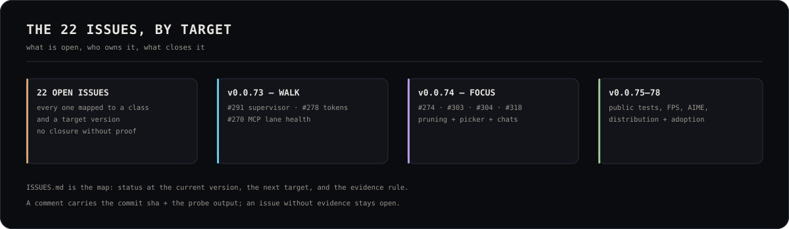

# The 22 open issues — status map at v0.0.82

> v0.0.73 is the detached-walk release. It measures the campaign economics, adds
> opt-in spend caps, gates the docs against the code and refuses a strategy
> switch while a walk is live. It closes the crash class and the mobile
> UX class; the rest stays open with a named target. No issue is closed
> without probe evidence.

| Issue | Title | Status at v0.0.71 | Target |
|---|---|---|---|
| #291 | detached supervisor + auto-resume on app restart | **closed as a class** — one detached process per lane, boot adoption (bounded), start/stop/status route, crash drill green; the packaged-app runner path is v0.0.78 | v0.0.73 |
| #287 | stop hops from starting unmanaged servers/builds | open — the preview manager refuses double-spawn, hops still can | v0.0.71 |
| #293 | stream bounded tool output/progress | **partial** — live tokens/files/last tool in the task sheet; the modal's thinking is still settle-only | v0.0.71 |
| #288 | persist the full recipe + Hop Detail drawer | **partial** — build snapshot + the build crystal in the sheet | v0.0.71 |
| #306 | source hops must run build/lint | **partial** — verify supports build/lint; a source hop without a gate is named in the walk log (warning, not a hard rejection yet) | v0.0.71 |
| #305 | visual gate for UI hops | **partial** — `visual:` reads opacity/console/login; the browser-level reviewer writes the JSON | v0.0.71 |
| #308 | work card GREEN but not mounted | **partial** — `mounted:<artifact>::<entry>` fails dead code; plans must declare it | v0.0.71 |
| #278 | capture tokens on the warm transport | **measured** — `cost:audit` prints the null-token hops by name; the current campaign rows carry tokens (2 historical nulls flagged); the warm-transport drill is next | v0.0.73 |
| #277 | per-model 5h/weekly/monthly caps | open | v0.0.72 |
| #279 | cost:audit reconciliation gate | open | v0.0.72 |
| #269 | epic(cost): cost truth | open (parent) | v0.0.72 |
| #272 | epic(telemetry): context/benchmark/counts | open (parent) | v0.0.72 |
| #271 | epic(hop): campaign truth + reliability | open (parent) | v0.0.71 |
| #270 | epic(mcp): MCP lifecycle | open (parent) | v0.0.73 |
| #283 | lane-scoped health, probe-before-enable, quarantine | **partial** — quarantine (two strikes + clear route) and the honest classification; lane scoping/next | v0.0.71 |
| #284 | repair or retire tamp/serena/opendesign/docker/postgres/git | **partial** — quarantine retires them from the probe loop with the reason; repair is a manual clear | v0.0.71 |
| #317 | every MCP first-class — vendor all + cure matrix | open | v0.0.73 |
| #274 | epic(autonomy): per-god chats | open (parent) | v0.0.74 |
| #303 | element/component picker → god chat/queue | **partial** — the live-preview Mark overlay captures the element + instruction; the picker UI is next | v0.0.71 |
| #304 | per-god chats (10 tabs/sessions/queues) | open | v0.0.74 |
| #318 | user-sovereignty decision ledger + cognitive protocol | open | v0.0.74 |
| #273 | epic(design): live preview + magic wand | open (parent) | v0.0.74 |

## What v0.0.72 did close (the class, not the issue number)

- **The cost question has a command**: `npm run cost:audit` reads the lane's
  telemetry + the cost ledger and prints tokens/hop, cache hit, p50/p95, list
  value and invoice — three money numbers, never one. Null token rows are
  named, not zeroed.
- **Spend is bounded**: opt-in 5h/weekly/monthly caps park a hop by name
  (`cost-cap-*`) instead of burning through a budget silently.
- **Docs contradict the code → the gate fails**: `npm run docs:check` checks
  VERSION, the status bar, README Latest, CHANGELOG, ROADMAP, STABILITY and the
  retired 97% claim.
- **A strategy switch cannot break a live walk**: the route refuses with the
  holder named (409), or requires `force:true`.

## What v0.0.71 did close (the class, not the issue number)

- The app no longer sits on `ERR_CONNECTION_REFUSED`: a 10s health watchdog
  respawns a dead dev server and reloads when it answers; the `did-fail-load`
  respawn check now handles the null `nextProcess` (the actual bug).
- The phone scrolls: the root `<body>` no longer carries `overflow-hidden`.
- The phone sends voice: `/m` uses the same `useHoldToTalk` as the studio
  (server STT + browser fallback), not the browser-only dictation.
- The phone is one screen: ring + hold-to-talk + god row; the details sheet
  holds the rest.
- One canvas on the phone (the ring); the desktop panel's particle budget is
  96→64.
