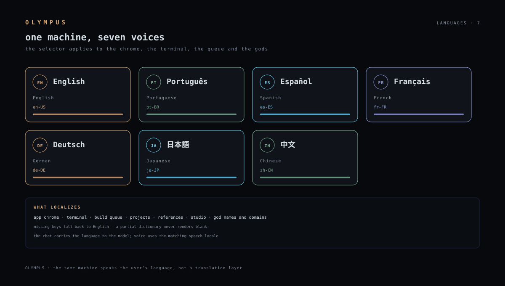

# Languages — seven voices

OLYMPUS ships **seven locales**. The Settings selector applies instantly to
the app chrome, the terminal, the build queue, the projects, the reference
catalog, the Pattern Studio and the gods' replies. Missing keys fall back to
English, so a partial dictionary never renders blank.

| Locale | Native | English | Speech | Coverage |
|---|---|---|---|---|
| `en` | English | English | `en-US` | core + projects + studio |
| `pt-BR` | Português | Portuguese | `pt-BR` | core + projects + studio |
| `es` | Español | Spanish | `es-ES` | core + projects + studio |
| `fr` | Français | French | `fr-FR` | core + projects + studio |
| `de` | Deutsch | German | `de-DE` | core + projects + studio |
| `ja` | 日本語 | Japanese | `ja-JP` | core + projects + studio |
| `zh` | 中文 | Chinese | `zh-CN` | core + projects + studio |

## What localizes

- **Chrome** — menus, status bar, dialogs, toasts, errors.
- **Terminal** — prompts, system lines, plan/todo labels, permission cards.
- **Projects** — brief, status, parked cause, next parts, docs.
- **Studio** — build queue, reference categories, design direction.
- **Gods** — names and domains (*Apolo, Atena, Hefesto, Perséfone* in
  Português; *アポロン, アテナ* in 日本語).
- **Voice** — the matching speech locale for TTS/STT.

## Adding a locale

1. Add the id/native/speech row to `LANGUAGES` in `src/lib/i18n.ts`.
2. Fill the dictionary (or leave keys out — English is the fallback).
3. Add the god names/domains in `src/lib/god-names.ts`.
4. The selector picks it up automatically; no build step.

## Honest limits

- Coverage is strongest in English and Português; the other five are complete
  on the core surfaces and fall back on the long tail.
- The model receives the language in the prompt; it may still answer in
  another language if the task demands it.
