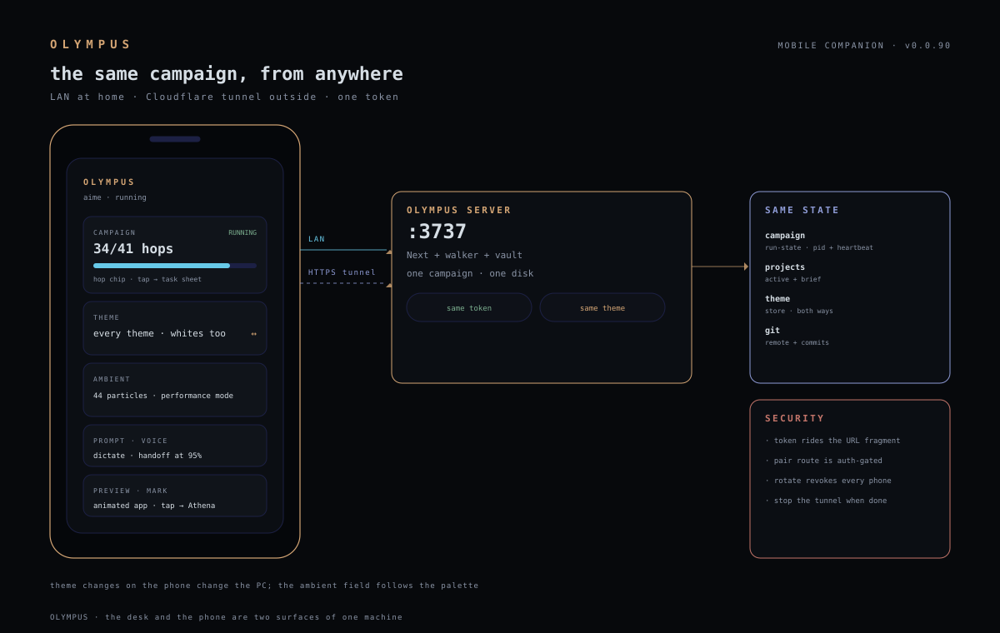

# Mobile companion

> v0.0.60 · the same server, the same campaign, the same token.

OLYMPUS is a desktop app, but the walk does not need the desk. The companion
is **the app itself at `/m`** — no second backend, no second database, no
second secret. A phone on the same network opens the paired URL and sees the
campaign that is running, switches the active project, sends a prompt by text
or voice, reads the campaign aloud, opens the live preview and checks the
project's git remote and last commits.

## Pairing

1. On the desktop, click the **phone icon in the status bar**.
2. The dialog shows a QR, the LAN URL and the session token.
3. Scan the QR with the phone camera. The token rides the URL **fragment**
   (`/m#t=…`), which the browser never sends in a request line; the page
   stores it in `localStorage` and drops it from the address bar.
4. If the mode reads `local`, press **enable LAN** and restart OLYMPUS. The
   bind is chosen at process start (`electron/main.ts`): `local` binds
   loopback, `lan` binds `0.0.0.0`, `tunnel` keeps loopback for
   Tailscale/SSH.

The QR stays valid across restarts because the token lives at
`~/.olympus/session-token` (0600). **Rotate** in the same dialog revokes every
paired phone immediately.

## Outside the house (remote)

The companion also works on mobile data. The desktop starts a **Cloudflare
quick tunnel** (no account, no stored credential):

1. Desktop → phone icon → **start remote tunnel**.
2. The dialog shows the `https://…trycloudflare.com` URL and a **link** button
   that copies `…/m#t=<token>` — open that on the phone.
3. **stop the tunnel** when you are done; the URL is a public door.

The tunnel process is detached and survives app restarts; its URL is stored in
`~/.olympus/mobile-tunnel.json`. A quick tunnel gets a new URL when restarted,
so re-copy the link after a restart. Tailscale/SSH remains the private
alternative (the `tunnel` network mode).

## What the phone can do

| Surface | What it does |
|---|---|
| Campaign | state, completion bar, in-flight hops, the park reason |
| Projects | list + switch the active project |
| Prompt | send a turn; the live stream is reduced to short log lines |
| Voice | Web Speech API dictation; the campaign can also be read aloud |
| Preview | opens the active project's live-preview port |
| Git | remote, branch and the last three commits (read-only) |
| Cost | the 24h step-cost figure |
| Theme | inherits the desktop theme; a choice on the phone changes the PC too |
| Ambient | the creativity page's drifting particle field (44 particles, pauses when hidden) |

## Security model

- **One secret.** The companion uses the existing bearer token; there is no
  mobile-only password that could drift or be weaker.
- **Fragment, not query.** Tokens in a query string land in server logs and
  browser history; the fragment does not.
- **Auth-gated pairing.** `/api/olympus/mobile/pair` calls `requireAuth`:
  loopback-only Host/Origin in `local` mode, bearer token in `lan`/`tunnel`.
- **Explicit network switch.** Nothing leaves loopback until the user presses
  *enable LAN*; the app says a restart is required instead of pretending the
  bind changed live.
- **Revocation is real.** Rotating the token invalidates every paired phone
  and the old QR.
- **Read exposure, stated plainly.** Some read-only Olympus routes predate the
  read-auth gate and answer on the LAN without a token (`run-state`,
  `projects`, `costs`). The *pairing* payload and every *mutation* are
  token-gated; the mobile page always sends the token. A LAN host that knows
  the URL can still read those older GETs until they are migrated to
  `requireReadAuth` — tracked, not hidden.

## Honest limits

- No push notifications: the phone polls every 5s while the tab is visible.
- No offline queue: a prompt sent while the desktop is down fails loudly.
- The companion is a web app, not a store-native app; voice depends on the
  browser's speech engine and language.
- Git is read-only on the phone; create/connect/push stay on the desktop.
- The live preview is the project's own dev server; it must be running.

## Verification

`scripts/mobile-companion.test.mjs` — 17 assertions: token strength and file
mode, fragment-only URL, QR payload, mode round-trip, auth gates, rotate and
mode guards, campaign/project/prompt/voice/preview/git surfaces, and the
desktop mount.
