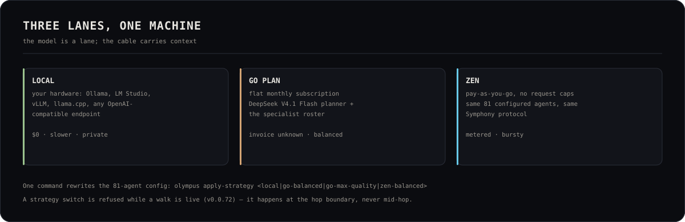

# OLYMPUS Model Strategies



> **v0.1.5 · 2026-11-27.** This page is the human read of
> `src/lib/model-strategies.ts` — the canonical source of truth. The UI, the
> strategy picker and `scripts/apply-strategy.js` mirror it; `npm run
> check-strategy-sync` enforces parity in CI. If this page and the code ever
> disagree, the code wins and this page is the defect.

## TL;DR

| Strategy | Plan | Cost | Apollo | Atlas | When |
|---|---|---|---|---|---|
| `go-max-quality` | GO | higher | DeepSeek V4.1 Flash | Hy3 | Quality over everything; Kimi K2.7 Code on the hard code/security hops |
| `go-balanced` (default) | GO | moderate | DeepSeek V4.1 Flash | Hy3 | Day-to-day 8h/day; DeepSeek/MiMo specialists |
| `go-budget` | GO | low | DeepSeek V4.1 Flash | Hy3 | Maximum savings; MiMo on the volume gods |
| `zen-max-quality` | ZEN | higher | GPT 6.1 Sol | GPT 6.1 Sol | Frontier private models (Claude Opus 5.5, Gemini 3.1 Pro, Grok 4.7) |
| `zen-balanced` | ZEN | moderate | GPT 6.1 Sol | GPT 6 Luna | Private models without runaway cost |
| `zen-budget` | ZEN | low | GPT 6 Luna | GPT 6 Luna | Cheapest private lane |
| `local` | — | **$0** | your hardware | your hardware | Ollama / LM Studio / vLLM / llama.cpp / any OpenAI-compatible endpoint |

Switch at any time:

```bash
olympus apply-strategy go-balanced
# or: Settings → LLM Strategy → the strategy card
```

**The old GLM-5.3 "sacred planner" rule is retired.** Apollo rides DeepSeek
V4.1 Flash in every GO strategy (1M ctx / 384k out, the 1017 planner floor).
DeepSeek V4 Pro is retired from the rosters. GLM-5.3-Flash survives only as a
cheap Zen/local fallback lane, never as the GO planner.

**BYOK is gone.** Every provider (OpenRouter and NVIDIA included) is
registered in OpenCode and selected in the Strategy Builder; there is no second
billing path inside OLYMPUS.

## GO — the open-weight lane

Command: `olympus apply-strategy go-balanced` (or `go-max-quality` / `go-budget`).

| God | go-max-quality | go-balanced (default) | go-budget |
|---|---|---|---|
| Apollo (planner) | `deepseek-v4.1-flash` | `deepseek-v4.1-flash` | `deepseek-v4.1-flash` |
| Atlas (orchestrator) | `hy3` | `hy3` | `hy3` |
| Hephaestus (backend) | `kimi-k2.7-code` | `deepseek-v4.1-flash` | `deepseek-v4.1-flash` |
| Athena (frontend) | `deepseek-v4.1-flash` | `deepseek-v4.1-flash` | `deepseek-v4.1-flash` |
| Artemis (security) | `kimi-k2.7-code` | `deepseek-v4.1-flash` | `deepseek-v4.1-flash` |
| Dionysus (QA) | `deepseek-v4.1-flash` | `mimo-v2.6-flash` | `mimo-v2.6-flash` |
| Hermes (integrations) | `mimo-v2.6-flash` | `mimo-v2.6-flash` | `mimo-v2.6-flash` |
| Persephone (data) | `deepseek-v4.1-flash` | `deepseek-v4.1-flash` | `deepseek-v4.1-flash` |
| Prometheus (DevOps) | `mimo-v2.6-flash` | `mimo-v2.6-flash` | `mimo-v2.6-flash` |
| Callimachus (vault) | `deepseek-v4.1-flash` | `deepseek-v4.1-flash` | `mimo-v2.6-flash` |

Vault writes use `deepseek-v4.1-flash` on all three GO strategies.

### Lane truth (verified on this account)

Every GO lane is probed with a real 1-token turn before a role is assigned.
The verified roster is:

- `deepseek-v4.1-flash`
- `mimo-v2.6-flash`
- `hy3`
- `kimi-k2.7-code`
- `glm-5.3-flash`

`qwen3.7-plus`, `qwen3.8-flash` and `minimax-m3` answer **“OpenCode Go requires
an API key”** on this account. They are marked `auth` and never assigned a
role. A dead lane fails over to the GO-safe set above with the provider's
cause; a GO campaign never silently leaves the plan for a free lane.

## ZEN — the private-model lane

Command: `olympus apply-strategy zen-balanced` (or `zen-max-quality` / `zen-budget`).
Model IDs use the `opencode/<id>` prefix; Hy3 is GO-only, so the Zen
orchestrator substitutes GPT 6.1 Sol / GPT 6 Luna.

| God | zen-max-quality | zen-balanced | zen-budget |
|---|---|---|---|
| Apollo | `gpt-6.1-sol` | `gpt-6.1-sol` | `gpt-6-luna` |
| Atlas | `gpt-6.1-sol` | `gpt-6-luna` | `gpt-6-luna` |
| Hephaestus | `claude-sonnet-5-5` | `claude-sonnet-5-5` | `deepseek-v4.1-flash` |
| Athena | `gpt-6-sol` | `gpt-6-luna` | `glm-5.3-flash` |
| Artemis | `claude-opus-5-5` | `claude-sonnet-5-5` | `deepseek-v4.1-flash` |
| Dionysus | `gpt-6.1-sol` | `claude-haiku-5-5` | `deepseek-v4.1-flash` |
| Hermes | `claude-sonnet-5-5` | `gpt-6-luna` | `deepseek-v4.1-flash` |
| Persephone | `gemini-3.1-pro` | `deepseek-v4.1-flash` | `deepseek-v4.1-flash` |
| Prometheus | `grok-4.7` | `grok-build-0.1` | `glm-5.3-flash` |
| Callimachus | `claude-haiku-5-5` | `claude-haiku-5-5` | `claude-haiku-5-5` |

Zen vault writes use `glm-5.3-flash`. OpenAI/Anthropic requests retain data for
30 days per their policies; the open-weight and free-trial models are the
zero-retention lanes.

## Local — your hardware

`olympus apply-strategy local` probes Ollama (`:11434`), LM Studio (`:1234`),
vLLM (`:8000`), llama.cpp (`:8080`) and any OpenAI-compatible endpoint. The
probe names the model that actually answers; if nothing answers, the apply
**refuses** with the probe table instead of writing a dead config. The model
needs tool calling and at least 32k context. Cost is $0 and no prompt leaves
the machine. See [LOCAL-LLM.md](LOCAL-LLM.md).

## Cost truth

There is **no single global GO cap**. Usage limits are monthly dollar amounts
**per model**, and each model's limit rolls as **5-hour = 20%, weekly = 50%,
monthly = 100%** of its monthly cap. A cheap model's cap goes a long way; a
premium model's cap is precious. Plan prices and request estimates change —
the UI stamps `GO_PLAN_LAST_VERIFIED` / `ZEN_PLAN_LAST_VERIFIED` and links the
canonical docs (`https://opencode.ai/docs/go/`, `https://opencode.ai/docs/zen/`).

OLYMPUS shows three separate numbers, never a silent sum:

1. **step cost** — what the provider reports for the step;
2. **list value** — the catalog-price estimate;
3. **invoice unknown** — the provider invoice is not exposed to OLYMPUS.

## Historical note

The v0.0.23 and earlier pages carried GLM-5.3/Qwen3.7 “sacred” tables and
request-count estimates that no longer match the rosters. They are archived in
the git history; this page is the v0.1.5 truth.
