<p align="center">
  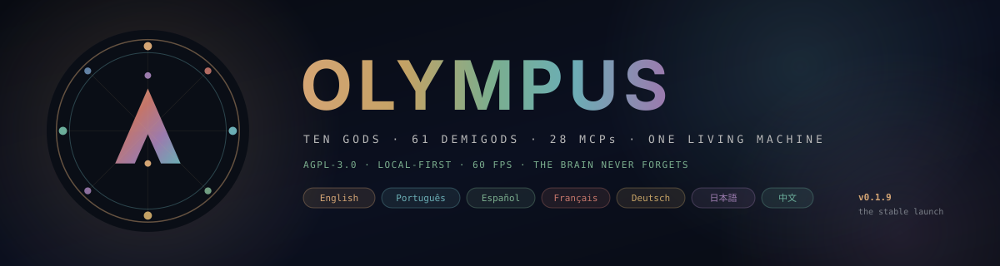
</p>

<p align="center">
  <strong>Low-cost. Excellent quality. Local when you need it.</strong>
</p>

<p align="center">
  
</p>

---

## Quick Start

**Five commands from a clean clone to the desktop app.**

```bash
git clone https://github.com/texugo7badger/olympus.git
cd olympus
npm install
npm run build:app
npm start
```

`npm start` opens OLYMPUS as its own desktop window. The first terminal message
starts the warm session; every message after it reuses the same context.

**Prefer the AppImage?** Download the latest `OLYMPUS-*.AppImage` from
[Releases](https://github.com/texugo7badger/olympus/releases), then:

```bash
chmod +x OLYMPUS-*.AppImage
./OLYMPUS-*.AppImage
```

Authorize providers inside OpenCode once (OLYMPUS has no API-key field):
`olympus opencode` → `/connect` → OpenCode Go (plan) or OpenCode Zen
(pay-as-you-go). The zero-cost path is **Local** — Ollama, LM Studio, vLLM,
llama.cpp or any OpenAI-compatible endpoint ([LOCAL-LLM.md](LOCAL-LLM.md)).

## Screens

One clean screen from the running OLYMPUS app: the brain and the chat, no
mockups.

<div align="center">

<a href="screenshots/olympus.png">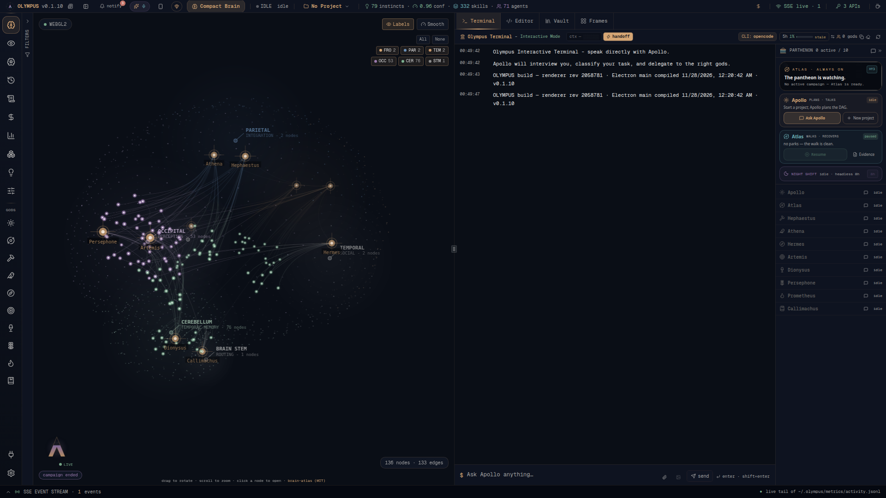</a>

<sub><b>OLYMPUS</b> · the 3D brain on the left, the Apollo chat on the right.</sub>

</div>


## What is OLYMPUS?

OLYMPUS is a multi-agent AI workspace built on OpenCode, packaged as a
standalone Electron desktop app. **Apollo** is the only god who talks to you;
he plans the DAG and hands execution to **Atlas** and the specialist gods. The
campaign runs as small hops on disk — sessions are lanes, the disk carries the
campaign — so an app restart, a provider hiccup or a closed window does not
erase the work.

The brain learns from completed hops: empirical instincts grow samples and
confidence, and the gate short-circuits only when both specific tags match.

## Latest

**v0.1.10 — modal and i18n patch.** The Atlas evidence modal now portals to the body with the same high z-index and strong blur as the task sheet, so the resize grip, brain controls and status bar can never sit above it. Settings headings follow all seven languages. Everything from v0.1.9 remains: the clean 1920×1080 screenshot, the 79-seed/51-knowledge/187-project-memory base, MCP profiles + Craft focus, clean boot/Smooth and the cost-free status bar.

**v0.1.9 was final polish and truth.** OLYMPUS opens clean: no project, an empty
Parthenon and the brain in **Smooth**. The base brain is intentional — 79 seed
instincts, 51 knowledge notes and 187 AIME project-memory instincts, with zero
archived files and zero unearned quick circuits. MCP Configuration explains the
terminal-vs-campaign contract and offers Minimal/Research/Design profiles;
Craft opens on a five-tool development shelf (FigCraft, VectorCraft, PhotoCraft,
CADCraft, PdfCraft) with the rest under Extras, and the Godot/Blender Engine
bridge keeps the agent in the engine and the human in the app. The status bar
keeps full labels without cost numbers, the Parthenon and menus follow all seven
languages, modals portal above the resize grip with blur, and the GNOME dock
gets the OLYMPUS launcher. The repository carries one clean 1920×1080
screenshot, captured from a fresh user window.

Measurement is a command, not a claim: `npm run brain:bench` records the
before/after brain state and `npm run bench:report` saves a durable AIME run.
The full history lives in [CHANGELOG.md](CHANGELOG.md).

## Architecture at a glance

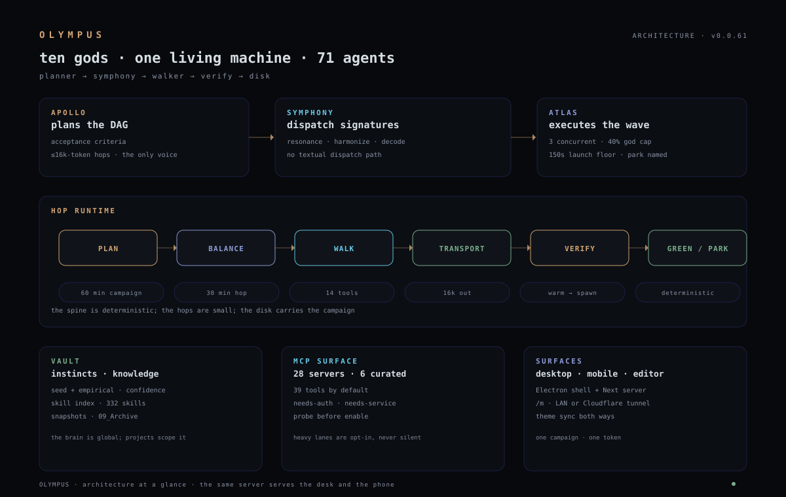

Ten gods plan, dispatch and execute through **Symphony**; a deterministic
spine walks small hops with artifacts on disk; the vault carries the brain.
The same Next server serves the desktop and the phone. Deep dive:
[ARCHITECTURE.md](ARCHITECTURE.md).

## How a walk runs


A plan becomes a DAG, the DAG is balanced (max 40% per god), the walker runs
at most three hops, the transport prefers warm and falls back to spawn, and
**verification decides** — never the model's claim. Budgets: 60-minute
campaign, 30-minute hop, 14 tool calls, 16k output tokens. A park names its
cause and resumes from disk.

## Token economy

Context is compressed and cited; the ledger separates **step cost**, **list
value** and the **invoice** (unknown on GO — never invented); cache hit is
measured, not guessed. Read [TOKEN-ECONOMY.md](TOKEN-ECONOMY.md).

## Testing & evidence

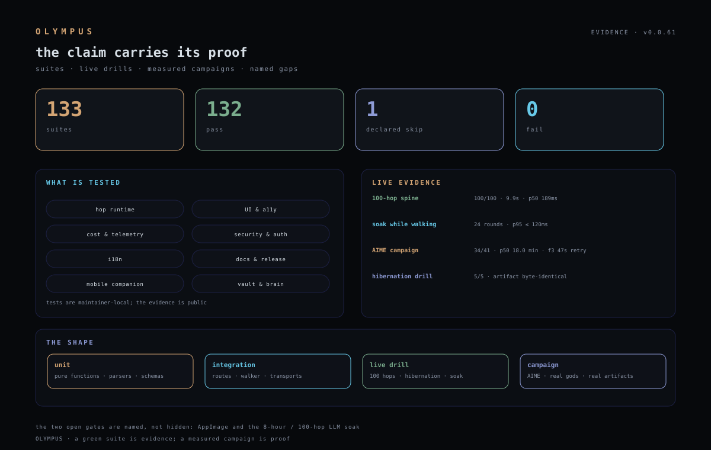

**66 PASS / 0 FAIL / 0 declared skip** across 66 suites is the v0.1.7 stable
gate (35 public in a clean clone; the tracked-local suites need the live
app/vault). The previous v0.1.2 gate was 57/57.
`npm run hygiene -- --battery` runs all eight gates. The 100-hop deterministic
certification passed (100/100, p50/p95 189/225 ms); the 8-hour model soak is
**not claimed**. The campaign's economics are measured by `npm run cost:audit`
(tokens/hop, cache hit, list value, invoice unknown) and the docs are gated by
`npm run docs:check`. Read [TESTING.md](TESTING.md) and
[HYGIENE.md](HYGIENE.md).

## Responsive by design

Phone, tablet, desktop and TV are one machine. `/m` is the premium phone
surface; the desktop shell is resizable; the status bar collapses; performance
mode is one switch for low-end hardware. The breakpoints, rules and the queue
live in [RESPONSIVE.md](RESPONSIVE.md).

## Languages — OLYMPUS is global

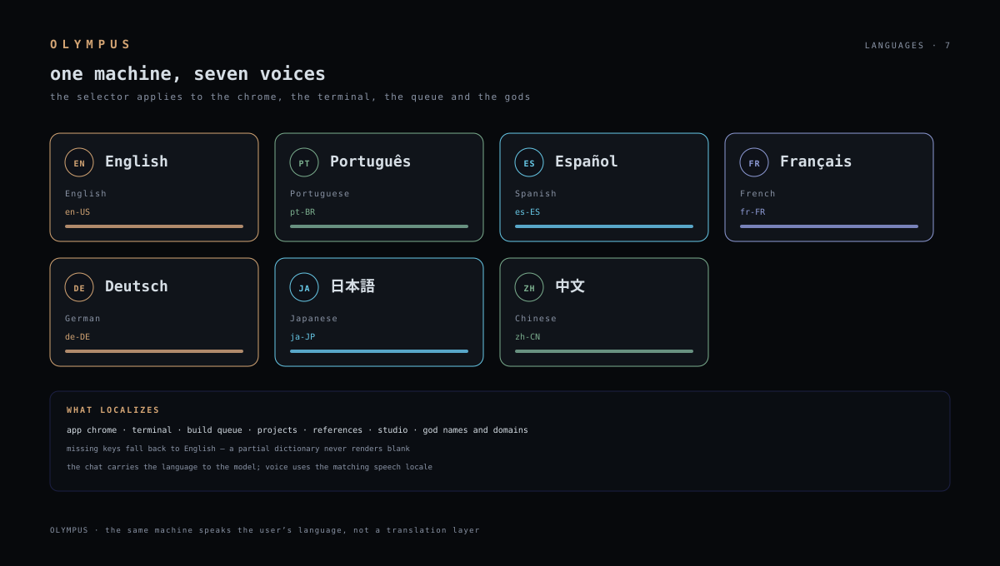

The Settings selector applies instantly to the app chrome, the terminal, the
build queue, the projects, the reference catalog, the Pattern Studio and the
gods' replies. The chat carries the language to the model; the voices are
chosen from the same language.

| | | | | | | |
|---|---|---|---|---|---|---|
| **English** | **Português** | **Español** | **Français** | **Deutsch** | **日本語** | **中文** |

God names and domains localize too — *Apolo, Atena, Hefesto, Perséfone* in
Português; *Apollon, Athéna, Héphaïstos* in Français; *アポロン, アテナ* in
日本語. Missing keys fall back to English, so a partial dictionary never
renders blank. The full table and speech locales live in
[LANGUAGES.md](LANGUAGES.md).

## Mobile companion — the walk leaves the desk


**v0.0.71.** The phone opens `/m` — one screen, voice first: the plasma ring
fills the view, **hold the mic in the middle**, speak, release; the server STT
transcribes and the request goes to Apollo in the active project's lane. The
god row below the ring picks the voice/persona; the details sheet holds the
campaign, the project, the live preview, git, cost, theme and language. The
creative button opens `/m/studio`: the desktop creative surface, responsive
from 320 px to tablet, with the progress per god, the development feed, the
prompt queue and the same ring.
Pairing is one QR in the status bar; the token rides the URL fragment, never a
query string. Outside the house, **start remote tunnel** gives an HTTPS
Cloudflare link for the phone (stop it when done); the theme follows the PC
both ways and the creativity particle field rides along. The switch to LAN mode is explicit and says a restart is
required. Rotate the token to revoke every paired phone.

The preview is a SERVER answer now, not a client-side guess. `GET
/api/olympus/projects/preview?slug=` probes the port and returns the reachable
URL: the desktop's LAN IPv4 on the same Wi-Fi, or a per-port HTTPS
`cloudflared` tunnel when you are away (the old
`http://<location.hostname>:<port>` could never work through the tunnel —
wrong host, mixed content). Start/stop the dev server and the tunnel from the
phone. The phone speaks the desktop's language (it reads the shared choice and
never overwrites it), and `/m/studio` is the creativity surface: the same
particles, orb and per-god voice, stacked for one hand. Every god keeps its
Greek epithet and tone (Phoebus the Luminous, Kore of the Two Worlds, the
Forethinker) in all seven languages.

Read [MOBILE.md](MOBILE.md) for the security model and the honest limits.

**Talent Studio** is a first-class route (`/talent`) and a status-bar button:
the god's own animated symbol, ten sector chips, five temperature dots, speed,
output budget and quality — saved, exportable and in the build prompt.

## Creative mode — progress you can question


The creativity screen (desktop and phone) is the same surface: the live
development feed, the progress bar (completed ÷ the **current plan** — a new
prompt can lower it because the plan grew), one bar per god, the build crystal,
the prompt queue, and the plasma ring. **Hold the mic inside the ring**, speak,
release: the server STT transcribes and the request goes to Apollo in the
project's lane. Tap a god's bar and that god explains its number, aloud, in
your language. The phone mirrors the god and voice switches of the desktop.

**The loader is the theme's logo.** A sphere of stars drifts around the peak;
the light fills it as the app boots. Same component on PC and phone, 60 FPS,
static in stable mode.


**Notifications follow your palette.** When the app is visible, the toast is
themed (type accent + your bg/panel/text); when it is hidden, the OS owns the
notification and follows the system theme — stated, not hidden.

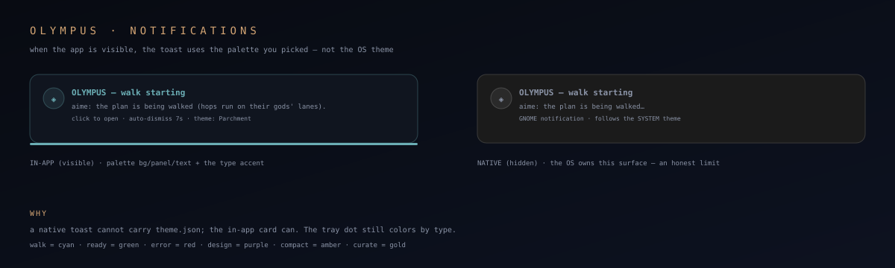

## Themes — eighteen families and a palette lab

Every theme repaints the app, the terminal, the brain, the loader, the tray,
the system icon and the scrollbars. The full gallery lives in [screenshots/THEMES.md](screenshots/THEMES.md);
click a card to open it.

| | | |
|---|---|---|
| [](screenshots/themes/olympus.svg) | [](screenshots/themes/obsidian.svg) | [](screenshots/themes/ember.svg) |
| [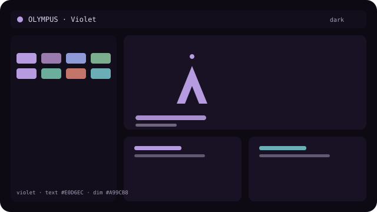](screenshots/themes/violet.svg) | [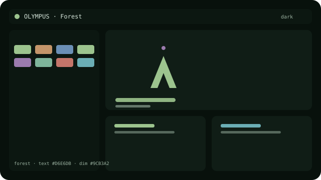](screenshots/themes/forest.svg) | [](screenshots/themes/ice.svg) |
| [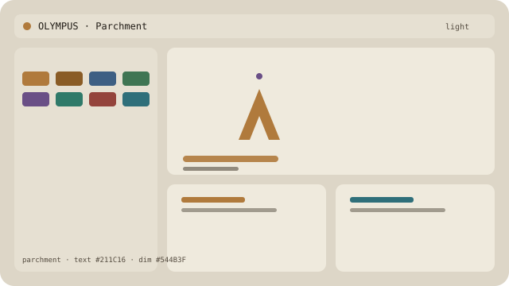](screenshots/themes/parchment.svg) | [](screenshots/themes/eclipse.svg) | [](screenshots/themes/mist.svg) |
| [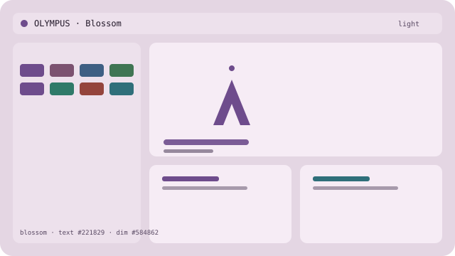](screenshots/themes/blossom.svg) | [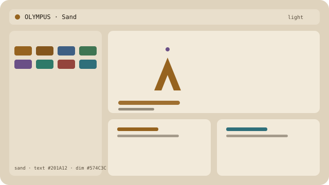](screenshots/themes/sand.svg) | [](screenshots/themes/mint.svg) |
| [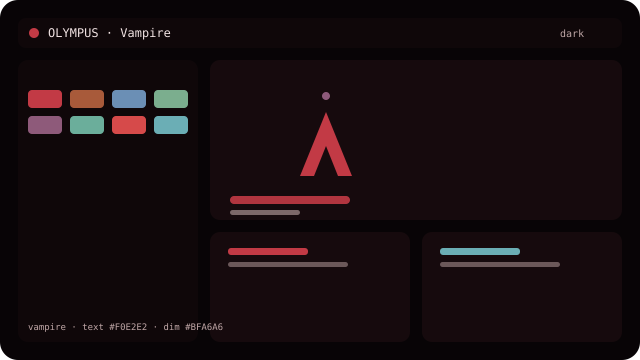](screenshots/themes/vampire.svg) | [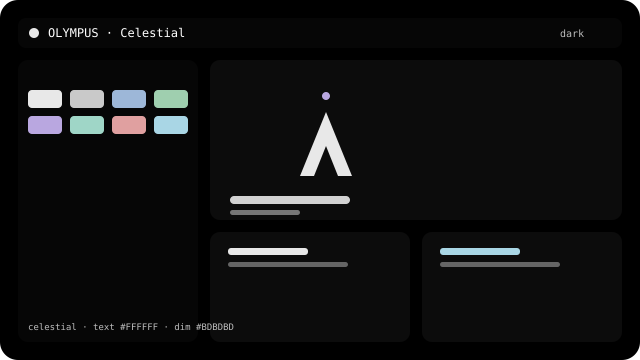](screenshots/themes/celestial.svg) | [](screenshots/themes/abyss.svg) |
| [](screenshots/themes/rosewood.svg) | [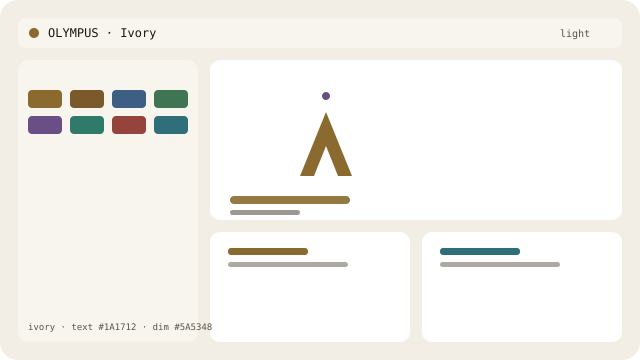](screenshots/themes/ivory.svg) | [](screenshots/themes/paper.svg) |

Beyond the presets, the **palette lab** generates all 14 colors of a family
from a hue + harmony, with contrast floors (text ≥ 7:1, dim ≥ 4.5:1, accent
≥ 3:1). Apply it and every surface follows — including the OS icon.


## Voice — the gods speak, and they listen

**They speak.** The free, open-source [`edge-tts`](https://github.com/rany2/edge-tts)
lane gives each of the ten gods a distinct, calm neural voice in the selected
language — no API key. Apollo is warm and measured, Hephaestus is deep and
slow, Hermes is quick and light. The Pattern Studio's orb is an organic plasma
sphere that expands while the god speaks, tinted by the active god; the
terminal speaks the final reply once per run.

**They listen.** Choose any audio input on your machine in the studio, press
the mic, and speak. The clip is transcribed locally by
[`faster-whisper`](https://github.com/SYSTRAN/faster-whisper) (Whisper base via
ffmpeg → 16 kHz PCM), and the transcript is sent as your question. The god
answers in persona and speaks the answer. **No audio leaves the machine** for
STT.

The voice answers **only what you ask** — it does not narrate the walk. If the
neural lane is missing, the app falls back to the browser voice and says so;
`GET /api/olympus/voice/status` reports the honest state of TTS, STT and
ffmpeg.

**Requirements:** `pip install --user --break-system-packages edge-tts faster-whisper`
and `ffmpeg` on PATH. The first transcription downloads the Whisper base model
(~74 MB); it is cached by faster-whisper.

## Key Features


| Feature | What it does |
|---------|--------------|
| **10 Gods** | Apollo (primary) + Atlas (orchestration) + 7 specialists + Callimachus (background vault curator). Each has a fixed domain and model. |
| **61 Demigods** | Unprefixed live specialists organized under `.opencode/prompts/agents/demigods/<god>/`; 61 never-used ids archived with a one-command restore. |
| **Symphony v1.0** | Latent God↔Demigod protocol. Every dispatch is a `VibrationalSignature` — no textual dispatch path. The old 70–90% transport claim was **refuted in CAL-1**; the protocol is real, the saving is measured per campaign. |
| **VaultBrain v3.0** | Self-curating brain at `~/OLYMPUS-VAULT/05_Auto_Learning/`. Seed + empirical + archive instincts, cross-god patterns, 7-stage maintenance loop. |
| **Cascading Compression** | 5 layers, wired. The percentages were **design math**, not measured; the measured economy today is the hop shape + an 89.7% cache hit (`npm run cost:audit`). |
| **Hot/Warm/Cold Tiers** | Loads mastered + stack-relevant skills. `[DESIGN]` — no A/B measurement yet; the instinct gate measured **0 short-circuits in 4,754 evaluations** and is retired (`GATE.md`). |
| **3D Brain Atlas** | Three.js / Canvas2D visualization of gods, instincts, knowledge, and Symphony vibrations. Brain view shows only Gods / Instincts / Knowledge (Skills, Evolved, and Projects removed for focus). Scope filters (Global / Stack / Project / Cross-stack) narrow the view. |
| **Editor Bridge** | No built-in code editor — OLYMPUS launches your preferred IDE (Zed, VSCode, VSCodium, Cursor) on the active project and shares the live terminal via a token-gated WebSocket bridge. Use `olympus terminal` in any editor to attach. See [EDITORS.md](EDITORS.md). |
| **Native Terminal** | Built-in `node-pty`/`xterm.js` terminal — shared live with your IDE via the Terminal Bridge (port 3740). |
| **Warm Session** | One persistent `opencode serve` per app run — the first terminal message cold-starts it, every following message reuses the running server + session (no cold start, context retained). Applies to all strategies. |
| **Vault Backup** | Auto-commit (every 5 min) + manual push to a private GitHub repo via `isomorphic-git`. |

## The Pantheon


| God | Domain | Model (go-balanced) |
|-----|--------|---------------------|
| **Apollo** | Planning & architecture | DeepSeek V4.1 Flash (1M ctx / 384k out) |
| **Atlas** | Orchestration & execution | Hy3 |
| **Artemis** | Security / auditing | DeepSeek V4.1 Flash |
| **Athena** | Frontend / design | DeepSeek V4.1 Flash |
| **Dionysus** | QA / testing | MiMo-V2.6-Flash |
| **Hephaestus** | Backend / infrastructure | DeepSeek V4.1 Flash |
| **Hermes** | Integrations / APIs / MCPs | MiMo-V2.6-Flash |
| **Persephone** | Database / persistence | DeepSeek V4.1 Flash |
| **Prometheus** | DevOps / CI-CD / deploy | MiMo-V2.6-Flash |
| **Callimachus** | Background vault curator | DeepSeek V4.1 Flash |

The table above is the **go-balanced** roster (the default). DeepSeek V4.1 Flash (the 1017 line) is the preferred lane across the GO strategies; DeepSeek V4 Pro is retired; the planner rides DeepSeek V4.1 Flash in every GO strategy; the old GLM-5.3 planner rule is retired.

## Architecture (brief)

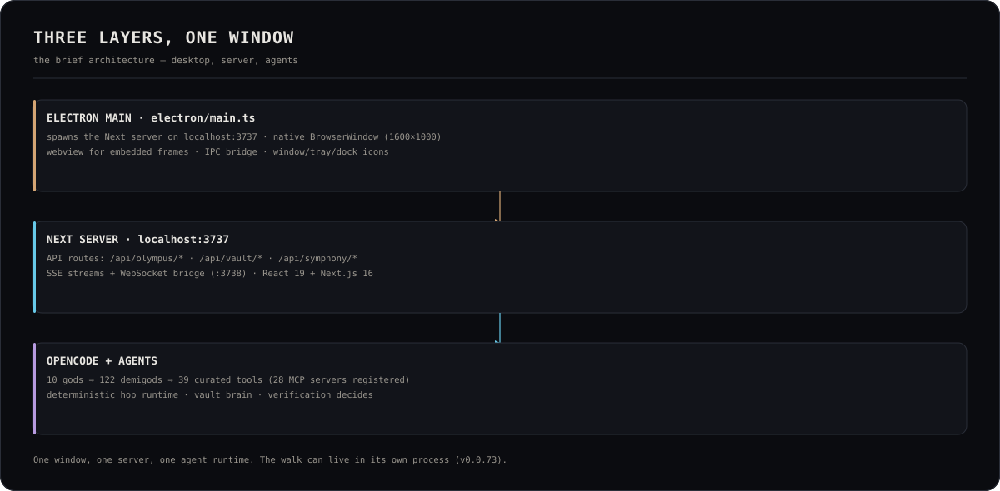

## Strategies

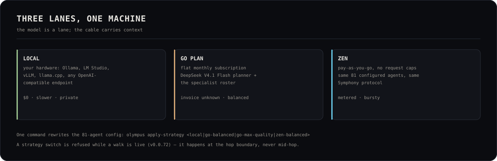

| Strategy | Apollo | Atlas | Specialists | Callimachus |
|----------|--------|-------|-------------|-----------|
| `go-max-quality` | DeepSeek V4.1 Flash | Hy3 | Kimi K2.7 Code (backend/security) · DeepSeek V4.1 Flash (frontend/QA/DB/vault) · MiMo-V2.6-Flash (integrations/DevOps) | DeepSeek V4.1 Flash |
| `go-balanced` (default) | DeepSeek V4.1 Flash | Hy3 | DeepSeek V4.1 Flash (frontend/backend/security/QA/DB/vault) · MiMo-V2.6-Flash (integrations/DevOps) | DeepSeek V4.1 Flash |
| `go-budget` | DeepSeek V4.1 Flash | Hy3 | DeepSeek V4.1 Flash (frontend/backend/security/DB) · MiMo-V2.6-Flash (QA/integrations/DevOps/vault) | MiMo-V2.6-Flash |
| `zen-max-quality` (**Zen**) | GPT 6.1 Sol | GPT 6.1 Sol | Claude Sonnet 5.5 (backend/integrations) · GPT 6 Sol (frontend) · Claude Opus 5.5 (security) · Gemini 3.1 Pro (DB) · Grok 4.7 (DevOps) | Claude Haiku 5.5 |
| `zen-balanced` (**Zen**) | GPT 6.1 Sol | GPT 6 Luna | Claude Sonnet 5.5 (backend/security) · GPT 6 Luna (frontend/integrations) · Claude Haiku 5.5 (QA) · DeepSeek V4.1 Flash (DB) · Grok Build 0.1 (DevOps) | Claude Haiku 5.5 |
| `zen-budget` (**Zen**) | GPT 6 Luna | GPT 6 Luna | DeepSeek V4.1 Flash (backend/security/QA/DB) · GLM-5.3-Flash (frontend/DevOps) | Claude Haiku 5.5 |
| `local` (**Local**) | your harness model | same | same | same |

The **Zen** strategies (`zen-max-quality`, `zen-balanced`, `zen-budget`) run the full 71-agent OLYMPUS on OpenCode Zen — pay-as-you-go, **no request caps**, built around **proprietary APIs** (GPT 6.1 Sol, Claude Sonnet 5.5/Opus 5.5, Gemini 3.1 Pro, Grok 4.7) while the GO plan runs the open-weight line (DeepSeek V4.1 Flash, MiMo-V2.6-Flash, Hy3, Kimi K2.7 Code, GLM-5.3-Flash). Model ids use `opencode/<id>`. Authorize via `olympus opencode` → `/connect` → OpenCode Zen (key stored in OpenCode's own auth.json under the `opencode` provider; env override `OPENCODE_API_KEY`). NOTE: OpenAI/Anthropic requests are retained 30 days per their data policies — the open-weight and trial models are zero-retention.

DeepSeek V4.1 Flash (the 1017 line) is the preferred lane across GO Balanced/Budget and the max-quality specialists; DeepSeek V4 Pro is retired. **Lane truth (v0.1.0):** each GO lane is probed with a real 1-token turn; on the reference account qwen3.7/3.8 and minimax-m3 are denied by the provider, so no role is assigned to them and a dead lane fails over to the verified roster with its cause. **ZEN** is the private-model lane (GPT 6.1 Sol, Claude Sonnet 5.5/Opus 5.5, Gemini 3.1 Pro, Grok 4.7) for users who want proprietary models.

The **Local** strategy (`local`) requires no plan and no key: OLYMPUS probes your machine for a local LLM server (Ollama `:11434`, LM Studio `:1234`, vLLM `:8000`, llama.cpp `:8080`, or any OpenAI-compatible endpoint) and wires the full 10-god + 61-demigod arsenal to it. The apply refuses with the exact probe result if nothing answers — no dead config, no hidden fallback. Requirements: tool calling + ≥32k context; see [LOCAL-LLM.md](LOCAL-LLM.md) for the honest hardware table.

## Uninstall

Vault-safe — never deletes your vault or project folder without confirmation.

```bash
bash scripts/install/uninstall.sh
```

## Documentation

| Document | Description |
|----------|-------------|
| [AGENTS.md](AGENTS.md) | The 10 gods, 61 demigods, dispatch protocol, instinct system, Symphony |
| [ARCHITECTURE.md](ARCHITECTURE.md) | Layered architecture, plugin/MCP stacks, cache instrumentation, Symphony |
| [EDITORS.md](EDITORS.md) | Supported external editors (Zed, VSCode, VSCodium, Cursor), per-OS install commands, Terminal Bridge protocol |
| [MODEL-STRATEGIES.md](MODEL-STRATEGIES.md) | LLM strategy reference — GO plan strategies, Zen (private models), Local (your hardware), the Strategy Builder, demigod inheritance, switching strategies |
| [BENCHMARKS.md](BENCHMARKS.md) | Eval harness (CI golden tasks) + always-on opt-in benchmark recording (real-world metrics), vault pruning policy |
| [BRAIN-HEALTH.md](BRAIN-HEALTH.md) | The four brain pools, what Compact Brain vs the recycler does, the health score and the before/after benchmark |
| [VOICE.md](VOICE.md) | The voice ladder (Chatterbox / Kokoro / edge-tts), licenses, per-god profiles and setup |
| [TOKEN-ECONOMY.md](TOKEN-ECONOMY.md) | Token cost flow — how OLYMPUS achieves quality at low cost |
| [HYGIENE.md](HYGIENE.md) · [KNOWN-ISSUES.md](KNOWN-ISSUES.md) | The zero-error gate of record and every declared limit / post-0.1.0 backlog |
| [WORKFLOW.md](WORKFLOW.md) | How a task flows end-to-end — standard dispatch + Symphony latent path |
| [SECURITY.md](SECURITY.md) | Security policy + vulnerability reporting |
| [CONTRIBUTING.md](CONTRIBUTING.md) | How to contribute (setup, demigods, skills, MCPs, code style) · [good first issues](https://github.com/texugo7badger/olympus/labels/good%20first%20issue) |
| [Discussions](https://github.com/texugo7badger/olympus/discussions) | Ideas and Q&A — the feedback channel after a launch post |
| [CREDITS.md](CREDITS.md) | Open-source projects that make OLYMPUS possible |
| [CLA.md](CLA.md) | Contributor License Agreement (required for all PRs) |

## License — AGPL-3.0-or-later

OLYMPUS is licensed under the [GNU Affero General Public License v3 or later](LICENSE). This is a strong copyleft license that guarantees:

- Free to use, modify, distribute, and host (personal, commercial, SaaS — any purpose).
- **Network use triggers source disclosure** — if you modify OLYMPUS and expose it to users over a network, you MUST offer those users the source code of your modified version (AGPL-3.0 §13).
- **Derivative works must also be AGPL-3.0-or-later.** You cannot relicense OLYMPUS under a proprietary or permissive license.

Vendored code (ECC, OpenDesign, superpowers, caveman, impeccable, context-cache, go-cache recipe) retains its upstream license (MIT or Apache-2.0). See [CREDITS.md](CREDITS.md).

### Contributing

All contributors must accept the [Contributor License Agreement (CLA)](CLA.md) before their pull request can be merged. The CLA is managed automatically by [CLA Assistant 2.0](https://cla-assistant.io/) — the first time you open a PR, the bot posts a comment with a one-click acceptance link.

## Support

- **Issues:** [github.com/texugo7badger/olympus/issues](https://github.com/texugo7badger/olympus/issues)
- **Discussions:** [github.com/texugo7badger/olympus/discussions](https://github.com/texugo7badger/olympus/discussions)

<div align="center">

  <h3>Support the dev</h3>

  <table>
    <tr>
      <td><a href="https://ko-fi.com/G4H521S5GK"></a></td>
      <td width="16"></td>
      <td><a href="https://livepix.gg/texugo7badger"></a></td>
    </tr>
  </table>

  <sub>Made by <a href="https://github.com/texugo7badger">@texugo7badger</a></sub>

</div>
