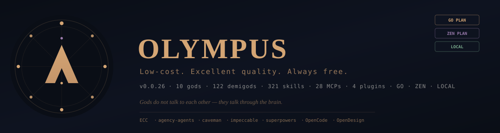
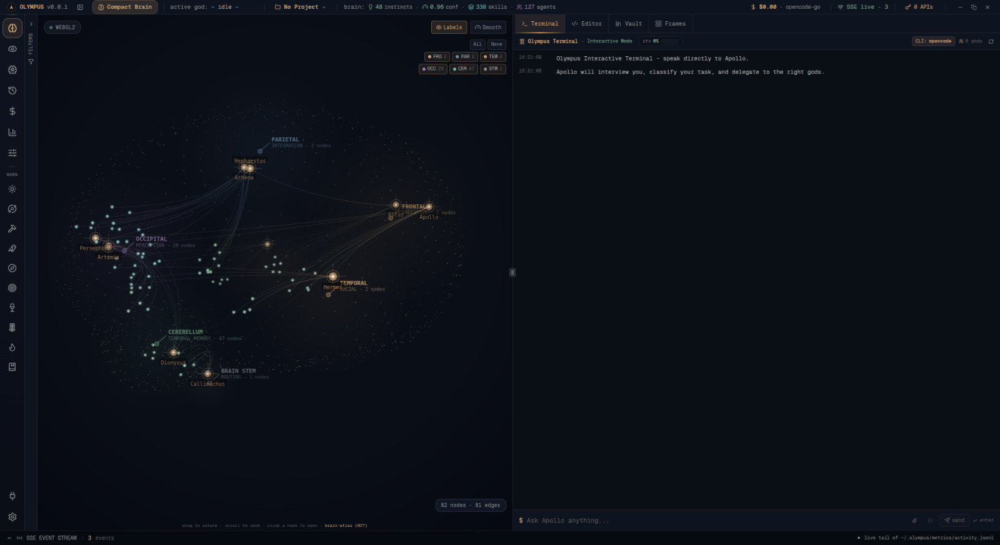

<p align="center">
  
</p>

<p align="center">
  <strong>Low-cost. Excellent quality. Local when you need it.</strong>
</p>

<p align="center">
  
</p>

---

## What is OLYMPUS?

OLYMPUS is a multi-agent AI operating system built on [OpenCode](https://opencode.ai). It runs as a standalone **Electron desktop app** on Linux. Other platforms should use WSL. OLYMPUS routes each task to the cheapest LLM that can handle it, cascades token compression across five layers (including the Symphony latent protocol), and learns from every action via a self-curating **VaultBrain**.

<div align="center">
  
</div>

- **Three ways to run.** The GO plan (flat monthly, no per-token charges), OpenCode **Zen** (pay-as-you-go, no request caps), or **Local** — your own hardware (Ollama, LM Studio, vLLM, llama.cpp, or any OpenAI-compatible endpoint). The zero-cost path is the local lane, and it tells you exactly what it found (see [LOCAL-LLM.md](LOCAL-LLM.md)).
- **10 gods + 122 demigods (132 agents).** Apollo is the only god who talks to you; the other 9 are dispatched by Apollo via Symphony.
- **The Craft Apps inside (v0.0.8).** The thirteen open-source ArtCraft apps (image editor, vector illustration, video, PDF, word processing, CAD, spreadsheets) are DOWNLOADED INTO OLYMPUS — the self-hosted web builds run embedded from your own disk (no login, ever; auto-update ON), the native portable builds open as real OS windows, and the `olympus-craft` MCP gives the agents headless CLI/JSON control. The AI crafting Studio rides the live lane.
- **Self-curating brain.** Each god maintains an instinct pool — empirical patterns that, at confidence ≥ 0.85, **short-circuit** deliberation. OLYMPUS gets faster and cheaper with use. Live telemetry in the God Intelligence Dashboard shows the short-circuit hit rate + tokens saved.
- **Always open.** AGPL-3.0-or-later. The public code is the most up-to-date and best version — forever.

## Quick Start

OLYMPUS runs as a **standalone desktop application** — it opens its own window. Your IDE terminal stays free for coding.

### Option A: Download the AppImage (recommended for users)

> **This is the standalone build.** Auto-updates via GitHub Releases. No Node.js, no terminal needed after download.

```bash
# 1. Download the latest AppImage from GitHub Releases:
#    https://github.com/texugo7badger/olympus/releases
#    OLYMPUS-0.0.25-linux-x86_64.AppImage (~457 MB)

# 2. Make it executable and run:
chmod +x OLYMPUS-*.AppImage
./OLYMPUS-*.AppImage
```

**Before opening the app, authorize your providers inside OpenCode** (there is no API key field anywhere in OLYMPUS):

```bash
olympus opencode      # the OpenCode TUI
# inside: /connect  → OpenCode Go (plan) or OpenCode Zen (pay-as-you-go)
# optional: Settings → Providers → OpenRouter / NVIDIA (registered in OpenCode)
```

Then open OLYMPUS. Every key lives in OpenCode's own `auth.json`; OLYMPUS only detects what is registered there. The zero-cost path is **Local** (your own Ollama/LM Studio/vLLM server — see [LOCAL-LLM.md](LOCAL-LLM.md)).

OLYMPUS opens as its own desktop window. Use the **Editor Bridge** tab to launch your IDE on a project.

### Option B: Run from source (for contributors)

```bash
# 1. Clone
git clone https://github.com/texugo7badger/olympus.git
cd olympus

# 2. Install (interactive installer):
bash scripts/install/install.sh

# 3. Launch
npm run dev
```

The installer applies the default `go-balanced` strategy (sustainable 8h/day coding). To switch later:

```bash
olympus apply-strategy go-budget
# or: Settings → LLM strategy in the app
```

> **Note:** `npm run dev` runs in your terminal. For daily use, download the AppImage instead — it runs as a standalone window and your terminal stays free.


## Key Features

| Feature | What it does |
|---------|--------------|
| **10 Gods** | Apollo (primary) + Atlas (orchestration) + 7 specialists + Callimachus (background vault curator). Each has a fixed domain and model. |
| **118 Demigods** | Unprefixed specialists organized under `.opencode/prompts/agents/demigods/<god>/`. |
| **Symphony v1.0** | Latent God↔Demigod protocol. Every dispatch is a `VibrationalSignature` — no textual dispatch path. 70–90% transport reduction on parallel dispatches. |
| **VaultBrain v3.0** | Self-curating brain at `~/OLYMPUS-VAULT/05_Auto_Learning/`. Seed + empirical + archive instincts, cross-god patterns, 7-stage maintenance loop. |
| **Cascading Compression** | 5 layers: none → caveman (65%) → strategic-compact → none → Symphony (70–90%). Net: ~90%+ cost reduction. |
| **Hot/Warm/Cold Tiers** | 81% input reduction by only loading mastered + stack-relevant skills. |
| **3D Brain Atlas** | Three.js / Canvas2D visualization of gods, instincts, knowledge, and Symphony vibrations. Brain view shows only Gods / Instincts / Knowledge (Skills, Evolved, and Projects removed for focus). Scope filters (Global / Stack / Project / Cross-stack) narrow the view. |
| **Editor Bridge** | No built-in code editor — OLYMPUS launches your preferred IDE (Zed, VSCode, VSCodium, Cursor) on the active project and shares the live terminal via a token-gated WebSocket bridge. Use `olympus terminal` in any editor to attach. See [EDITORS.md](EDITORS.md). |
| **Native Terminal** | Built-in `node-pty`/`xterm.js` terminal — shared live with your IDE via the Terminal Bridge (port 3740). |
| **Warm Session** | One persistent `opencode serve` per app run — the first terminal message cold-starts it, every following message reuses the running server + session (no cold start, context retained). Applies to all strategies. |
| **Vault Backup** | Auto-commit (every 5 min) + manual push to a private GitHub repo via `isomorphic-git`. |

## The Pantheon

| God | Domain | Model (go-balanced) |
|-----|--------|---------------------|
| **Apollo** | Planning & architecture | DeepSeek V4.1 Flash (1M ctx / 384k out) |
| **Atlas** | Orchestration & execution | Hy3 |
| **Artemis** | Security / auditing | DeepSeek V4.1 Flash |
| **Athena** | Frontend / design | Qwen3.7 Plus |
| **Dionysus** | QA / testing | Qwen3.7 Plus |
| **Hephaestus** | Backend / infrastructure | DeepSeek V4.1 Flash |
| **Hermes** | Integrations / APIs / MCPs | Qwen3.7 Plus |
| **Persephone** | Database / persistence | DeepSeek V4.1 Flash |
| **Prometheus** | DevOps / CI-CD / deploy | MiniMax M3 |
| **Callimachus** | Background vault curator | DeepSeek V4.1 Flash |

The table above is the **go-balanced** roster (the default). DeepSeek V4.1 Flash (the 1017 line) is the preferred lane across the GO strategies; DeepSeek V4 Pro is retired; GLM-5.3 only appears in `go-max-quality` where the planner needs the premium reasoning lane.

## Architecture (brief)

```
┌────────────────────────────────────────────────────────────────┐
│  Electron Main Process (electron/main.ts)                      │
│  • Spawns Next.js on localhost:3737                            │
│  • Native BrowserWindow (1600×1000)                            │
│  • <webview> for embedded frames · IPC bridge                  │
└────────────────────────────────────────────────────────────────┘
                          ↕
┌────────────────────────────────────────────────────────────────┐
│  Next.js Server (localhost:3737)                               │
│  • API routes: /api/olympus/*, /api/vault/*, /api/symphony/*   │
│  • SSE streams + WebSocket bridge (:3738)                      │
│  • React 19 + Next.js 16 dashboard                             │
└────────────────────────────────────────────────────────────────┘
                          ↕
┌────────────────────────────────────────────────────────────────┐
│  OpenCode + Agents                                             │
│  • 10 OLYMPUS gods → 122 demigods → 18 tools + 25 MCP servers  │
│  • Cascading compression (caveman → strategic-compact →        │
│    Symphony harmonics)                                         │
│  • Cache instrumentation (olympus-go-cache + context-cache +   │
│    native OpenCode caching)                                    │
│  • Self-curating brain (VaultBrain v3.0)                       │
└────────────────────────────────────────────────────────────────┘
```

## Strategies

| Strategy | Apollo | Atlas | Specialists | Callimachus |
|----------|--------|-------|-------------|-----------|
| `go-max-quality` | DeepSeek V4.1 Flash | Hy3 | Kimi K2.7 Code (backend) · Qwen3.7 Plus (frontend/integrations) · Kimi K3 (security) · DeepSeek V4.1 Flash (QA/DB/vault) · MiniMax M3 (DevOps) | DeepSeek V4.1 Flash |
| `go-balanced` (default) | DeepSeek V4.1 Flash | Hy3 | Qwen3.7 Plus (frontend/QA/integrations) · DeepSeek V4.1 Flash (backend/security/DB/vault) · MiniMax M3 (DevOps) | DeepSeek V4.1 Flash |
| `go-budget` | DeepSeek V4.1 Flash | Hy3 | DeepSeek V4.1 Flash (backend/security/DB) · Qwen3.8 Flash (frontend) · MiMo-V2.6-Flash (QA/integrations/DevOps/vault) | MiMo-V2.6-Flash |
| `zen-max-quality` (**Zen**) | GPT 6.1 Sol | GPT 6.1 Sol | Claude Sonnet 5.5 (backend/integrations) · GPT 6 Sol (frontend) · Claude Opus 5.5 (security) · Gemini 3.1 Pro (DB) · Grok 4.7 (DevOps) | Claude Haiku 5.5 |
| `zen-balanced` (**Zen**) | GPT 6.1 Sol | GPT 6 Luna | Claude Sonnet 5.5 (backend/security) · GPT 6 Luna (frontend/integrations) · Claude Haiku 5.5 (QA) · DeepSeek V4.1 Flash (DB) · Grok Build 0.1 (DevOps) | Claude Haiku 5.5 |
| `zen-budget` (**Zen**) | GPT 6 Luna | GPT 6 Luna | DeepSeek V4.1 Flash (backend/security/QA/DB) · GLM-5.3-Flash (frontend/DevOps) | Claude Haiku 5.5 |
| `local` (**Local**) | your harness model | same | same | same |

The **Zen** strategies (`zen-max-quality`, `zen-balanced`, `zen-budget`) run the full 132-agent OLYMPUS on OpenCode Zen — pay-as-you-go, **no request caps**, built around **proprietary APIs** (Claude Sonnet 5, GPT-5.4, Gemini 3.5 Flash, Kimi K2.7 Code, MiniMax) while the GO plan runs the open-weight line (GLM, DeepSeek, Qwen, Hy3). Model ids use `opencode/<id>`. Authorize via `olympus opencode` → `/connect` → OpenCode Zen (key stored in OpenCode's own auth.json under the `opencode` provider; env override `OPENCODE_API_KEY`). NOTE: OpenAI/Anthropic requests are retained 30 days per their data policies — the open-weight and trial models are zero-retention.

DeepSeek V4.1 Flash (the 1017 line) is the preferred lane across GO Balanced/Budget and the max-quality specialists; DeepSeek V4 Pro is retired. **ZEN** is the private-model lane (GPT 6.1 Sol, Claude Sonnet 5.5/Opus 5.5, Gemini 3.1 Pro, Grok 4.7) for users who want proprietary models.

The **Local** strategy (`local`) requires no plan and no key: OLYMPUS probes your machine for a local LLM server (Ollama `:11434`, LM Studio `:1234`, vLLM `:8000`, llama.cpp `:8080`, or any OpenAI-compatible endpoint) and wires the full 10-god + 122-demigod arsenal to it. The apply refuses with the exact probe result if nothing answers — no dead config, no hidden fallback. Requirements: tool calling + ≥32k context; see [LOCAL-LLM.md](LOCAL-LLM.md) for the honest hardware table.

## Uninstall

Vault-safe — never deletes your vault or project folder without confirmation.

```bash
bash scripts/install/uninstall.sh
```

## Documentation

| Document | Description |
|----------|-------------|
| [AGENTS.md](AGENTS.md) | The 10 gods, 122 demigods, dispatch protocol, instinct system, Symphony |
| [ARCHITECTURE.md](ARCHITECTURE.md) | Layered architecture, plugin/MCP stacks, cache instrumentation, Symphony |
| [EDITORS.md](EDITORS.md) | Supported external editors (Zed, VSCode, VSCodium, Cursor), per-OS install commands, Terminal Bridge protocol |
| [MODEL-STRATEGIES.md](MODEL-STRATEGIES.md) | LLM strategy reference — GO plan strategies, Zen (private models), Local (your hardware), the Strategy Builder, demigod inheritance, switching strategies |
| [BENCHMARKS.md](BENCHMARKS.md) | Eval harness (CI golden tasks) + always-on opt-in benchmark recording (real-world metrics), vault pruning policy |
| [TOKEN-ECONOMY.md](TOKEN-ECONOMY.md) | Token cost flow — how OLYMPUS achieves quality at low cost |
| [WORKFLOW.md](WORKFLOW.md) | How a task flows end-to-end — standard dispatch + Symphony latent path |
| [SECURITY.md](SECURITY.md) | Security policy + vulnerability reporting |
| [CONTRIBUTING.md](CONTRIBUTING.md) | How to contribute (setup, demigods, skills, MCPs, code style) |
| [CREDITS.md](CREDITS.md) | Open-source projects that make OLYMPUS possible |
| [CLA.md](CLA.md) | Contributor License Agreement (required for all PRs) |

## License — AGPL-3.0-or-later

OLYMPUS is licensed under the [GNU Affero General Public License v3 or later](LICENSE). This is a strong copyleft license that guarantees:

- Free to use, modify, distribute, and host (personal, commercial, SaaS — any purpose).
- **Network use triggers source disclosure** — if you modify OLYMPUS and expose it to users over a network, you MUST offer those users the source code of your modified version (AGPL-3.0 §13).
- **Derivative works must also be AGPL-3.0-or-later.** You cannot relicense OLYMPUS under a proprietary or permissive license.

Vendored code (ECC, OpenDesign, superpowers, caveman, impeccable, context-cache, go-cache recipe) retains its upstream license (MIT or Apache-2.0). See [CREDITS.md](CREDITS.md).

### Contributing

All contributors must accept the [Contributor License Agreement (CLA)](CLA.md) before their pull request can be merged. The CLA is managed automatically by [CLA Assistant 2.0](https://cla-assistant.io/) — the first time you open a PR, the bot posts a comment with a one-click acceptance link.

## Support

- **Issues:** [github.com/texugo7badger/olympus/issues](https://github.com/texugo7badger/olympus/issues)
- **Discussions:** [github.com/texugo7badger/olympus/discussions](https://github.com/texugo7badger/olympus/discussions)

<div align="center">

  <h3>💙 Support the Dev</h3>

  <p>
    <sub><i>Did OLYMPUS supercharge your multi-agent workflow? If you can, buy me a coffee to keep the cauldron bubbling!</i></sub>
  </p>

  <p>
    <a href="https://ko-fi.com/G4H521S5GK">
      
    </a>
    &nbsp;&nbsp;&nbsp;&nbsp;
    <a href="https://livepix.gg/texugo7badger">
      
    </a>
  </p>

  <p>
    <sub>Made by <a href="https://github.com/texugo7badger">@texugo7badger</a></sub>
  </p>

</div>
