<p align="center">
  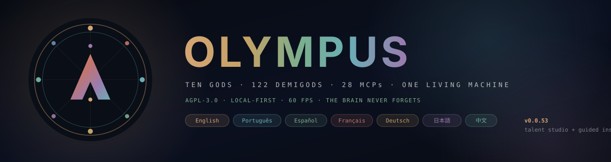
</p>

<p align="center">
  <strong>Low-cost. Excellent quality. Local when you need it.</strong>
</p>

<p align="center">
  
</p>

---


## Screens

Twelve surfaces, captured from the running build in **English**, at
1600×1000 — no mockups.

<div align="center">

| | | |
|---|---|---|
| <a href="screenshots/screens/01-brain-terminal.png">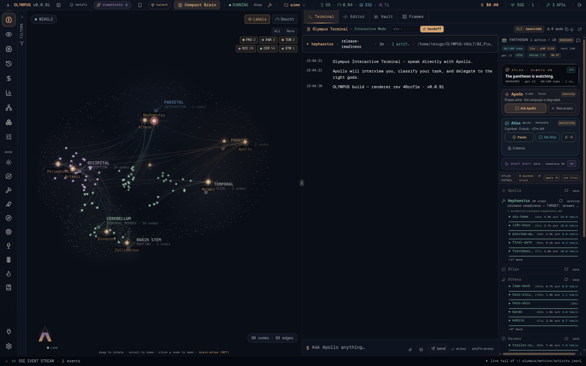</a><br><sub><b>Brain + terminal</b> · the atlas and a clean session</sub> | <a href="screenshots/screens/02-creative.png">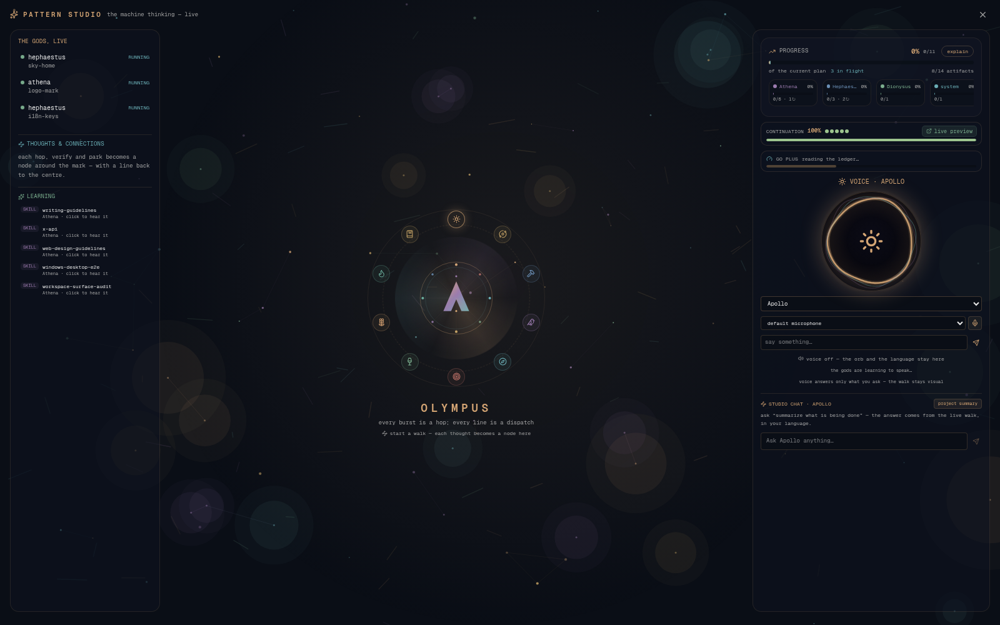</a><br><sub><b>Creative mode</b> · progress, ring, build crystal and queue</sub> | <a href="screenshots/screens/03-craft-apps.png">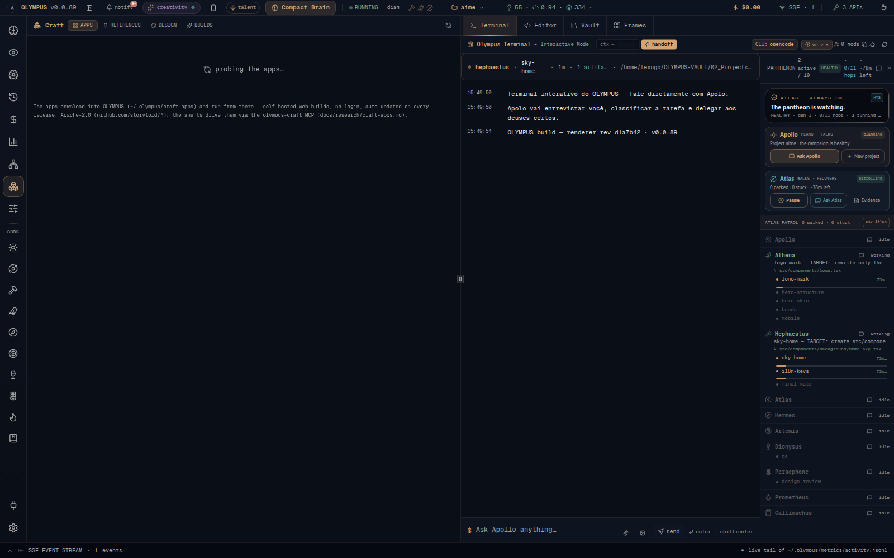</a><br><sub><b>Craft apps</b> · the vendored creative suite</sub> |
| <a href="screenshots/screens/04-references.png">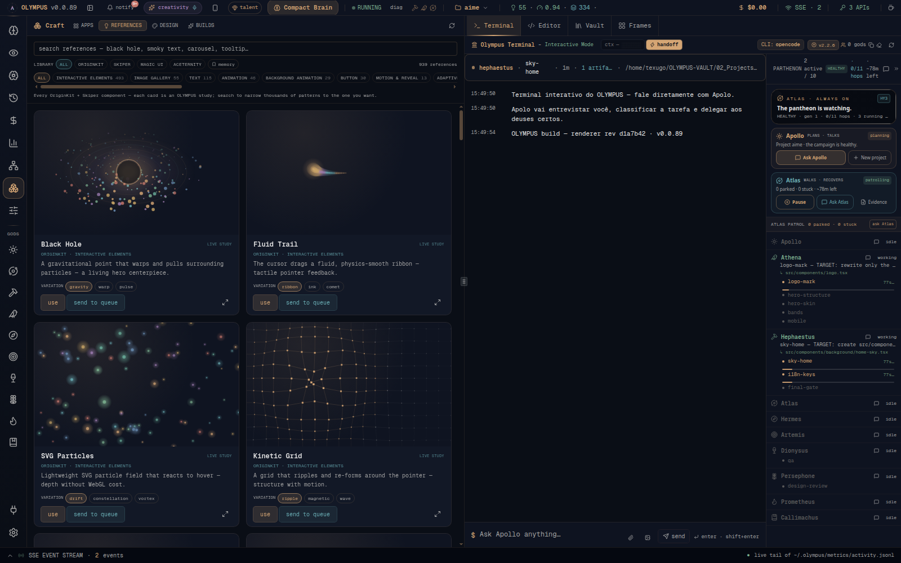</a><br><sub><b>References</b> · 8 curated collections over the 939-study catalog</sub> | <a href="screenshots/screens/05-design.png">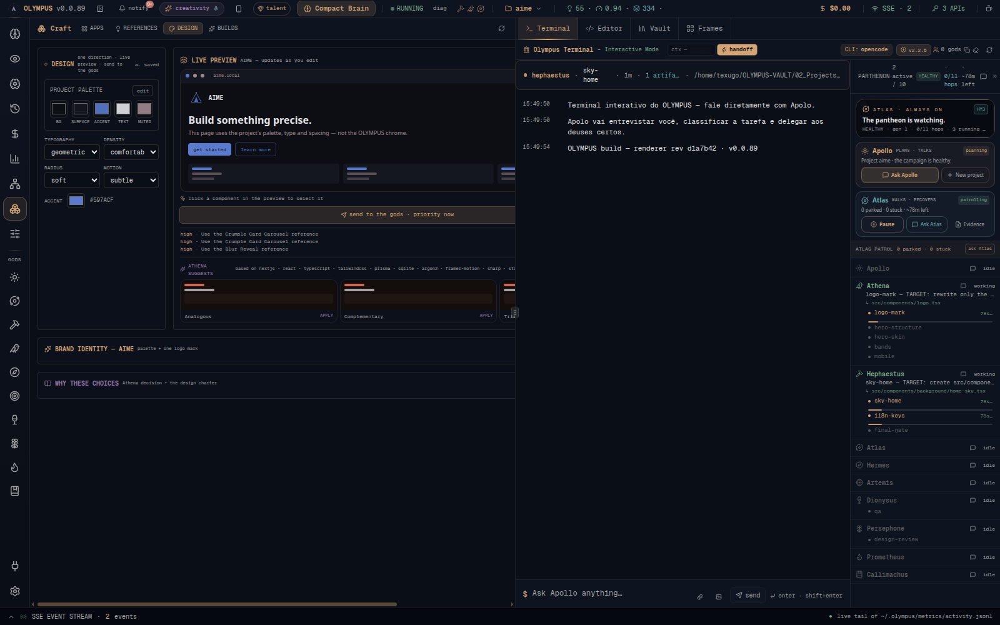</a><br><sub><b>Athena design studio</b> · style, contract, review and approval in her chat</sub> | <a href="screenshots/screens/06-builds.png">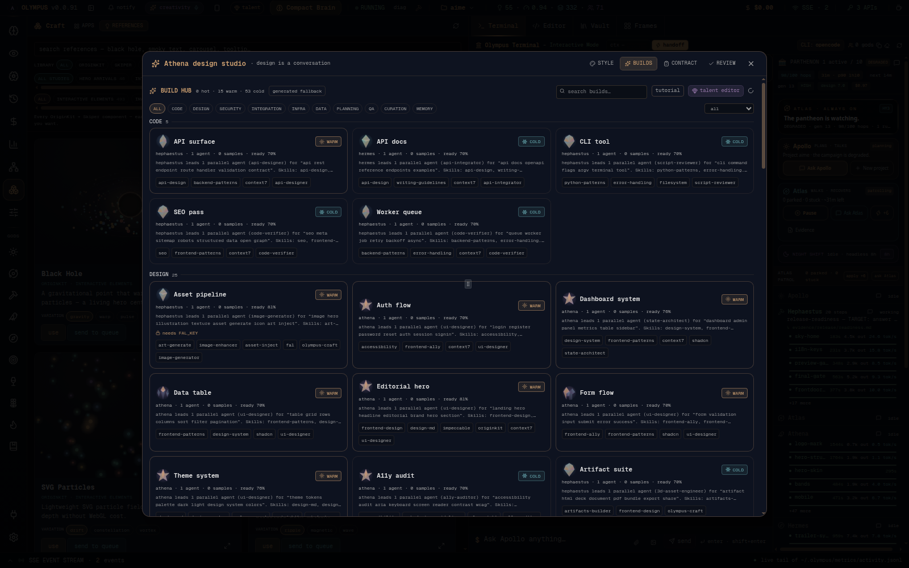</a><br><sub><b>Build Hub</b> · the talent builds and their crystals</sub> |
| <a href="screenshots/screens/07-settings.png">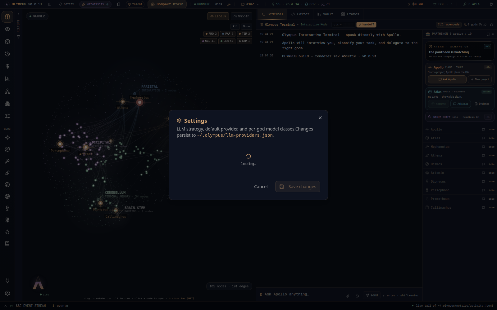</a><br><sub><b>Settings</b> · appearance, themes and performance</sub> | <a href="screenshots/screens/08-talent.png">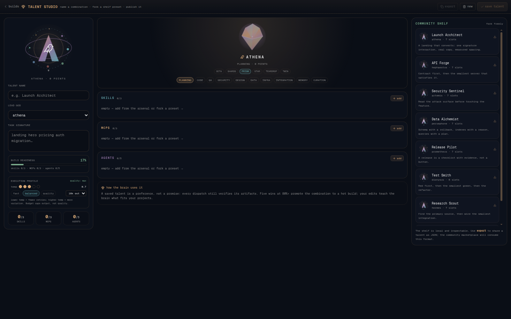</a><br><sub><b>Talent Studio</b> · the build editor and the crystal picker</sub> | <a href="screenshots/screens/09-vault.png">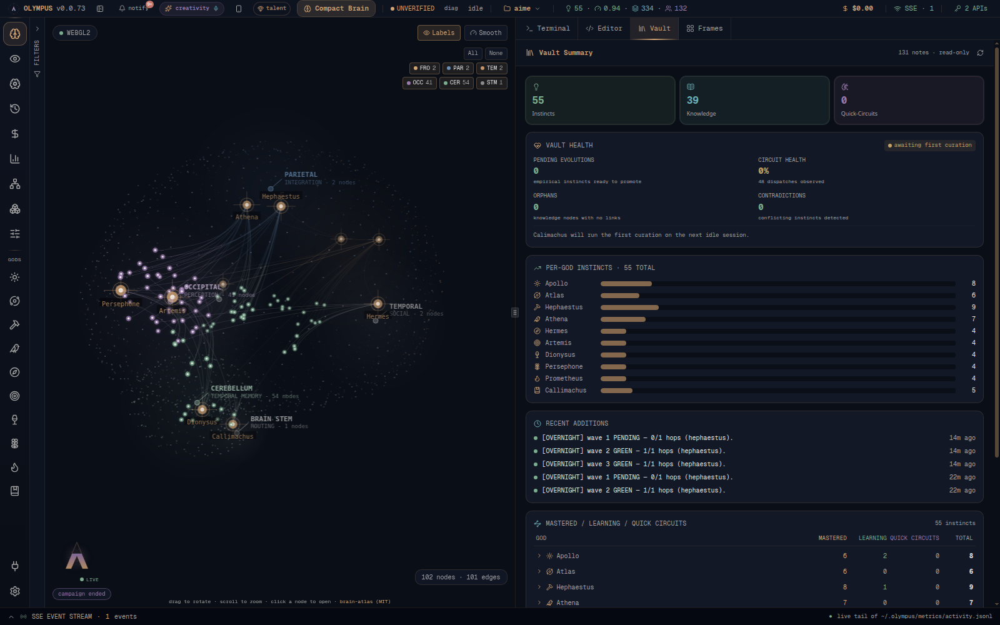</a><br><sub><b>Vault</b> · instincts, knowledge and skills</sub> |
| <a href="screenshots/15-mobile-preview-mark.png">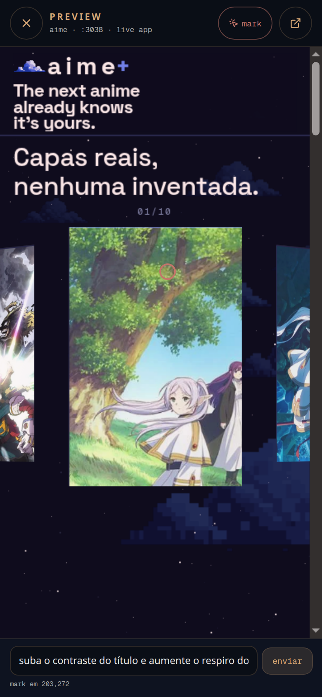</a><br><sub><b>Animated preview + mark</b> · the real app on the phone, a pin → Athena</sub> | <a href="screenshots/16-mobile-cost-hops.png">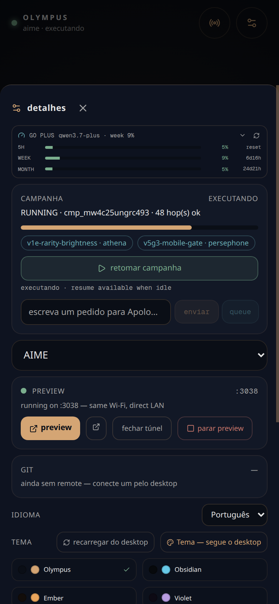</a><br><sub><b>Cost + hops</b> · the GO bar and a hop chip that opens the task sheet</sub> | <a href="screenshots/17-creative-hops.png">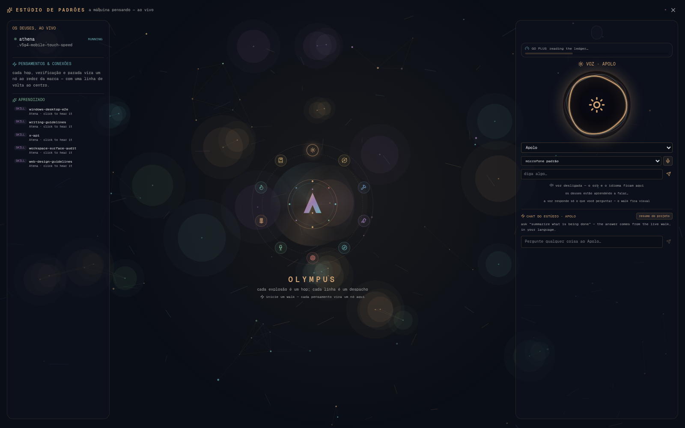</a><br><sub><b>Creative left column</b> · every hop is a button</sub> |
| <a href="screenshots/screens/10-frames.png">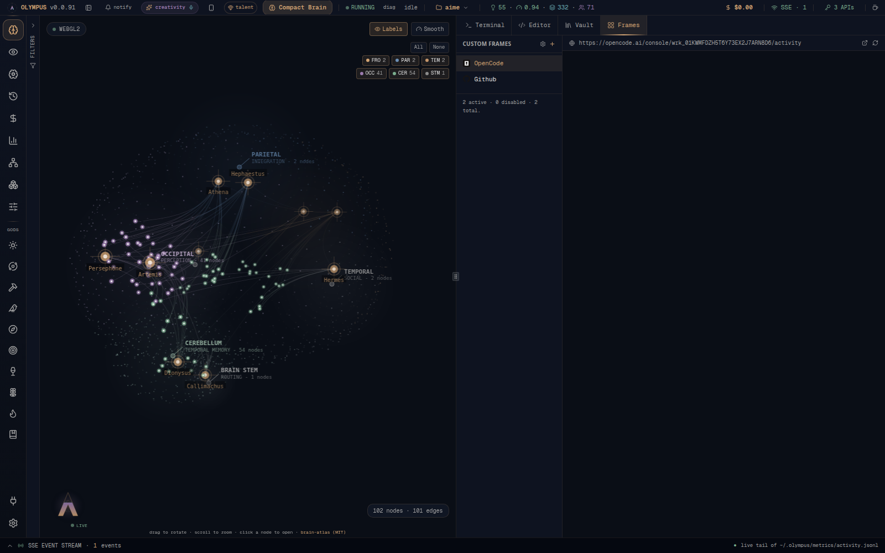</a><br><sub><b>Frames</b> · the live tool frames</sub> | <a href="screenshots/screens/11-mobile.png">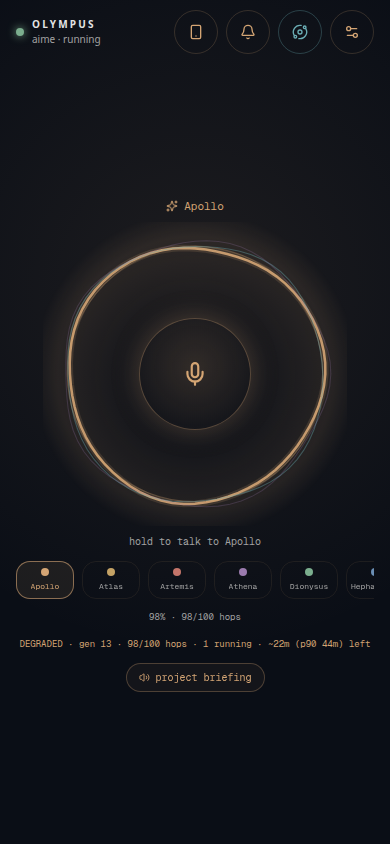</a><br><sub><b>Mobile</b> · one screen: ring, hold-to-talk and the god row</sub> | <a href="screenshots/screens/12-mobile-studio.png">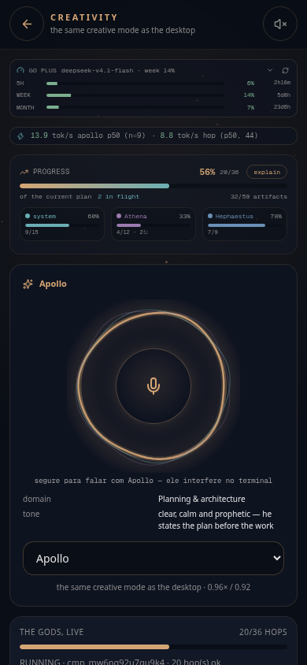</a><br><sub><b>Mobile creative</b> · the same surface in one hand</sub> |

</div>

A guided tour lives in [screenshots/UX-TOUR.md](screenshots/UX-TOUR.md). Every screenshot is captured from the running app.

**v0.0.89 evidence:** [Parthenon command deck](screenshots/screens/01-brain-terminal.png) · [GO forecast](screenshots/screens/38-go-forecast-089.png) · [Mobile Parthenon](screenshots/screens/39-mobile-parthenon-089.png).

**v0.0.90 evidence:** [Preview window](screenshots/screens/40-preview-window-090.png) · [Athena mark plan + Atlas handoff](screenshots/screens/41-athena-mark-090.png).

**v0.0.91 evidence (dev):** [Athena design studio](screenshots/screens/05-design.png) · [curated references](screenshots/screens/04-references.png) · [Parthenon ETA + night shift](screenshots/screens/01-brain-terminal.png).

## Latest

**v0.0.91 — the contract, the 60-second lane, the night shift and the startup update box.**
A refactor now starts with a page map and a **design contract**: a P0 page or
P0 unknown refuses the walk until the user decides. Athena's **design studio**
(style, builds, contract, review) lives in her chat; the approval is a signed
artifact bound to the exact contract + review and refuses a score below 7. A
mark that fits in **≤3 files / ≤200 lines** becomes a **Quick Edit** — one
bounded turn, typecheck + lint, deterministic undo — instead of a hop. The ETA
is a **p50/p90 band with park rate** (`~1h26 · p90 3h04 · 28% park`), and the
Parthenon carries the design score and the measured list value. The **night
shift** runs headless through `systemd-run`, outside the app cgroup, with a
hard stop and a morning report. On launch, the **update box** now appears when
a newer release exists: the `electron-updater` events reach the renderer,
the check runs **5s** after the window opens, and the card offers **Update
now / Later / progress / Restart and install** with persisted **check on
startup** (ON) and **download automatically** (OFF); source builds fall back
to the stable manifest and the release page. Battery **176 PASS / 0 FAIL / 1
declared skip of 177**.

**v0.0.90 — the wand plans.**
A live-preview mark is now a planning turn on the **preview's** pixels: the
iframe viewport and URL travel with the mark, Athena opens her chat and proposes
a concise plan, and **Approve → Apollo + Atlas** hands the approved change to
Apollo (hop override or staged next generation; never a live-plan rewrite)
while Atlas resumes and fixes the walk. The mark no longer dies on the GO
credential: a 401 retries once on a verified GO model and says which one
answered. The Live Preview gains a real **window** — an OS window that shows the
OLYMPUS loader until the project dev server is ready, then the app, following
the port and the settled hops. Battery **170 PASS / 0 FAIL / 1 declared skip of
171**. This is a refinement release; v0.1.0 waits for the next planning.

**v0.0.89 — Atlas stays on.**
A server-side warden keeps every campaign lane under watch: inside a live walk
it only observes, after the user opts a campaign in it applies the
deterministic recovery and restarts the detached walk (bounded), and before
the opt-in it writes **one** decision box — *Continue AIME* or *Start another
project* — instead of prompting Apollo. Atlas is pinned to
`opencode-go/hy3`; a timeout never falls back to a free/nemotron lane. The
Parthenon now opens with the Atlas/Apollo command deck on desktop **and** mobile
(HY3 chip, health, Pause/Resume, Ask, apply the staged generation, Evidence),
over the animated Nakkas SVG with a static twin for stable motion. The cost
screen adds the GO forecast chart: current %, measured daily burn, the date the
forecast crosses 100%, the renewal (Nov 5 → Dec 5, not the calendar month), the
actual cumulative ledger, a dashed forecast and a hatched area. Public CI stays
27 suites; battery **170 PASS / 0 FAIL / 1 declared skip of 171**. The v0.0.88
generation/recovery/health work and the 61-demigod archive are unchanged.

**v0.0.88 — the campaign that finishes.**
A plan is now a generation: every hop carries a definition hash, the live walk
freezes its snapshot, and a planner rewrite is staged as `dispatch-plan.next`
instead of mutating the DAG under the walker. Atlas's verdict is deterministic
and instant (no more 120s `verdict skipped`), and a recovery policy acts on
each park — tool-budget gets a 24-call override, timeouts fail over, verify
failures get a targeted fix, provider/auth stops and asks the user — bounded to
2 per hop and 6 per campaign, then the walk resumes by itself. Every Apollo
turn sees the campaign context and the steering law (no rewriting a live plan).
One health line (`HEALTHY / DEGRADED / BLOCKED / NEEDS-YOU / PAUSED / DONE`)
rides the Parthenon and the phone. The tool budget is 20 with per-hop
overrides; warm hops read tokens from the global session DB or record a named
null reason. The public core CI grows to 27 suites; `docs-check` now covers
V1-READINESS and the README Testing numbers. Builds: 68 curated (8 new), build
packs export/import with a ToxicSkills-style scan. The fleet cut is reversible:
61 never-used demigods archived (122 → 61 live; 10 gods + 61 = 71 agents) with
a one-command restore. Concurrency stays 3 by default with a measured 4-width
experiment and an AIMD-off knob. `npm run soak:note8` runs the 100-hop + soak
harness; the note-8 claim stays **not claimed** until an external campaign
exists. **v0.0.87 — Apollo speaks, Atlas thinks, the ledger tells the truth.**
Apollo narrates every long turn (elapsed + last tool) and a dead lane fails
fast with the next healthy lane named instead of hanging for 180s. Atlas
patrols every park deterministically: it classifies the cause, checks the
artifacts, picks the next lane and emits `retry` / `replan` / `ask-user` to
the activity feed and the Parthenon, with opt-in `think` (Atlas) and
`escalate` (Apollo) turns. The GO ledger reads the hop-data DB's real shape,
so the 5h/week/month windows finally move with the walk; the cost screen adds
an hourly token chart, honest tips and a recent-request log. Measured tok/s
appears in the Parthenon, task sheet, demigod chips, phone recent list and
briefing (settled hops only; running hops show elapsed and `… tok/s`, never a
fake rate). The PWA status strip follows the theme background, not the gold
accent. Retried hops clear stale parks, `campaign_end` no longer prints
"Hop 'undefined' PARKED", and a lane is health-checked before the first
attempt. **v0.0.86 — every god live, every park named.**
**v0.0.86 — every god live, every park named.**
The Parthenon now shows all ten gods from second zero: the task API overlays
the live event state, so a god working a hop is visible before the terminal
has ever streamed a frame, and every card opens that god's own durable
terminal. A mark-preview edit lands in Athena's thread as a pending request,
her turn runs in the background, and the reply appears in the same thread —
the mark is a steering adjustment to the work she is already doing, not a
detached process with its output discarded. The turn ceiling is 30 minutes
(was 15 in the action route, 10 in the session), the hop hard cap is 40, and
the pre-step reasoning cap is 48 KB with a taller, non-yanking thinking box —
the AIME `c13b` kill and the truncated-thoughts reports are the specimens.
Every hop that parks now names its cause (`dispatch-failed:transport`,
`:tool-budget`, `:provider`, `:agent-missing`, …), script failures carry the
traced failing line and the command, a lane marked dead mid-hop fails over
instead of burning another crescendo, a config change waits for the hop
boundary, a fixed plan clears the stale quarantine, and a partial plan can no
longer be reported as "walked". The dead-model-lane chip lists the lane and
the reason and Settings → LLM Strategy has a real Retry. The Build Hub ships
Phase 0 in full: 60 curated builds (12 new), a `builds:check` reference gate,
path-based skill ids, optional-key badges, the matrix moved to an on-demand
labelled fallback, and the fused `spec-lifecycle` / `docs-truth` /
`asset-pipeline` builds. A hop's `buildId` (or best god+skill/MCP fit) now
injects the build into the dispatch and writes the outcome back to
`arsenal-resonance.jsonl`, so a build is an execution contract. `bench:hops`
turns a lane's telemetry into the AIME benchmark (completion/park rates,
p50/p90 duration, token and null-token truth) with an optional gate. The
mobile pairing dialog now shows **one QR for the OLYMPUS app** — the widget
opens from inside it. A live AIME resume on v0.0.86 completed its
deterministic closes (p4b, f1, campaign-inventory) in under a second each,
named the first new park (`f2-flip-fix`, `dispatch-failed:timeout`, 20 min)
instead of an empty error, and adopted the healthy preview on :3038 instead
of refusing it. **v0.0.85 — the Apollo companion in your pocket.**
**v0.0.84 — the park that survives a resume.**
A machine auto-resume (overnight or boot orphan pickup) now keeps the hop
quarantine: the hops that just parked are not re-run from scratch, while a
human start still retries them. A park is truth on disk from the initial
write — the prior park survives until the hop passes, so the AIME 55/78
silent stop (no park, no in-flight, no process) can no longer happen.
**v0.0.84 — the animated preview, the real share, mark and handoff.**
The AIME static preview was the dev `allowedDevOrigins` gate; the public
trycloudflare tunnel now hydrates and animates. Share returns the direct tunnel app
(not the HTML-rewriting proxy), revoke kills it, and the OLYMPUS phone preview
has a mark crosshair that sends a coordinate + instruction to Athena. A full
context window offers a one-click handoff: a compact 0600 brief on disk, a
clean warm server, and one pointer prompt — the same task continues without
re-injecting the transcript. Per-model 5h/weekly/monthly caps land in the cost
brake (#277) and `npm run cost:audit:gate` is the strict reconciliation gate
(#279). Hops are clickable on the PC's left column and in the phone's
cost/details sheet. v0.0.83 was the user lane and the measured speed:
The studio god cites measured tok/s (last turn, p50 by model, hop wall-clock)
and the shared GO-bucket truth; studio sessions rotate hourly; an agent-scoped
chip names the lane. A chat/mark/voice lease holds NEW hops while the human is
driving. The mobile creative gets Apollo-only hold-to-talk into the terminal
queue, the particle field, all themes (whites included), performance mode and
clickable hops; the Cost panel carries the GO Plus bar. v0.0.82 was the
markview bridge and the two dead clicks:
References stage into the composer and queue into the shared prompt queue with
priority; high items auto-drain when the terminal is idle. The project
switcher and notification panel are portals above the studio (the status bar
`overflow-hidden` was clipping them), and the profile card opens with its
identity while a bounded scan runs. v0.0.81 was the fix pass plus the
instruments:
Notifications open, the mobile creative is chat-only, voices stop reading logs,
restarts ask instead of auto-continuing, the GO Plus bar matches the console
and tok/s is measured. The first v0.0.81 cut also shipped the public core, the
FPS probe and the honest 7.x checkpoint:
Ten pure suites are published and a clean clone runs them (10/10); `npm run
fps:probe` measures four surfaces (60/61 on brain, mobile and the creative with
performance mode; the full creative field is 28 in software — reported, not
hidden); `repo:privacy` is clean and the 39 moderate advisories are documented
in [SECURITY.md](SECURITY.md). The checkpoint is **7.x**, not 8.0: the pruning
census exists, the cut and an external user do not. Everything below is
evidence, not a promise. [All releases](https://github.com/texugo7badger/OLYMPUS/releases) · [v1.0 readiness](V1-READINESS.md) · [the 22 open issues and their targets](ISSUES.md).

## Architecture at a glance

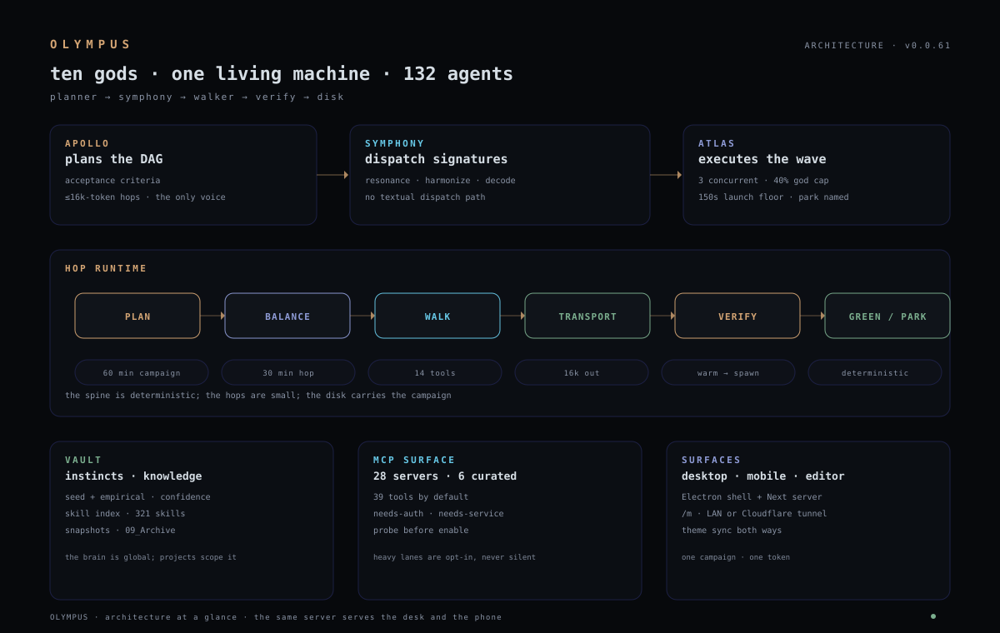

Ten gods plan, dispatch and execute through **Symphony**; a deterministic
spine walks small hops with artifacts on disk; the vault carries the brain.
The same Next server serves the desktop and the phone. Deep dive:
[ARCHITECTURE.md](ARCHITECTURE.md).

## How a walk runs

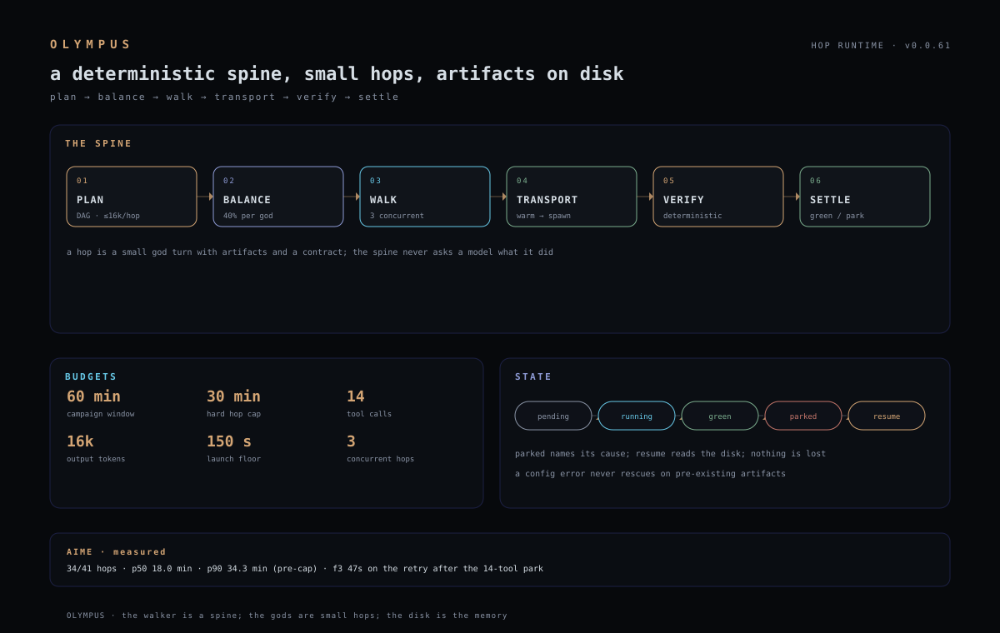

A plan becomes a DAG, the DAG is balanced (max 40% per god), the walker runs
at most three hops, the transport prefers warm and falls back to spawn, and
**verification decides** — never the model's claim. Budgets: 60-minute
campaign, 30-minute hop, 14 tool calls, 16k output tokens. A park names its
cause and resumes from disk.

## Token economy


Context is compressed and cited; the ledger separates **step cost**, **list
value** and the **invoice** (unknown on GO — never invented); cache hit is
measured, not guessed. Read [TOKEN-ECONOMY.md](TOKEN-ECONOMY.md).

## Testing & evidence

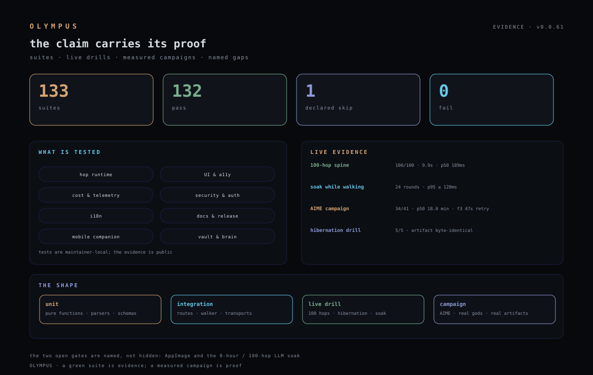

**176 PASS / 0 FAIL / 1 declared skip** across 177 suites; a 100-hop
deterministic certification (100/100, 9.9s); a soak that passed while a
campaign was walking; a hibernation drill with byte-identical artifacts. The
campaign's economics are measured by `npm run cost:audit` (tokens/hop, cache
hit, list value, invoice unknown) and the docs are gated by
`npm run docs:check`. The hermetic suite is public and gated; the full battery runs on the maintainer's
machine and its numbers are derived from `public/stable.json`. Read [TESTING.md](TESTING.md).

## Responsive by design

Phone, tablet, desktop and TV are one machine. `/m` is the premium phone
surface; the desktop shell is resizable; the status bar collapses; performance
mode is one switch for low-end hardware. The breakpoints, rules and the queue
live in [RESPONSIVE.md](RESPONSIVE.md).

## Languages — OLYMPUS is global

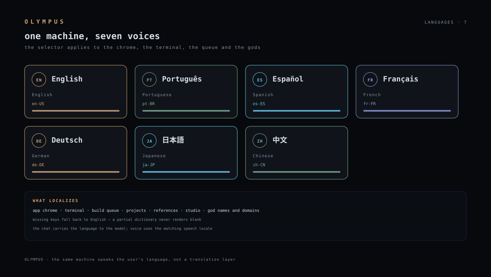

The Settings selector applies instantly to the app chrome, the terminal, the
build queue, the projects, the reference catalog, the Pattern Studio and the
gods' replies. The chat carries the language to the model; the voices are
chosen from the same language.

| | | | | | | |
|---|---|---|---|---|---|---|
| **English** | **Português** | **Español** | **Français** | **Deutsch** | **日本語** | **中文** |

God names and domains localize too — *Apolo, Atena, Hefesto, Perséfone* in
Português; *Apollon, Athéna, Héphaïstos* in Français; *アポロン, アテナ* in
日本語. Missing keys fall back to English, so a partial dictionary never
renders blank. The full table and speech locales live in
[LANGUAGES.md](LANGUAGES.md).

## Mobile companion — the walk leaves the desk

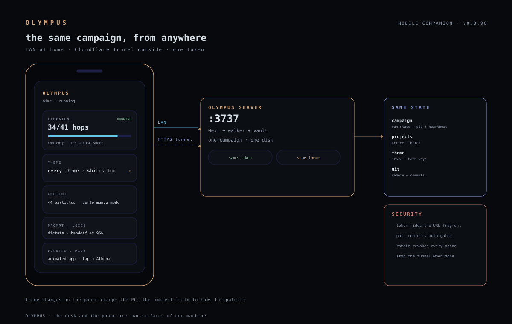

**v0.0.71.** The phone opens `/m` — one screen, voice first: the plasma ring
fills the view, **hold the mic in the middle**, speak, release; the server STT
transcribes and the request goes to Apollo in the active project's lane. The
god row below the ring picks the voice/persona; the details sheet holds the
campaign, the project, the live preview, git, cost, theme and language. The
creative button opens `/m/studio`: the desktop creative surface, responsive
from 320 px to tablet, with the progress per god, the development feed, the
prompt queue and the same ring.
Pairing is one QR in the status bar; the token rides the URL fragment, never a
query string. Outside the house, **start remote tunnel** gives an HTTPS
Cloudflare link for the phone (stop it when done); the theme follows the PC
both ways and the creativity particle field rides along. The switch to LAN mode is explicit and says a restart is
required. Rotate the token to revoke every paired phone.

The preview is a SERVER answer now, not a client-side guess. `GET
/api/olympus/projects/preview?slug=` probes the port and returns the reachable
URL: the desktop's LAN IPv4 on the same Wi-Fi, or a per-port HTTPS
`cloudflared` tunnel when you are away (the old
`http://<location.hostname>:<port>` could never work through the tunnel —
wrong host, mixed content). Start/stop the dev server and the tunnel from the
phone. The phone speaks the desktop's language (it reads the shared choice and
never overwrites it), and `/m/studio` is the creativity surface: the same
particles, orb and per-god voice, stacked for one hand. Every god keeps its
Greek epithet and tone (Phoebus the Luminous, Kore of the Two Worlds, the
Forethinker) in all seven languages.

Read [MOBILE.md](MOBILE.md) for the security model and the honest limits.

**Talent Studio** is a first-class route (`/talent`) and a status-bar button:
the god's own animated symbol, ten sector chips, five temperature dots, speed,
output budget and quality — saved, exportable and in the build prompt.

## Creative mode — progress you can question

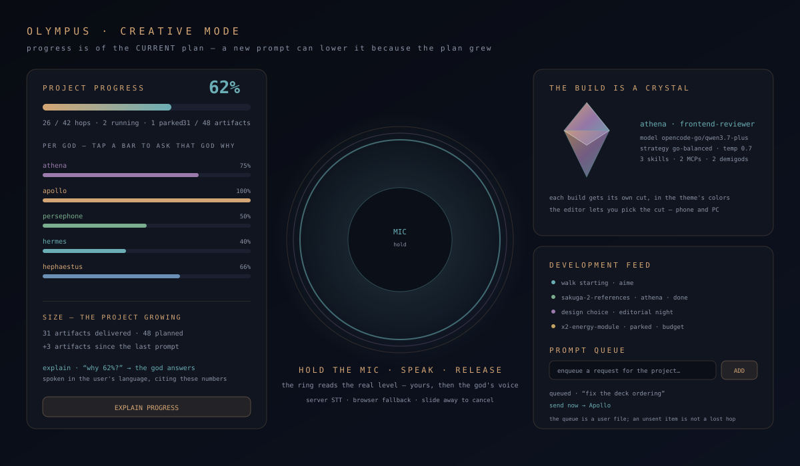

The creativity screen (desktop and phone) is the same surface: the live
development feed, the progress bar (completed ÷ the **current plan** — a new
prompt can lower it because the plan grew), one bar per god, the build crystal,
the prompt queue, and the plasma ring. **Hold the mic inside the ring**, speak,
release: the server STT transcribes and the request goes to Apollo in the
project's lane. Tap a god's bar and that god explains its number, aloud, in
your language. The phone mirrors the god and voice switches of the desktop.

**The loader is the theme's logo.** A sphere of stars drifts around the peak;
the light fills it as the app boots. Same component on PC and phone, 60 FPS,
static in stable mode.

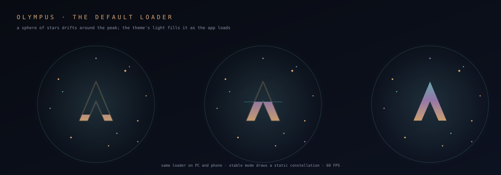

**Notifications follow your palette.** When the app is visible, the toast is
themed (type accent + your bg/panel/text); when it is hidden, the OS owns the
notification and follows the system theme — stated, not hidden.

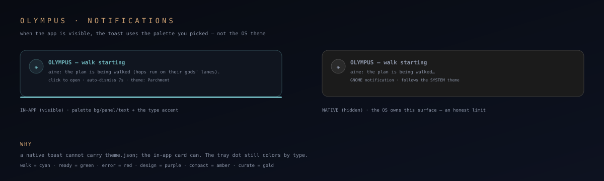

## Themes — eighteen families and a palette lab

Every theme repaints the app, the terminal, the brain, the loader, the tray,
the system icon and the scrollbars. The full gallery lives in [screenshots/THEMES.md](screenshots/THEMES.md);
click a card to open it.

| | | |
|---|---|---|
| [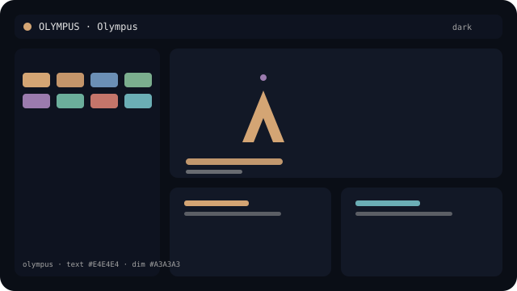](screenshots/themes/olympus.svg) | [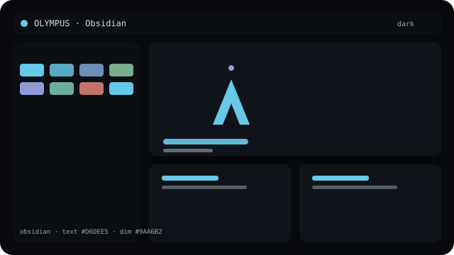](screenshots/themes/obsidian.svg) | [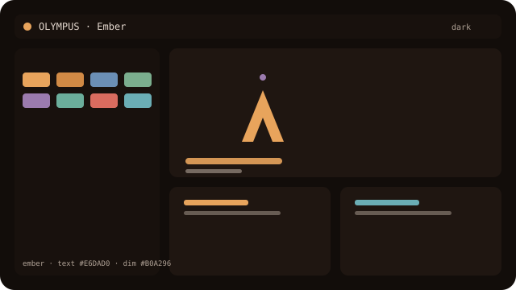](screenshots/themes/ember.svg) |
| [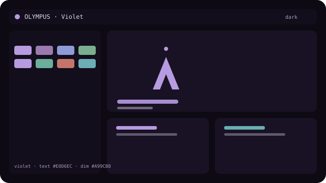](screenshots/themes/violet.svg) | [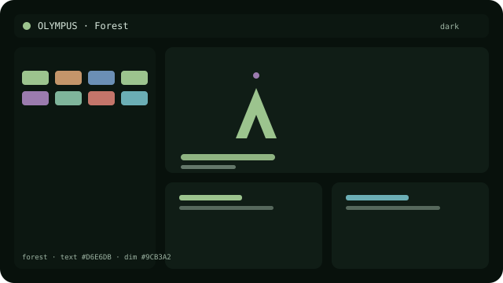](screenshots/themes/forest.svg) | [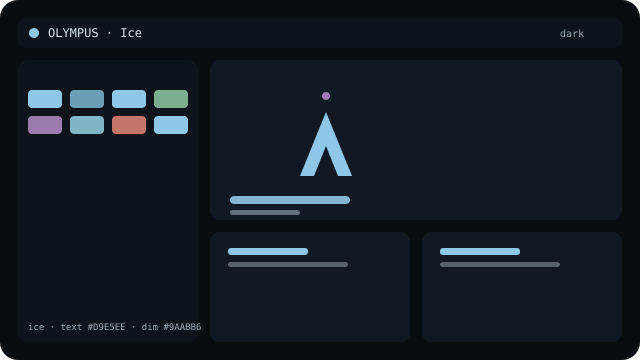](screenshots/themes/ice.svg) |
| [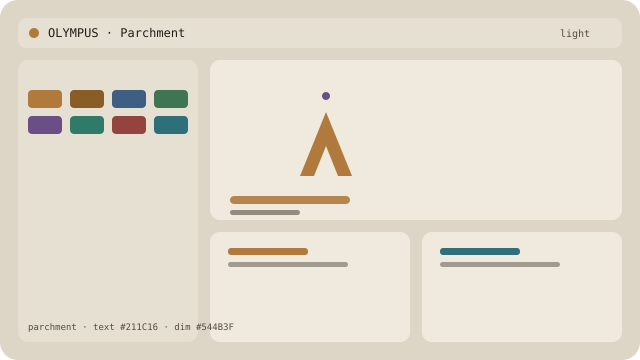](screenshots/themes/parchment.svg) | [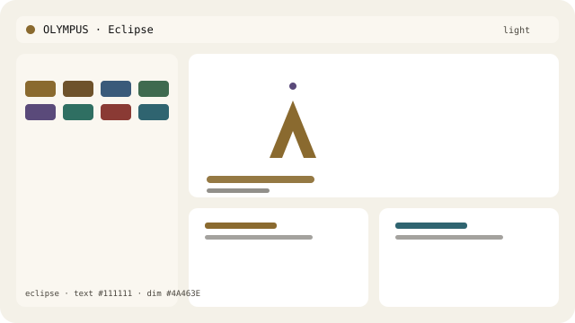](screenshots/themes/eclipse.svg) | [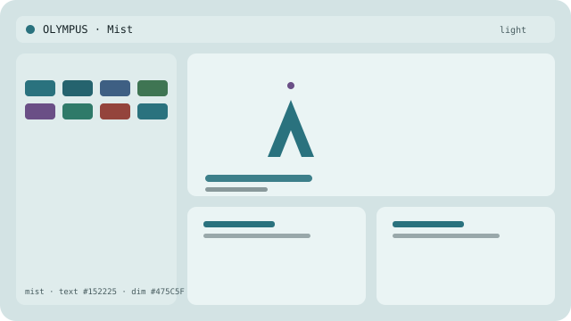](screenshots/themes/mist.svg) |
| [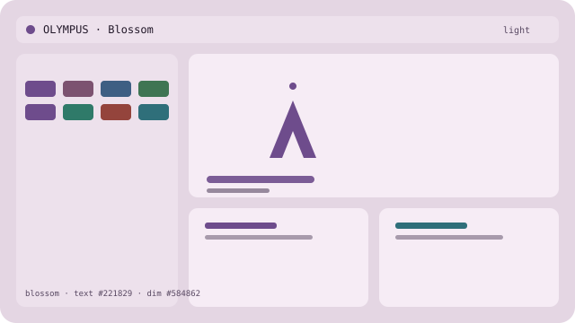](screenshots/themes/blossom.svg) | [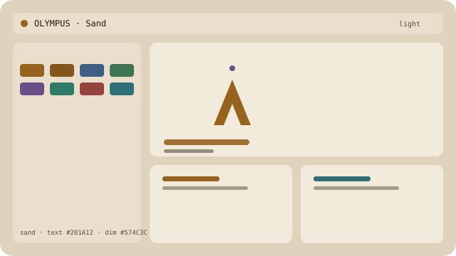](screenshots/themes/sand.svg) | [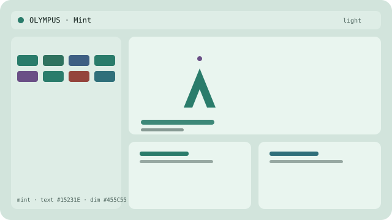](screenshots/themes/mint.svg) |
| [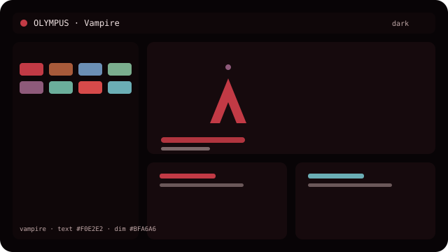](screenshots/themes/vampire.svg) | [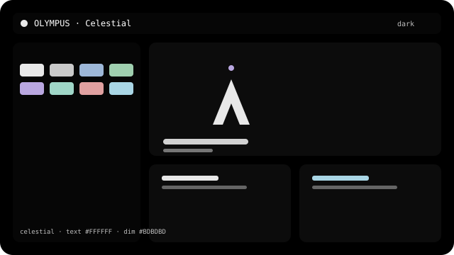](screenshots/themes/celestial.svg) | [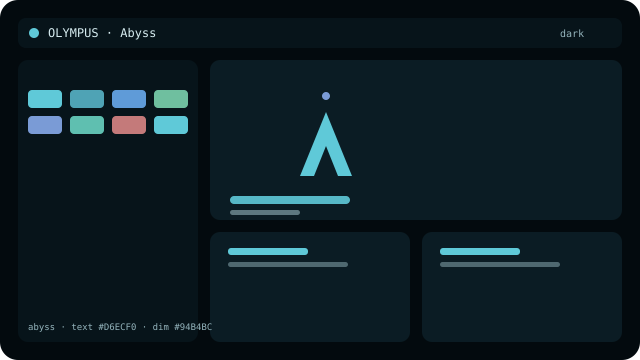](screenshots/themes/abyss.svg) |
| [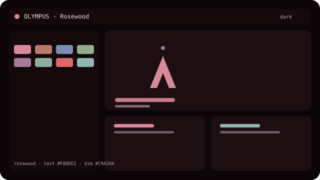](screenshots/themes/rosewood.svg) | [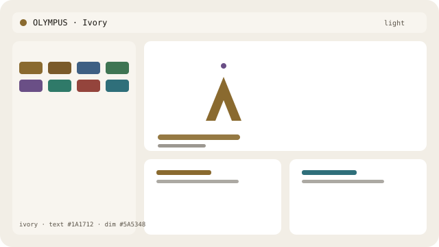](screenshots/themes/ivory.svg) | [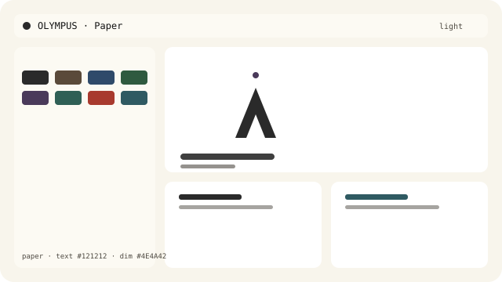](screenshots/themes/paper.svg) |

Beyond the presets, the **palette lab** generates all 14 colors of a family
from a hue + harmony, with contrast floors (text ≥ 7:1, dim ≥ 4.5:1, accent
≥ 3:1). Apply it and every surface follows — including the OS icon.


## Voice — the gods speak, and they listen

**They speak.** The free, open-source [`edge-tts`](https://github.com/rany2/edge-tts)
lane gives each of the ten gods a distinct, calm neural voice in the selected
language — no API key. Apollo is warm and measured, Hephaestus is deep and
slow, Hermes is quick and light. The Pattern Studio's orb is an organic plasma
sphere that expands while the god speaks, tinted by the active god; the
terminal speaks the final reply once per run.

**They listen.** Choose any audio input on your machine in the studio, press
the mic, and speak. The clip is transcribed locally by
[`faster-whisper`](https://github.com/SYSTRAN/faster-whisper) (Whisper base via
ffmpeg → 16 kHz PCM), and the transcript is sent as your question. The god
answers in persona and speaks the answer. **No audio leaves the machine** for
STT.

The voice answers **only what you ask** — it does not narrate the walk. If the
neural lane is missing, the app falls back to the browser voice and says so;
`GET /api/olympus/voice/status` reports the honest state of TTS, STT and
ffmpeg.

**Requirements:** `pip install --user --break-system-packages edge-tts faster-whisper`
and `ffmpeg` on PATH. The first transcription downloads the Whisper base model
(~74 MB); it is cached by faster-whisper.

## What is OLYMPUS?

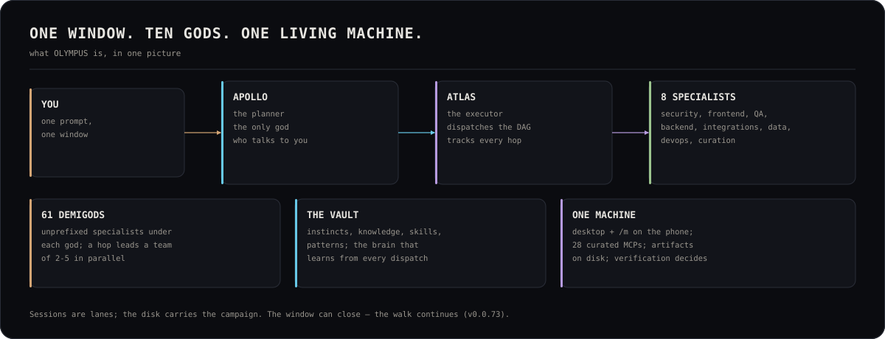

OLYMPUS is a multi-agent AI operating system built on [OpenCode](https://opencode.ai). It runs as a standalone **Electron desktop app** on Linux. Other platforms should use WSL. OLYMPUS routes each task to the cheapest LLM that can handle it, cascades token compression across five layers (including the Symphony latent protocol), and learns from every action via a self-curating **VaultBrain**.

- **Three ways to run.** The GO plan (flat monthly, no per-token charges), OpenCode **Zen** (pay-as-you-go, no request caps), or **Local** — your own hardware (Ollama, LM Studio, vLLM, llama.cpp, or any OpenAI-compatible endpoint). The zero-cost path is the local lane, and it tells you exactly what it found (see [LOCAL-LLM.md](LOCAL-LLM.md)).
- **10 gods + 61 demigods (71 agents).** Apollo is the only god who talks to you; the other 9 are dispatched by Apollo via Symphony.
- **The Craft Apps inside (v0.0.8).** The thirteen open-source ArtCraft apps (image editor, vector illustration, video, PDF, word processing, CAD, spreadsheets) are DOWNLOADED INTO OLYMPUS — the self-hosted web builds run embedded from your own disk (no login, ever; auto-update ON), the native portable builds open as real OS windows, and the `olympus-craft` MCP gives the agents headless CLI/JSON control. The AI crafting Studio rides the live lane.
- **Self-curating brain.** Each god maintains an instinct pool — empirical patterns that, at confidence ≥ 0.85, **short-circuit** deliberation. The design intent is that OLYMPUS gets faster and cheaper with use; the 2026-10-31 measured baseline shows the gate is still **0/2,999** and the campaign is slower than intended, so treat the improvement as a target, not a shipped claim. Live telemetry in the God Intelligence Dashboard shows the hit rate + tokens saved; see [BENCHMARKS.md](BENCHMARKS.md) for the honest numbers.
- **Always open.** AGPL-3.0-or-later. The public code is the most up-to-date and best version — forever.

## Quick Start

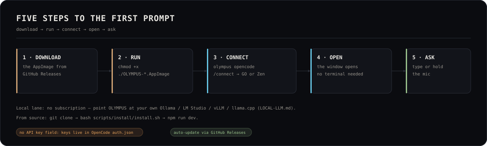

OLYMPUS runs as a **standalone desktop application** — it opens its own window. Your IDE terminal stays free for coding.

### Option A: Download the AppImage (recommended for users)

> **This is the standalone build.** Auto-updates via GitHub Releases. No Node.js, no terminal needed after download.

```bash
# 1. Download the latest AppImage from GitHub Releases:
#    https://github.com/texugo7badger/olympus/releases
#    OLYMPUS-<version>-linux-x86_64.AppImage (see the release assets)

# 2. Make it executable and run:
chmod +x OLYMPUS-*.AppImage
./OLYMPUS-*.AppImage
```

**Before opening the app, authorize your providers inside OpenCode** (there is no API key field anywhere in OLYMPUS):

```bash
olympus opencode      # the OpenCode TUI
# inside: /connect  → OpenCode Go (plan) or OpenCode Zen (pay-as-you-go)
# optional: Settings → Providers → OpenRouter / NVIDIA (registered in OpenCode)
```

Then open OLYMPUS. Every key lives in OpenCode's own `auth.json`; OLYMPUS only detects what is registered there. The zero-cost path is **Local** (your own Ollama/LM Studio/vLLM server — see [LOCAL-LLM.md](LOCAL-LLM.md)).

OLYMPUS opens as its own desktop window. Use the **Editor Bridge** tab to launch your IDE on a project.

### Option B: Run from source (for contributors)

```bash
# 1. Clone
git clone https://github.com/texugo7badger/olympus.git
cd olympus

# 2. Install (interactive installer):
bash scripts/install/install.sh

# 3. Launch
npm run dev
```

The installer applies the default `go-balanced` strategy (sustainable 8h/day coding). To switch later:

```bash
olympus apply-strategy go-budget
# or: Settings → LLM strategy in the app
```

> **Note:** `npm run dev` runs in your terminal. For daily use, download the AppImage instead — it runs as a standalone window and your terminal stays free.


## Key Features

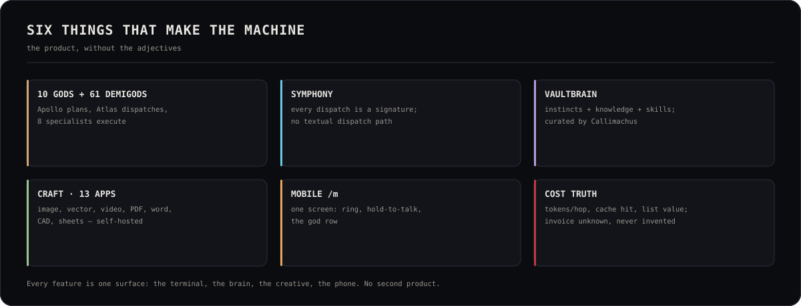

| Feature | What it does |
|---------|--------------|
| **10 Gods** | Apollo (primary) + Atlas (orchestration) + 7 specialists + Callimachus (background vault curator). Each has a fixed domain and model. |
| **61 Demigods** | Unprefixed live specialists organized under `.opencode/prompts/agents/demigods/<god>/`; 61 never-used ids archived with a one-command restore. |
| **Symphony v1.0** | Latent God↔Demigod protocol. Every dispatch is a `VibrationalSignature` — no textual dispatch path. The old 70–90% transport claim was **refuted in CAL-1**; the protocol is real, the saving is measured per campaign. |
| **VaultBrain v3.0** | Self-curating brain at `~/OLYMPUS-VAULT/05_Auto_Learning/`. Seed + empirical + archive instincts, cross-god patterns, 7-stage maintenance loop. |
| **Cascading Compression** | 5 layers, wired. The percentages were **design math**, not measured; the measured economy today is the hop shape + an 89.7% cache hit (`npm run cost:audit`). |
| **Hot/Warm/Cold Tiers** | Loads mastered + stack-relevant skills. `[DESIGN]` — no A/B measurement yet; the instinct gate measured **0 short-circuits in 4,754 evaluations** and is retired (`GATE.md`). |
| **3D Brain Atlas** | Three.js / Canvas2D visualization of gods, instincts, knowledge, and Symphony vibrations. Brain view shows only Gods / Instincts / Knowledge (Skills, Evolved, and Projects removed for focus). Scope filters (Global / Stack / Project / Cross-stack) narrow the view. |
| **Editor Bridge** | No built-in code editor — OLYMPUS launches your preferred IDE (Zed, VSCode, VSCodium, Cursor) on the active project and shares the live terminal via a token-gated WebSocket bridge. Use `olympus terminal` in any editor to attach. See [EDITORS.md](EDITORS.md). |
| **Native Terminal** | Built-in `node-pty`/`xterm.js` terminal — shared live with your IDE via the Terminal Bridge (port 3740). |
| **Warm Session** | One persistent `opencode serve` per app run — the first terminal message cold-starts it, every following message reuses the running server + session (no cold start, context retained). Applies to all strategies. |
| **Vault Backup** | Auto-commit (every 5 min) + manual push to a private GitHub repo via `isomorphic-git`. |

## The Pantheon

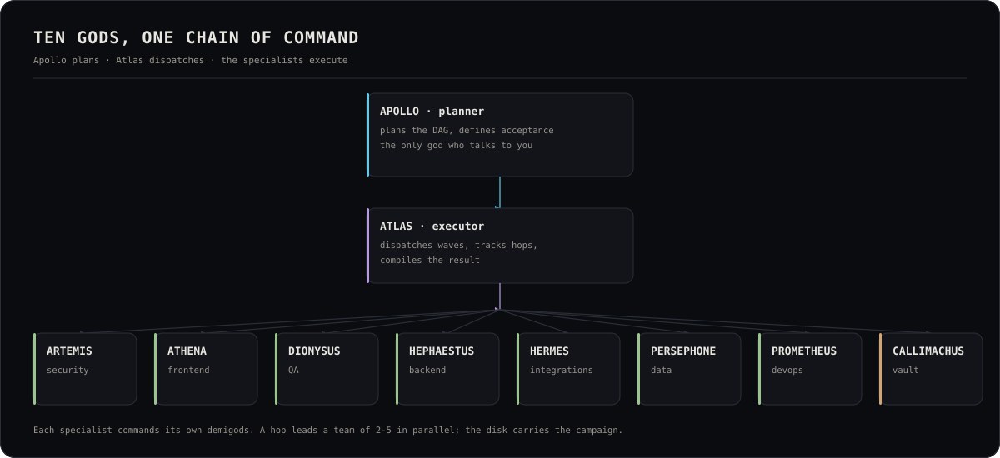

| God | Domain | Model (go-balanced) |
|-----|--------|---------------------|
| **Apollo** | Planning & architecture | DeepSeek V4.1 Flash (1M ctx / 384k out) |
| **Atlas** | Orchestration & execution | Hy3 |
| **Artemis** | Security / auditing | DeepSeek V4.1 Flash |
| **Athena** | Frontend / design | Qwen3.7 Plus |
| **Dionysus** | QA / testing | Qwen3.7 Plus |
| **Hephaestus** | Backend / infrastructure | DeepSeek V4.1 Flash |
| **Hermes** | Integrations / APIs / MCPs | Qwen3.7 Plus |
| **Persephone** | Database / persistence | DeepSeek V4.1 Flash |
| **Prometheus** | DevOps / CI-CD / deploy | MiniMax M3 |
| **Callimachus** | Background vault curator | DeepSeek V4.1 Flash |

The table above is the **go-balanced** roster (the default). DeepSeek V4.1 Flash (the 1017 line) is the preferred lane across the GO strategies; DeepSeek V4 Pro is retired; The planner rides DeepSeek V4.1 Flash in every GO strategy; the old GLM-5.3 planner rule is retired.

## Architecture (brief)

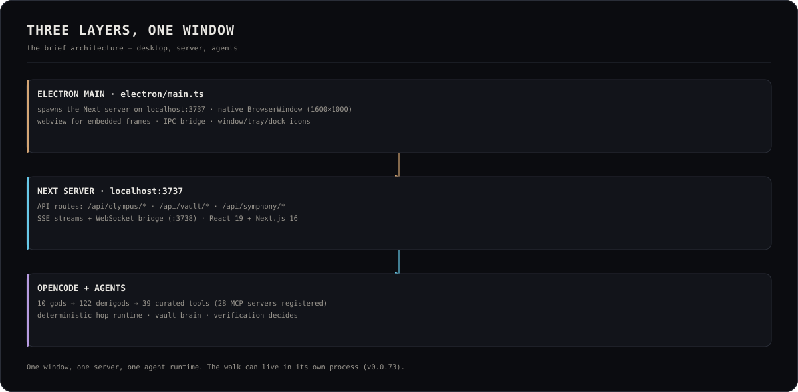

## Strategies

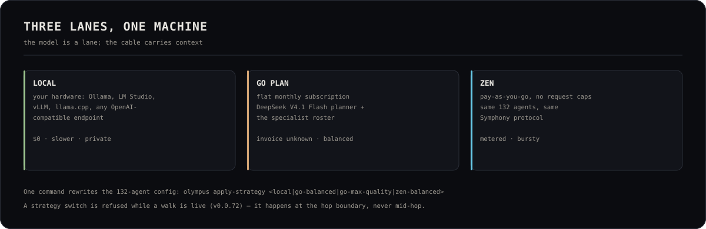

| Strategy | Apollo | Atlas | Specialists | Callimachus |
|----------|--------|-------|-------------|-----------|
| `go-max-quality` | DeepSeek V4.1 Flash | Hy3 | Kimi K2.7 Code (backend) · Qwen3.7 Plus (frontend/integrations) · Kimi K3 (security) · DeepSeek V4.1 Flash (QA/DB/vault) · MiniMax M3 (DevOps) | DeepSeek V4.1 Flash |
| `go-balanced` (default) | DeepSeek V4.1 Flash | Hy3 | Qwen3.7 Plus (frontend/QA/integrations) · DeepSeek V4.1 Flash (backend/security/DB/vault) · MiniMax M3 (DevOps) | DeepSeek V4.1 Flash |
| `go-budget` | DeepSeek V4.1 Flash | Hy3 | DeepSeek V4.1 Flash (backend/security/DB) · Qwen3.8 Flash (frontend) · MiMo-V2.6-Flash (QA/integrations/DevOps/vault) | MiMo-V2.6-Flash |
| `zen-max-quality` (**Zen**) | GPT 6.1 Sol | GPT 6.1 Sol | Claude Sonnet 5.5 (backend/integrations) · GPT 6 Sol (frontend) · Claude Opus 5.5 (security) · Gemini 3.1 Pro (DB) · Grok 4.7 (DevOps) | Claude Haiku 5.5 |
| `zen-balanced` (**Zen**) | GPT 6.1 Sol | GPT 6 Luna | Claude Sonnet 5.5 (backend/security) · GPT 6 Luna (frontend/integrations) · Claude Haiku 5.5 (QA) · DeepSeek V4.1 Flash (DB) · Grok Build 0.1 (DevOps) | Claude Haiku 5.5 |
| `zen-budget` (**Zen**) | GPT 6 Luna | GPT 6 Luna | DeepSeek V4.1 Flash (backend/security/QA/DB) · GLM-5.3-Flash (frontend/DevOps) | Claude Haiku 5.5 |
| `local` (**Local**) | your harness model | same | same | same |

The **Zen** strategies (`zen-max-quality`, `zen-balanced`, `zen-budget`) run the full 71-agent OLYMPUS on OpenCode Zen — pay-as-you-go, **no request caps**, built around **proprietary APIs** (GPT 6.1 Sol, Claude Sonnet 5.5/Opus 5.5, Gemini 3.1 Pro, Grok 4.7) while the GO plan runs the open-weight line (GLM, DeepSeek, Qwen, Hy3). Model ids use `opencode/<id>`. Authorize via `olympus opencode` → `/connect` → OpenCode Zen (key stored in OpenCode's own auth.json under the `opencode` provider; env override `OPENCODE_API_KEY`). NOTE: OpenAI/Anthropic requests are retained 30 days per their data policies — the open-weight and trial models are zero-retention.

DeepSeek V4.1 Flash (the 1017 line) is the preferred lane across GO Balanced/Budget and the max-quality specialists; DeepSeek V4 Pro is retired. **ZEN** is the private-model lane (GPT 6.1 Sol, Claude Sonnet 5.5/Opus 5.5, Gemini 3.1 Pro, Grok 4.7) for users who want proprietary models.

The **Local** strategy (`local`) requires no plan and no key: OLYMPUS probes your machine for a local LLM server (Ollama `:11434`, LM Studio `:1234`, vLLM `:8000`, llama.cpp `:8080`, or any OpenAI-compatible endpoint) and wires the full 10-god + 61-demigod arsenal to it. The apply refuses with the exact probe result if nothing answers — no dead config, no hidden fallback. Requirements: tool calling + ≥32k context; see [LOCAL-LLM.md](LOCAL-LLM.md) for the honest hardware table.

## Uninstall

Vault-safe — never deletes your vault or project folder without confirmation.

```bash
bash scripts/install/uninstall.sh
```

## Documentation

| Document | Description |
|----------|-------------|
| [AGENTS.md](AGENTS.md) | The 10 gods, 61 demigods, dispatch protocol, instinct system, Symphony |
| [ARCHITECTURE.md](ARCHITECTURE.md) | Layered architecture, plugin/MCP stacks, cache instrumentation, Symphony |
| [EDITORS.md](EDITORS.md) | Supported external editors (Zed, VSCode, VSCodium, Cursor), per-OS install commands, Terminal Bridge protocol |
| [MODEL-STRATEGIES.md](MODEL-STRATEGIES.md) | LLM strategy reference — GO plan strategies, Zen (private models), Local (your hardware), the Strategy Builder, demigod inheritance, switching strategies |
| [BENCHMARKS.md](BENCHMARKS.md) | Eval harness (CI golden tasks) + always-on opt-in benchmark recording (real-world metrics), vault pruning policy |
| [VOICE.md](VOICE.md) | The voice ladder (Chatterbox / Kokoro / edge-tts), licenses, per-god profiles and setup |
| [TOKEN-ECONOMY.md](TOKEN-ECONOMY.md) | Token cost flow — how OLYMPUS achieves quality at low cost |
| [WORKFLOW.md](WORKFLOW.md) | How a task flows end-to-end — standard dispatch + Symphony latent path |
| [SECURITY.md](SECURITY.md) | Security policy + vulnerability reporting |
| [CONTRIBUTING.md](CONTRIBUTING.md) | How to contribute (setup, demigods, skills, MCPs, code style) |
| [CREDITS.md](CREDITS.md) | Open-source projects that make OLYMPUS possible |
| [CLA.md](CLA.md) | Contributor License Agreement (required for all PRs) |

## License — AGPL-3.0-or-later

OLYMPUS is licensed under the [GNU Affero General Public License v3 or later](LICENSE). This is a strong copyleft license that guarantees:

- Free to use, modify, distribute, and host (personal, commercial, SaaS — any purpose).
- **Network use triggers source disclosure** — if you modify OLYMPUS and expose it to users over a network, you MUST offer those users the source code of your modified version (AGPL-3.0 §13).
- **Derivative works must also be AGPL-3.0-or-later.** You cannot relicense OLYMPUS under a proprietary or permissive license.

Vendored code (ECC, OpenDesign, superpowers, caveman, impeccable, context-cache, go-cache recipe) retains its upstream license (MIT or Apache-2.0). See [CREDITS.md](CREDITS.md).

### Contributing

All contributors must accept the [Contributor License Agreement (CLA)](CLA.md) before their pull request can be merged. The CLA is managed automatically by [CLA Assistant 2.0](https://cla-assistant.io/) — the first time you open a PR, the bot posts a comment with a one-click acceptance link.

## Support

- **Issues:** [github.com/texugo7badger/olympus/issues](https://github.com/texugo7badger/olympus/issues)
- **Discussions:** [github.com/texugo7badger/olympus/discussions](https://github.com/texugo7badger/olympus/discussions)

<div align="center">

  <h3>Support the dev</h3>

  <table>
    <tr>
      <td><a href="https://ko-fi.com/G4H521S5GK"></a></td>
      <td width="16"></td>
      <td><a href="https://livepix.gg/texugo7badger"></a></td>
    </tr>
  </table>

  <sub>Made by <a href="https://github.com/texugo7badger">@texugo7badger</a></sub>

</div>
