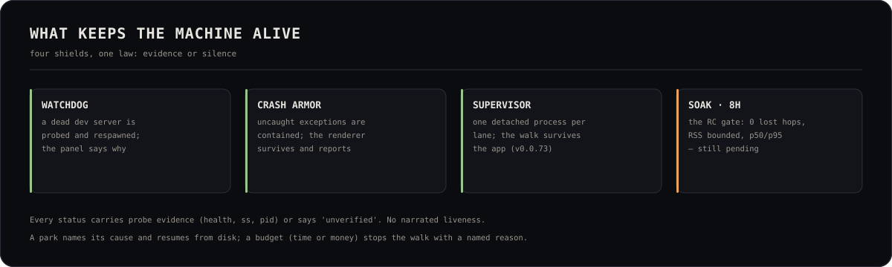

# OLYMPUS — stability protocol



> v0.0.77 · The harness is shipped and measured; the 8-hour / 100-hop
> certification is **not** claimed yet. This page records what was actually
> run and what remains. The cost side is now measured by `npm run cost:audit`
> (tokens/hop, cache hit, list value, invoice unknown) and bounded by the
> opt-in caps in `~/.olympus/cost-caps.json`. Since v0.0.73 a campaign can
> walk in a **detached supervisor process**: the app restarting no longer
> kills the walk, and an orphaned state is resumed once at boot (bounded).

## What the harness measures

`npm run soak` probes the running app every few seconds and fails on the
truth, not on a vibe:

| Probe | What it proves | Budget |
|---|---|---|
| `/api/olympus/health` | the Next server answers | 1200 ms |
| `/api/olympus/power` | the power/suspend lane answers | 1500 ms |
| `/api/olympus/resources` | the governor can read the host | 2500 ms |
| `/api/olympus/run-state` | the campaign truth answers | 2500 ms |
| `/api/olympus/projects` | the project store answers | 2500 ms |

Thresholds:

- any non-2xx or timeout is a **failure** (an unreachable app is never a skip);
- a probe above its budget is a failure;
- available memory below **900 MB** is a failure (the governor floor is
  1.2 GB, with headroom for the sampler);
- OLYMPUS RSS growth above `max(600 MB, 25% of the first sample)` is a leak
  signal. A single sample is not a trend; the harness compares the run.

The report lands in the temp directory (or `--report <path>`) with p50/p95/max
per endpoint, memory first/last/growth, the process census and every failure.

## What was run (2026-11-03, v0.0.59)

```
node scripts/soak.mjs --minutes 2 --interval 5 --json /tmp/opencode/soak-v059.json
```

This run happened **while the AIME campaign was walking** (one hop in
flight, dev server + three opencode processes), so the baseline is heavier
than an idle app:

- **24 rounds · PASS** · 5/5 probes on every round.
- p50 / p95 / max: health 33/51/159 ms · power 42/48/160 ms ·
  resources 61/83/300 ms · run-state 69/120/179 ms · projects 74/108/217 ms.
- Available memory: min **7,357 MB** · last 7,432 MB.
- OLYMPUS RSS: 5,611 → 5,796 MB (**+185 MB** over 2 min; budget is
  `max(600 MB, 25%)`), 45 processes.

Report: `~/Documents/OLYMPUS-plan/soak-v0.0.59.md` (machine-local evidence,
not committed). The older idle-app check (v0.0.40: 40 rounds, RSS −121 MB)
is still valid as the low-load reference.

## 100-hop runtime certification (2026-11-03, v0.0.59)

`npm run certify:100hop` builds a disposable lane with **100 script hops in 10
dependency chains**, walks it, and asserts: 100 completed, 0 lost, 0 parked,
100 artifacts, 100 telemetry rows, unique ids, 0 tokens, under 5 minutes.

Result: **PASS — 9.9s wall clock, p50 189ms, p95 225ms, 0 tokens.** This
certifies the deterministic spine at scale; it is **not** the 8-hour model
soak. Report: `~/Documents/OLYMPUS-plan/certification-100hop.md`.

## The certification still owed

The roadmap's v0.0.40 asks for an **8-hour soak + 100-hop campaign** and the
chaos matrix. They are not claimed:

| Drill | Expected typed recovery | Status |
|---|---|---|
| Kill the warm server mid-hop | spawn fallback / next prompt recreates | covered by unit suites, not a live 100-hop run |
| Kill the app chat server | next prompt recreates, lock released | covered by `walk-lock` + `server-lock` suites |
| DB locked by another process | typed refusal, no history deletion | covered by DB-health suites |
| Disk nearly full | honest write failure, no partial state | **not drilled** |
| Network loss mid-hop | retry plan / named park | covered by retry suites |
| Machine suspend/resume | power marker + reconcile | covered by power suites |

To certify: run `npm run soak -- --minutes 480 --interval 10` with a real
100-hop campaign on a lane, then fill the table with the actual evidence.
Do not tag a release as "certified" before that run exists.

## Reading the result

- **PASS** means the app stayed reachable, the governor stayed readable and
  memory stayed bounded for the window. It does not prove a campaign completes.
- **FAIL** names the endpoint, the elapsed second and the measured number. Fix
  the cause; never raise the threshold to make a red run green.
