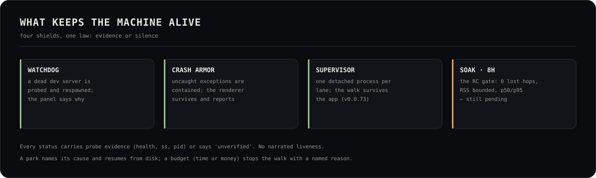

# OLYMPUS — stability protocol



> v0.0.98-11 · 2026-11-23 · the current release. The socket is the port's
> owner and the process group is the MCP children's owner: the watchdog no
> longer spawns a second Next on 3737, and the warm serve kills its children
> with it. The Boot Health tab exposes the evidence. v0.0.98-10 added the
> verification-hop guard, the blocked-signal dedupe and the log filter. The 98.x line adds the plan archive,
> the telemetry definition/tool ledger, the Callimachus status card and the
> learning animation on top of v0.0.98. The GO 5-hour limit is a WAIT
> with the console reset; a blocked gate recovers its quarantined
> dependencies; the report is deterministic and lands in Apollo's chat; the
> Logs workspace and the terminal 5h/weekly/monthly meter make every hop and
> cost visible. v0.0.97's exact console anchor, stale-anchor pause, rolling
> 65/80/100 and qwen→DeepSeek guard remain. v0.0.96's hibernation v2 remains. The harness is shipped and
> measured; the 8-hour / 100-hop certification is **not** claimed yet. The
> hibernation path is a bounded, detached walk with an explicit window, not
> the note-8 claim. v0.0.96 turned hibernation into a real quit, gated it on
> streaming turns, kept only a preview a live hop needs and restored stopped
> previews on wake; the GO graph is anchored to the console (Monday weekly reset) and
> the smart burn applies at hop/message boundaries without config rewrites.
> v0.0.95's OpenCode 2.3.2 alignment and patch-notes screen remain. This page
> records what was actually run and what remains. The cost side is now measured by `npm run cost:audit`
> (tokens/hop, cache hit, list value, invoice unknown) and bounded by the
> opt-in caps in `~/.olympus/cost-caps.json`. Since v0.0.73 a campaign can
> walk in a **detached supervisor process**: the app restarting no longer
> kills the walk, and an orphaned state is resumed once at boot (bounded).
> The suspend contract is drilled (`npm run suspend:drill`): a hop with 1.5s
> timers survives a suspend marker written mid-flight.

## The same-hop loop breaker (v0.0.98-9.1)

The AIME specimen failed `qa-glow-local` 16 times between 03:52 and 16:15 —
across 9 campaign ids, 9.5–29.6 minutes each. Every new campaign reset the
recovery ledger. The hotfix makes the hop, not the campaign, the unit of memory:

- a deterministic failure (`tool-budget`, `verify-failed`, `script`,
  `unknown`) is counted per lane + plan generation + hop; the second one
  writes `.olympus-loop-guard.json` and blocks the hop;
- the walk lock reuses the state's campaign id while the generation is
  unchanged, so the recovery ledger no longer resets;
- the warden and the post-run refuse to auto-resume a blocked hop; the digest
  and one decision name it;
- a QA `verify-failed` schedules an upstream fix hop from the evidence, then
  the QA re-runs as a judge; a QA `tool-budget` schedules a deterministic
  harness + JSON judge. Two cycles, then BLOCKED.
- a QA hop is clamped to 16 tool calls and a hard 12-minute ceiling; lint is
  measured on the touched files, not the repo baseline.

`opts.unattended` is the explicit night-shift permission. An expired
hibernation plan or a supervisor's stale `autoResume: true` is not.

## Verification-hop coverage (v0.0.98-10)

The 9.1 loop breaker only knew `qa-*`. The next AIME generation proved the gap:
`gate-back-parity` (a hard gate) parked eight times, ran 25.5 minutes, and the
loop guard blocked it six times without a repair path.

- One definition (`src/lib/hop-runtime/verification-hop.ts`) covers `qa-*`,
  `gate-*` and `design-gate`; the walker, recovery, post-run repair and UI
  agree on it.
- Clamps: QA 16 calls / 12 min; gate 20 calls / 18 min; design gate 24 calls /
  20 min. The judge after a repair gets 10/14 calls.
- A failed gate schedules an upstream fix (from the evidence's FAIL rows and
  its own next-step paragraph) or a deterministic harness + JSON; two cycles,
  then BLOCKED with evidence.
- A blocked hop emits **one** event/decision per generation; repeated walks
  keep the state current but no longer repeat the notification.
- A tool-budget park is a **narrowed retry**: 28 calls, missing artifacts only,
  one shell batch. No blind 36-call inflation.
- `errors.log` filters Chromium preload/CSP noise and rotates to `.1` at 10 MB;
  the desktop launcher rotates its log at 10 MB.

## Boot truth (v0.0.98-11)

The 2026-11-23 audit found **174 EADDRINUSE** lines and **five orphan
`uvx mcp-server-git`** children, with a SIGTERM waiting 2,630 seconds.

- `isPortListening` (TCP) is checked before every watchdog spawn; the HTTP
  health route is readiness, not ownership. A busy port is attached/reused.
- The watchdog is single-flight; one probe at a time.
- `opencode serve` is detached; shutdown signals the **process group**
  (SIGTERM → 5s → SIGKILL), and a boot reaper clears ppid-1 MCP children
  older than 30 minutes.
- Electron writes `~/.olympus/boot-health.json`; `/api/olympus/boot-health`
  and the Logs **Boot Health** tab read it with live probes.
- Regression: `scripts/boot-health.test.mjs` — TCP/HTTP probes, a real
  process-group kill, reaper bounds and watchdog wiring.

## What the harness measures

`npm run soak` probes the running app every few seconds and fails on the
truth, not on a vibe:

| Probe | What it proves | Budget |
|---|---|---|
| `/api/olympus/health` | the Next server answers | 1200 ms |
| `/api/olympus/power` | the power/suspend lane answers | 1500 ms |
| `/api/olympus/resources` | the governor can read the host | 2500 ms |
| `/api/olympus/run-state` | the campaign truth answers | 2500 ms |
| `/api/olympus/projects` | the project store answers | 2500 ms |

Thresholds:

- any non-2xx or timeout is a **failure** (an unreachable app is never a skip);
- a probe above its budget is a failure;
- available memory below **900 MB** is a failure (the governor floor is
  1.2 GB, with headroom for the sampler);
- OLYMPUS RSS growth above `max(600 MB, 25% of the first sample)` is a leak
  signal. A single sample is not a trend; the harness compares the run.

The report lands in the temp directory (or `--report <path>`) with p50/p95/max
per endpoint, memory first/last/growth, the process census and every failure.

## What was run (2026-11-03, v0.0.59)

```
node scripts/soak.mjs --minutes 2 --interval 5 --json /tmp/opencode/soak-v059.json
```

This run happened **while the AIME campaign was walking** (one hop in
flight, dev server + three opencode processes), so the baseline is heavier
than an idle app:

- **24 rounds · PASS** · 5/5 probes on every round.
- p50 / p95 / max: health 33/51/159 ms · power 42/48/160 ms ·
  resources 61/83/300 ms · run-state 69/120/179 ms · projects 74/108/217 ms.
- Available memory: min **7,357 MB** · last 7,432 MB.
- OLYMPUS RSS: 5,611 → 5,796 MB (**+185 MB** over 2 min; budget is
  `max(600 MB, 25%)`), 45 processes.

Report: `~/Documents/OLYMPUS-plan/soak-v0.0.59.md` (machine-local evidence,
not committed). The older idle-app check (v0.0.40: 40 rounds, RSS −121 MB)
is still valid as the low-load reference.

## 100-hop runtime certification (2026-11-03, v0.0.59)

`npm run certify:100hop` builds a disposable lane with **100 script hops in 10
dependency chains**, walks it, and asserts: 100 completed, 0 lost, 0 parked,
100 artifacts, 100 telemetry rows, unique ids, 0 tokens, under 5 minutes.

Result: **PASS — 9.9s wall clock, p50 189ms, p95 225ms, 0 tokens.** This
certifies the deterministic spine at scale; it is **not** the 8-hour model
soak. Report: `~/Documents/OLYMPUS-plan/certification-100hop.md`.

## The certification still owed

The roadmap's v0.0.40 asks for an **8-hour soak + 100-hop campaign** and the
chaos matrix. They are not claimed:

| Drill | Expected typed recovery | Status |
|---|---|---|
| Kill the warm server mid-hop | spawn fallback / next prompt recreates | covered by unit suites, not a live 100-hop run |
| Kill the app chat server | next prompt recreates, lock released | covered by `walk-lock` + `server-lock` suites |
| DB locked by another process | typed refusal, no history deletion | covered by DB-health suites |
| Disk nearly full | honest write failure, no partial state | **not drilled** |
| Network loss mid-hop | retry plan / named park | covered by retry suites |
| Machine suspend/resume | power marker + reconcile | covered by power suites |

To certify: run `npm run soak -- --minutes 480 --interval 10` with a real
100-hop campaign on a lane, then fill the table with the actual evidence.
Do not tag a release as "certified" before that run exists.

## Reading the result

- **PASS** means the app stayed reachable, the governor stayed readable and
  memory stayed bounded for the window. It does not prove a campaign completes.
- **FAIL** names the endpoint, the elapsed second and the measured number. Fix
  the cause; never raise the threshold to make a red run green.
