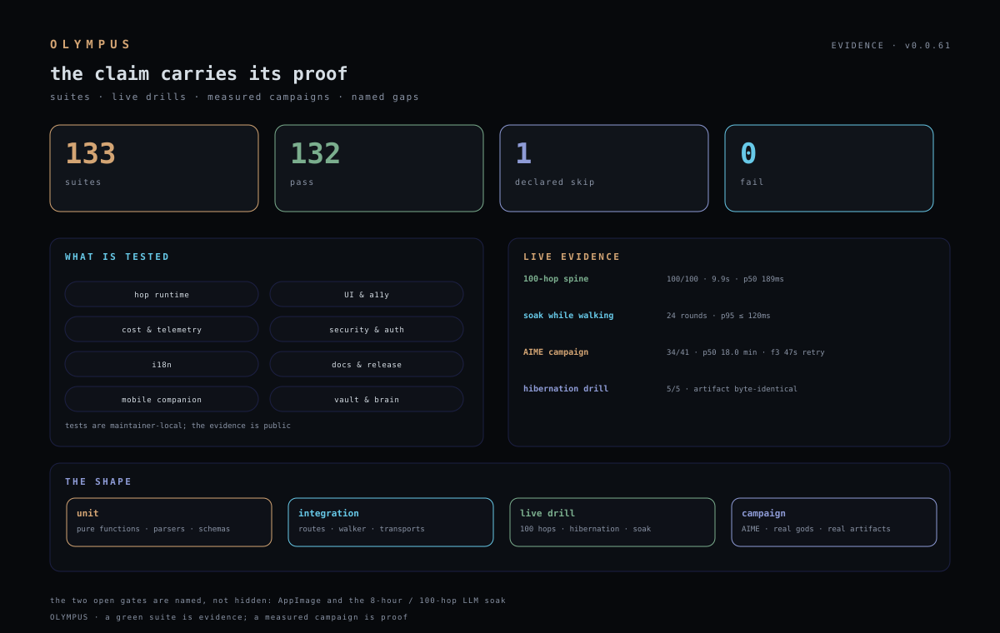

# Testing & evidence

> The claim carries its proof. Tests are maintainer-local; the **evidence is
> public**. This page explains how OLYMPUS is tested, what the tests protect,
> and what is still open — without shipping the test code.



## The shape

| Layer | What it proves | Where it runs |
|---|---|---|
| **Unit** | pure functions, parsers, schemas, cost math | `npm run battery` (maintainer machine) |
| **Integration** | routes, walker, transports, locks, auth | same battery, local vault/lanes |
| **Live drill** | 100 hops, hibernation, soak, a real campaign | local, against the running app |
| **Campaign** | real gods, real artifacts, p50/p90, parks | AIME lane |

## The public core (v0.0.90)

Twenty-seven hermetic suites are published — no vault, no credentials — and a clean clone
runs them:

```
cost-caps · docs-check · terminal-paste · preview-share · alignment-preview
i18n-audit · theme-gallery · god-chat · brain-live · cost-window
context-handoff · plan-recovery · atlas-patrol · cost-speed · apollo-narrative
parthenon-live · hop-failure-class · builds-check · build-execution · bench-hops
sync-map-scope · mobile-companion · companion-apps · campaign-smoke
concurrency · build-packs · demigod-archive
```

`.github/workflows/core.yml` runs `tsc` + lint + the 27 public suites. The
`campaign-smoke` suite is the acceptance: 10 hops, one tool-budget park, Atlas
recovery, resumed walk **10/10 with no human**.

`npm run suites:manifest` (v0.0.89, #330) is the checked-in map: every one of
the 171 suites is PUBLIC (tracked + CI), TRACKED_LOCAL (in the repo but needs
the local OpenCode run state/overlay) or LOCAL (maintainer machine, with a
named reason). The manifest is `scripts/local-suites.manifest.json`; the
command fails on drift, so a new suite cannot be silently invisible.

The maintainer-only battery still reads the real vault, lanes and credentials;
its numbers ride `public/stable.json` and are gated by `docs-check`. What ships
publicly is the **method, the hermetic proof and the measured result**, never a
green badge without a number.

## What the suites protect

- **Hop runtime** — plan schema, DAG validation, 40% balance, 150s launch
  floor, 40-minute cap, 20-tool budget with per-hop overrides, plan generations/recovery, warm→spawn fallback, artifact rescue,
  park causes, resume, telemetry.
- **UI & accessibility** — reduced motion, focus rings, contrast, tooltips,
  the one-loader boot gate, the mobile companion's 390×844 surface.
- **Cost & telemetry** — step/list/invoice separation, 5h/24h/7d/30d windows,
  cache-hit rate, null tokens shown as `—` (never zero), the campaign report.
- **Security & auth** — loopback/lan/tunnel modes, bearer tokens, pairing,
  rotate/revoke, the IPC-only session token, no shell interpolation.
- **i18n** — seven locales, god names/domains, no raw keys, speech locales.
- **Docs & release** — README links, version stamps, release-body privacy,
  the readiness gates.
- **Vault & brain** — instincts, knowledge, skill index, archive, backup.
- **Project routing** — approval/meta never mint a slug, an explicit name
  beats conversation memory, approval resolves a gate (not a project), and a
  continuation still inherits (the 2026-11-03 ghost-project specimen).
- **Mobile** — theme both ways, remote tunnel, QR, voice, preview, git; the
  preview URL is a server answer (LAN IPv4 or per-port HTTPS tunnel), the
  phone adopts the desktop's language and never overwrites it, and the studio
  reuses the same particles/orb/voice. v0.0.71: `/m` is one screen (ring +
  hold-to-talk + god row), the body no longer blocks scroll, and the details
  sheet holds the campaign/preview/git/cost/theme.
- **Creative mode** — the progress model (current plan; a dead walker is
  INTERRUPTED, never running), the per-god bars, the plasma ring's real level,
  the stardrift loader's fill, the prompt queue (a user file) and the auth
  gates on the new routes (`creative.test.mjs`, 12 checks).
- **Hop gates** — `mounted:<artifact>::<entry>` (dead code fails) and
  `visual[:<json>]` (opacity/console/login), plus unknown checks never pass
  silently (`verify-gates.test.mjs`, 6 checks).
- **MCP quarantine** — two strikes, the reason, the clear path; a live probe
  clears the streak (`mcp-quarantine.test.mjs`, 6 checks).

## How a hop becomes GREEN

A hop is green only when its deterministic contract passes:
`file-exists`, `file-contains`, `file-omits`, `build`, `lint`, `design-score`.
The spine never asks the model what it did. A hop that wrote the right file
but never imported it is **not** proven mounted (issue #308) and is not
claimed here.

## Measured evidence (2026-11-03)

| Evidence | Result |
|---|---|
| Battery | **170 PASS / 0 FAIL / 1 declared skip** (171 suites) at v0.0.90 |
| 100-hop spine | **100/100** in 9.9s · p50 189ms · p95 225ms · 0 tokens |
| Soak while walking | **24 rounds PASS** · 5/5 probes · p95 ≤ 120ms |
| Hibernation drill | pre-hibernation artifact **byte-identical**; 0 lost |
| AIME campaign | 37/41 at 12:00Z · p50 18.0 min · f3 47s on retry |
| Security | 0 high / 0 critical · 0 open alerts · 0 open PRs |

## Token economy under test

- The campaign budget (60 min), hop ceiling (30 min), tool budget (14) and
  output budget (16k) are asserted at the resolver and at the call site.
- A null token row is `—`, never `0`; a spawn hop fills the gap from
  `session_v2` when the row exists.
- Cache hit is **ledger-measured** (`cached ÷ (input + cached)`); the provider
  invoice is **unknown** on GO and is never invented.
- Quality is not a token budget: verification decides.

## What is not tested (named, not hidden)

- **AppImage** — the build has not completed on this machine.
- **8-hour / 100-hop LLM soak** — the deterministic spine certifies; the
  model soak remains the v1.0 gate.
- **Fullscreen** — currently opt-in; the Linux renderer crash is under
  investigation.
- **Every read route on LAN** — some older GETs predate `requireReadAuth`.

## Running it

Maintainers run `npm run battery` (local suites), `npm run soak`, `npm run cost:audit` (the campaign economics) and `npm run docs:check` (docs vs code). The
public repo intentionally does not ship the suites; a fresh clone can still
build, typecheck and lint.
