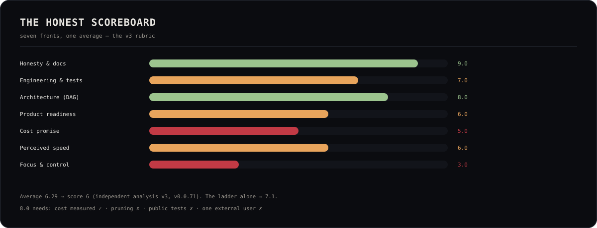

# OLYMPUS — v1.0 readiness

> v0.0.91 · 2026-11-08 · **GO for a release candidate after two named gates**
> (the 8-hour/100-hop certification and the AppImage). **NO-GO for calling
> this build "certified v1.0" until those gates are green.** This page is the
> report; it does not claim what was not run.

## The ladder that shipped (v0.0.38 → v0.0.58)

| Version | Theme | The measured change |
|---|---|---|
| v0.0.38 | 60 FPS, folder identity, 60-min projects | GPU default (60 FPS), canvas budget, lowercase project identity + stack marks, 60-minute campaign budget, live-preview parts |
| v0.0.39 | The host budget | resource governor (green/amber/red, 1.2 GB admission floor), settings memory bar + reclaim |
| v0.0.40 | The stability harness | `npm run soak` (p50/p95, memory, failures), 2-min measured PASS, honest 8h/100-hop gap |
| v0.0.41 | The living project brief | status, parked cause, next parts, docs, memory, brain scope, localized profile |
| v0.0.42 | The editor follows the agent | opt-in follow, `file:line`, root-confined open API |
| v0.0.43 | Design memory & critique | named references per project, copy prompt, Athena critique |
| v0.0.44 | Agent access, proven | real byte read from the newest asset, MCP lane names, honest prices |
| v0.0.45 | Many projects, one truth | per-project status in the switcher, scoped memory/follow |
| v0.0.46 | The editor speaks to the gods | VSIX 0.0.15: send-to-god, live hop context |
| v0.0.47 | Unattended, bounded, visible | explicit `Run without me`, 3 bounded resumes, auto-approval only when unattended |
| v0.0.48 | Projects that travel | passport export/import, no home paths, no overwrite |
| v0.0.49 | Seven languages, one focus ring | complete project surface in 7 locales, reduced motion, focus-visible |
| v0.0.50 | v1.0 readiness | this report |
| v0.0.51 | launch reliability | XWayland default; Wayland deadlock guard |
| v0.0.52 | quiet mark | notification replay fixed; 900 refs; 30-min cap |
| v0.0.53 | talent & instincts | Talent Studio; MCP market; gate wired; cost windows |
| v0.0.54 | stabilization | context 19-26%; light brain; GitHub per project; hibernate plan |
| v0.0.55 | balanced DAG | max 40% non-script hops per god |
| v0.0.56 | talent profiles | per-god sigils; temp/speed/budget/quality; hibernation hours |
| v0.0.57 | talent simplified | god hero, sector chips, five temperature dots |
| v0.0.58 | mobile companion | QR pairing, /m, voice, git, mobile preview; spawn tool bound |
| v0.0.59 | talent surface | /talent one click; launch floor; window-bounded hibernation; token fill |
| v0.0.60 | remote companion | Cloudflare tunnel, theme both ways, ambient particles, one boot loader, archive, source-only git |
| v0.0.61 | any screen + stability | windowed default, crash-loop safe mode, performance mode, SVG docs, tests private |
| v0.0.62 | Apollo auth | desktop HttpOnly cookie; terminal reset/prompt pass the LAN gate |
| v0.0.63 | project routing + mobile P0 | approval/meta never mints a project; explicit name beats conversation memory; phone preview via LAN/HTTPS tunnel; one shared language; `/m/studio`; Greek god personas |
| v0.0.64 | creative mode + truth | honest 0–100% (current plan) + per-god bars + explain by voice; plasma ring + hold-to-talk → Apollo; build crystal; stardrift loader; themed in-app notifications; live running tokens/duration/files; dead walker = INTERRUPTED/resume |
| v0.0.71 | truth | **mounted** + **visual** verify gates; source-hop gate warnings in the walk log; the phone's secure-voice card (HTTP LAN cannot use the mic; one tap opens the HTTPS tunnel); **gate go/no-go: 4,754 evaluations, 0 short-circuits — retired** (GATE.md); the measured levers documented |

## Evidence (this machine, 2026-11-03)

| Claim | Evidence |
|---|---|
| 60 FPS creative mode (measured v0.0.61) | offscreen probe: **Brain 60.1** · **Studio idle 59.8** · **Studio chat 60.2**. v0.0.71 reduced the phone to one canvas and the panel to 64 particles; the repeatable probe is the **v0.0.71** gate |
| Stability | soak **39 rounds PASS**, 5/5 probes every round, p95 ≤ 85 ms |
| Memory bounded | available min **7,956 MB** (governor floor 1.2 GB); OLYMPUS RSS 4,457 → 4,331 MB (**−126 MB**), 32 processes |
| Test battery | **170 PASS / 0 FAIL / 1 declared skip** (171 suites) at v0.0.90 — the same stable core plus the mark planning/approval gate, the GO auth fallback and the preview window |
| Types/lint | `tsc --noEmit` and `lint` clean |
| Security | `npm run security:audit` → **0 high / 0 critical**; 54 moderate transitive `glob/minimatch` advisories via the opencode/electron/npm tree, no safe non-breaking fix; the 3 Dependabot alerts are dismissed with that reason and 0 remain open |
| Governor | live snapshot 15,459 MB total · 8,426 MB available · 45% · 36 processes · green |
| Editor | VSIX `olympus-bridge-0.0.15.vsix` (9 files, 27 KB), compiled + packaged |
| Projects | AIME campaign `cmp_mw0lu2wt9cwo16`: 24/41 at 09:15Z, 3 in flight, 0 parked; per-hop report in `campaign-report-aime.md` |
| Mobile companion | `/m` rendered in Chromium 390×844 LAN + Cloudflare tunnel; 22 assertions in `mobile-companion` |
| References | **939** deduped (OriginKit 755 · Skiper 103 · Magic UI 42 · Aceternity 39) + learned user rows merged at runtime |
| Hibernation | 5 assertions: pre-hibernation artifact byte-identical, in-flight cleared, no park, no invented tokens |
| 100-hop runtime | **PASS**: 100/100 script hops in 9.9s, p50/p95 189/225ms, 0 lost, 0 parked, 0 tokens (`certification-100hop.md`) |
| Soak at v0.0.59 | **24 rounds PASS** during a live walk; p95 ≤ 120ms; RSS +185MB |

Machine-local evidence: `~/Documents/OLYMPUS-plan/soak-v0.0.50.md`; the latest campaign report is `~/Documents/OLYMPUS-plan/campaign-report-aime.md`.

## The two gates before a v1.0 candidate

1. **8-hour soak + 100-hop campaign — not run.** The deterministic 100-hop
   spine certifies (see evidence above); the 8-hour model soak remains the
   gate.
   `npm run soak -- --minutes 480 --interval 10` with a real 100-hop campaign
   on a lane. Acceptance: 100 started, 0 lost, every hop traceable, 0
   un-named parks, RSS bounded, the 60-minute project budget respected per
   project. **Not run yet.**
2. **AppImage.** The last attempt was OOM-killed at the 6 GB heap cap; the
   build needs a lower cap (`--max-old-space-size=4096`) with the app stopped.
   **Not built yet.**

## Named gaps (honest)

- **Originkit `plasma-ring` exact source**: free quota (3/day) exhausted; the
  local organic study is in use.
- **Deep i18n sweep**: the project surface is complete in 7 languages; other
  panels still have English-only copy.
- **Multi-user** (accounts, permissions, live sharing) is not shipped; the
  passport is a file the user shares.
- **Concurrent campaigns** across projects are serialized by the walk lock;
  the cross-lane scheduler (R39-03) is not shipped.
- **Moderate advisories**: 27 transitive `glob/minimatch`; high/critical = 0.
- **Engine defects** from the roadmap baseline (E-01…E-16) are partly cured
  (park breaker, lane config, budget, MCP curation); a line-by-line closure
  table is not claimed.

## Go / no-go

- **GO**: daily development, the premium test, a v1.0 **release candidate**
  after the two gates above.
- **NO-GO**: public "v1.0 certified" language, the 100-hop reliability claim,
  or an AppImage asset that does not exist.

The rule is the house's own: *prove, never claim*. A green test is evidence
for what it tested; a missing gate is a named gap, not a footnote.
