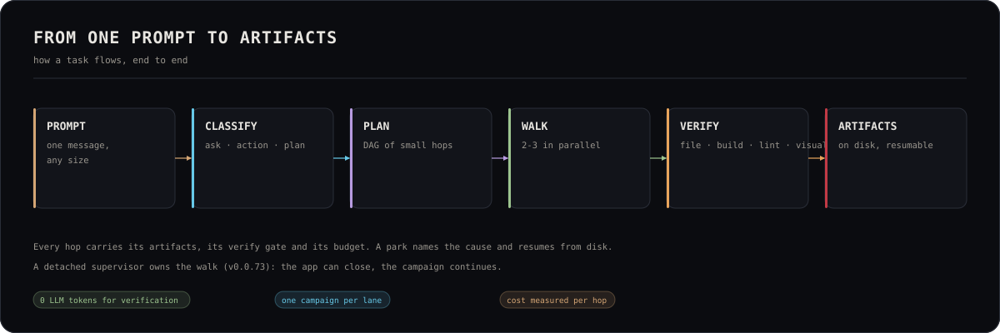

# OLYMPUS Workflow




> OLYMPUS v0.0.91 — how a task flows through the 10 gods, 61 demigods, Symphony, and the VaultBrain. See [AGENTS.md](AGENTS.md) for the full agent roster and [TOKEN-ECONOMY.md](TOKEN-ECONOMY.md) for the cost flow. The v0.0.91 design-first, quick-edit and night-shift path is in the section below.

## Task lifecycle

Every user request follows this path:

```
User input
    │
    ▼
Task classifier (heuristic, < 1ms)
    │  detects: domain, complexity, stack, needsPlanning
    │  outputs: TaskClassification JSON
    │
    ▼
/api/olympus/action (spawns `opencode run --agent apollo`)
    │  sets OLYMPUS_TASK_CLASSIFICATION env var
    │
    ▼
olympus-dynamic-context plugin
    │  rewrites system prompt:
    │    - Hot tier (mastered skills, always loaded)
    │    - Warm tier (stack-relevant, capped at 20)
    │    - Cold tier (not loaded — lazy via skill index)
    │    - God's MCP allowlist
    │    - Stack-relevant reference docs
    │    - Token budget by complexity
    │
    ▼
olympus-router chat.params hook
    │  1. Instinct gate — query god's instincts
    │     confidence ≥ 0.85? → SHORT-CIRCUIT (skip deliberation)
    │  2. Skill index search (if no short-circuit)
    │     top-5 relevant skills surfaced as hints
    │  3. Arsenal recon (Symphony quick-circuit)
    │     coherence ≥ 0.85? → quick-circuit fires
    │
    ▼
Apollo deliberates (or short-circuits)
    │  decomposes task into DAG of sub-problems
    │  defines acceptance criteria per node
    │  hands execution DAG to Atlas
    │
    ▼
Apollo hands DAG to Atlas via Symphony
    │  olympus-dispatch({ godId: 'atlas', task: 'exec DAG', dag, acceptanceCriteria })
    │  → composes VibrationalSignature
    │  → logs to live.jsonl + arsenal-resonance.jsonl
    │  → registers open dispatch with dispatch-tracker
    │
    ▼
Atlas orchestrates execution waves
    │  dispatches independent sub-tasks concurrently
    │  serializes only where dependencies force it
    │  tracks progress, detects failures
    │  reports back to Apollo after each wave
    │
    ▼
Specialist gods dispatch to demigods (parallel waves)
    │  each demigod's MCP calls gated by:
    │    - permission.ask hook (god MCP allowlist + tier check via mcp-tiers.ts)
    │    - mcp-gate.ts (mcp-state.json toggle + API key check)
    │  each demigod uses the same hot/warm/cold tier system
    │  human-in-the-loop review tools:
    │    - olympus-design-review (Athena: design-system candidates)
    │    - olympus-integration-review (Hermes: integration approach candidates)
    │    - olympus-deploy-review (Prometheus: deployment strategy candidates)
    │
    ▼
tool.execute.after hook captures everything
    │  attributes tool calls to open dispatch
    │  logs tokens, duration, outcome to live.jsonl + cost.jsonl
    │
    ▼
Dispatch finalization (when active agent changes)
    │  finalizeDispatch() logs outcome
    │  logs to arsenal-resonance.jsonl (feedback loop)
    │  if short-circuited: reward/penalize instinct confidence
    │
    ▼
Callimachus heartbeat (on session.idle)
    │  7-stage brain maintenance:
    │    observe → distill → inject → prune → compact → evolve → stocktake
    │  promotes high-confidence empirical instincts to seed
    │  detects cross-god patterns → creates quick-circuits
```

---

## Complexity routing

The task classifier routes based on complexity:

| Complexity | Token budget | Path |
|------------|-------------|------|
| **trivial** | 5K | Fast-path: Apollo answers in ≤ 30 tokens. No dispatch. |
| **simple** | 30K | Apollo handles directly or dispatches one demigod. |
| **moderate** | 80K | Apollo dispatches to one specialist god. |
| **complex** | 150K | Apollo dispatches to multiple gods in parallel waves. |
| **architectural** | 150K | Apollo runs spec interview first, then dispatches. |

---

## Short-circuit flow

When an instinct matches with confidence ≥ 0.85:

1. The god calls `olympus-dispatch` with `shortCircuit: true, instinctId: <id>`.
2. The dispatch tool composes the VibrationalSignature and dispatches directly.
3. The `olympus-shortcircuit` tool logs the short-circuit to the activity feed.
4. The instinct's `samples` count is incremented.
5. When the dispatch finalizes:
   - **Success** → `successes++`, confidence rewarded
   - **Failure** → `failures++`, confidence penalized by 0.3

1-in-10 short-circuits are **verification samples** — forced to re-deliberate. If re-deliberation picks a different approach AND it succeeds, the instinct's confidence is penalized (keeps patterns fresh).

---

## Symphony dispatch flow

```
God calls olympus-dispatch
    │
    ▼
Compose VibrationalSignature
    │  protocol: "symphony/1.0"
    │  composer: godId
    │  intentVector: { intentType, semanticTokens, dimensions }
    │  constraintMatrix: { hard, soft, scope }
    │  successCriteria: [{ predicate, type }]
    │  targetOrchestra: [demigod]
    │  broadcastMode: "single" | "parallel"
    │
    ▼
Broadcast to demigod(s)
    │  Conductor calls dispatchFn for each target
    │  dispatchFn wraps signature → invokes demigod
    │
    ▼
Demigod executes, returns HarmonicPattern
    │  outcomes: [{ predicateKind, target, status, evidence }]
    │  artifacts: [{ kind, location, summary }]
    │  tokensConsumed, durationMs, confidence
    │
    ▼
Conductor fuses harmonics (if parallel broadcast)
    │  consensus: { fusedOutcomes, fusedAt, coherence }
    │
    ▼
Choir decodes for the user
    │  produces polished user-facing response
    │  fallback: if coherence < baseline, use textual reconstruction
    │
    ▼
Vault Brain captures everything
    │  registry.jsonl — signature + harmonic + consensus
    │  templates.json — learned shorthand (promoted by tuner)
    │  metrics.json — aggregate counters
```

---

## Background maintenance

Callimachus runs on `session.idle` (when the user hasn't typed for a configurable interval). The 7-stage loop:

1. **Observe** — scan activity feed for new dispatch outcomes
2. **Distill** — extract patterns from successful dispatch chains
3. **Inject** — promote high-confidence empirical instincts to seed
4. **Prune** — archive stale instincts (low confidence, old `last_used`)
5. **Compact** — merge duplicate instincts
6. **Evolve** — update mastered-skills profiles if new skills emerged
7. **Stocktake** — write brain health metrics

The heartbeat is lockfile-protected (only one instance runs at a time). Use the **Compact Brain** button in the status bar for on-demand deep cleanup.

## The workspace lane (#99)

Interactive terminal sessions run their `opencode serve` **inside the workspace lane** — never inside the OLYMPUS repo. Resolution order:

1. `OLYMPUS_WORKSPACE` env — the explicit operator override, used verbatim;
2. default: `~/.local/share/olympus/workspace`.

The lane is bootstrapped with the UAT-kit's proven shape (`reports/uat-r1/SPAWN-INVOCATION.sh`): `.opencode` symlinked to the repo's overlay, `opencode.json` + `opencode.demigods.json` copied from the repo (created-if-missing; refresh semantics belong to the #78 drift-detector class). A workspace path pointing inside the OLYMPUS root falls back to the default — projects never silently land in the working tree. On the first cold start that creates the lane, the terminal shows a one-time notice (the ask seam); override it any time via `OLYMPUS_WORKSPACE`. The serve's spawn env also carries `OLYMPUS_ROOT_SESSION=1` (#95) — the app-spawned serve IS the root session, so the Part-3 heartbeat trio registers without any manual export.

---

## v0.0.91 — design-first, quick edit, night shift

The release adds three lanes that share one rule: **the user's decision is an
artifact, and the machine reads it**.

### 1. The design contract (before the plan)

A refactor/rescue lane starts with a page inventory and a decision ledger, not
a plan:

```
intake → page map (src/app/**/page.tsx)
       → Apollo/Athena interview (purpose, keep, change, tokens, signature)
       → PROJECT-CONTRACT.md + design-contract.json
       → P0 decisions resolved ──► plan allowed
       └─ P0 unknown / pending ──► walk REFUSED (design-contract-incomplete)
```

`design-contract.json` carries `pages[]`, `tokens`, `unknowns[]`, `stops[]`
and `signature[]`. A design stop has `requiresUserApproval: true`; before that
hop spends a token the walker validates `design-approval.json` against the
current `contractHash` + `reviewHash`. The approval is only valid at review
**overall ≥ 7**; a 4.9 cannot be clicked away.

The Studio lives in Athena's chat (`design` button): **style**, **builds**,
**contract** and **review**. ArtCraft keeps apps + references only.

### 2. Quick Edit (the 60-second lane)

A mark or a one-line request that changes ≤3 files / ≤200 lines does not
become a hop:

```
mark → one bounded Athena turn → sha256 snapshot diff
     → typecheck + lint → preview reload
     → success: "quick edit · N files · N lines" + undo
     → too large / verify failed: restore snapshot, name the reason
```

The backup lives in `/tmp/opencode/quick-edit/<lane>-<ts>/`; `undo` restores
the exact snapshot. The mark bar has a `quick` toggle (default off = plan
first). The endpoint is `POST /api/olympus/quick-edit`.

### 3. The night shift (headless, outside the app cgroup)

```
npm run campaign:night-shift -- --slug <slug> --hours 8 --max-hops 100 --headless
```

`scripts/night-shift.ts` relaunches through `systemd-run --user
--unit=olympus-night-<slug>`, so closing the Electron app does not kill the
walk. It enforces the wall-clock deadline and the hop cap, restarts only
retryable parks (`tool-budget`, `verify-failed`, `timeout`, `transport`,
`script`), stops on provider/auth/model/unknown, and writes a morning letter
at `~/.olympus/night-shift/<slug>/morning-report.md` with the six release
gates and `SHIPPABLE` / `NOT SHIPPABLE — N gates open`.

It refuses a lane with a live walk (the lane lock is the truth). The Parthenon
has the same control in one tap (`night shift · 8h / stop`).

### 4. The ETA is a band, not a promise

`src/lib/eta.ts` keeps the critical-path shape and adds the two facts the old
projection ignored: the **park rate** and the **design-gate loop**. The
Parthenon shows `p50 1h26 · p90 3h04 · 28% park · high`; the tooltip carries
the basis. A parked walk shows `PAUSED`, never an ETA.

---

## Release ritual — the tag IS the release notes

Every version follows the same order; no step is optional.

1. **Docs first.** Update the living docs in the same change that ships the
   behavior: `TOKEN-ECONOMY.md` and `WORKFLOW.md` always; `README.md`,
   `ARCHITECTURE.md`, `MCP.md`, `MODEL-STRATEGIES.md`, `AGENTS.md` and any
   other `.md` the change touched.
2. **Gate.** `npm run battery` green, `npx tsc --noEmit` clean, `npm run lint`
   clean, `npm run repo:privacy` clean, `npm run security:audit` with no high.
3. **Build.** Stop the dev app first (it owns `.next`); `npm run build`
   (Next standalone + Electron compile) and, for a release, `npm run build:linux`
   (AppImage/deb). `npm run verify:standalone` must pass.
4. **Tag.** `git tag -a vX.Y.Z -m "OLYMPUS vX.Y.Z"` on the release commit and
   push the tag.
5. **Release body.** Publish the notes as the GitHub Release body for that tag:
   `gh release create vX.Y.Z --title "OLYMPUS vX.Y.Z" --notes-file /tmp/notes.md`
   (or `gh release edit vX.Y.Z --notes-file /tmp/notes.md`).
   **Never commit `release-notes-vX.md` to the repository** — `repo:privacy`
   fails if one appears.
6. **Verify the surface.** `gh release view vX.Y.Z` shows the body; the tag
   points at the release commit; `npm run doctor` is green.
7. **Live docs.** If the release changed token economics, update
   `TOKEN-ECONOMY.md` **before** the tag; a number without a measurement is
   not published.
