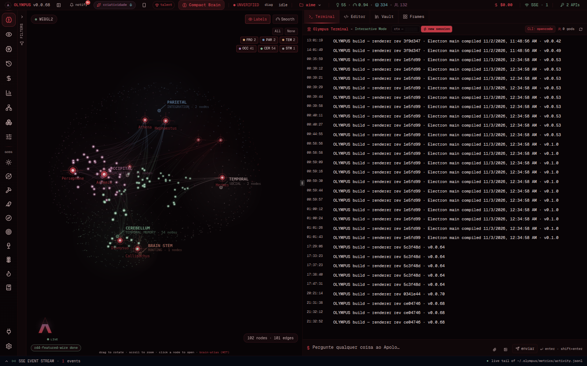
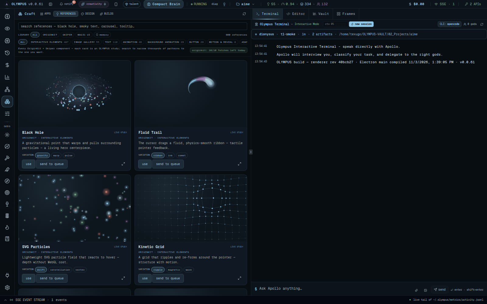
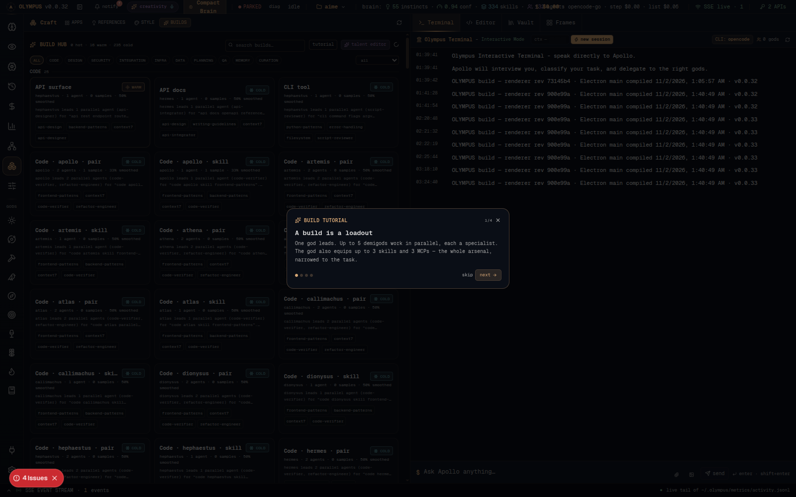
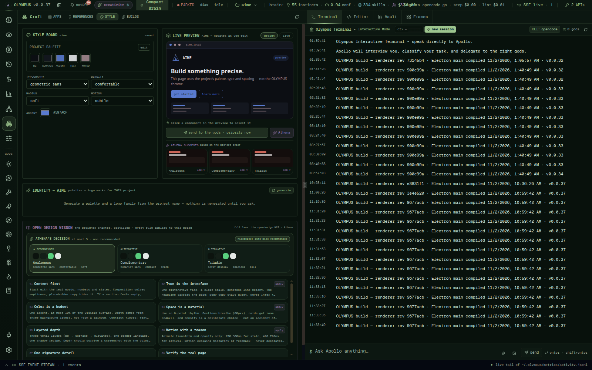
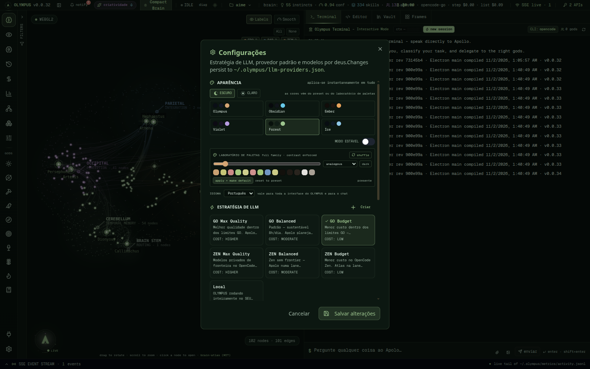
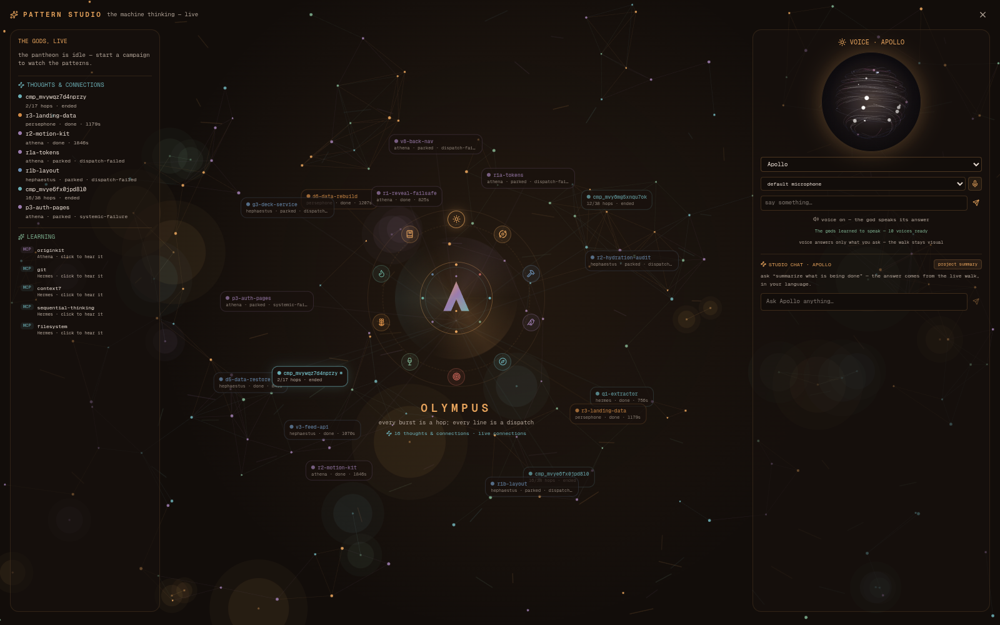

# OLYMPUS — UX tour (v0.0.34)

> Real screenshots from the running app: `npm run shots` (Electron, offscreen)
> captures them from `http://127.0.0.1:3737`. No mockups.

## 1. The Brain Atlas — where the work lives



The 3D/Canvas brain is the map of the project's intelligence: gods (gold),
instincts (green), knowledge (purple), skills (blue) and the project hub. It
follows the active theme (nodes are recolored by kind; the background, labels
and haze use the palette). Hover a node for its card, click to open the
document or the god. The bottom-left orbit is the live mark; campaign events
stream next to it.

## 2. Craft — the surfaces that build the product



The Craft dashboard gathers the vendored apps (ArtCraft Studio, PhotoCraft,
VectorCraft, …) and the design lanes. Each app runs inside OLYMPUS after a
one-click install; the ArtCraft Studio is the composition lane.

## 3. Builds — the loadout hub



**251 default builds** (51 curated + a matrix of every sector × every god ×
skill-led/agent-led), grouped by category and filterable by god. Every card
shows the god, the agents, the skills, the MCPs and the earned tier
(hot ≥ 80 % over 5 wins, warm ≥ 50 % over 2). Click a card to open the viewer;
**simulate** loads it into the talent carousel. The first visit gets a
four-step animated tutorial.

### The talent carousel

One sector per screen, swipe or use the arrows. Each slot opens the **whole
arsenal** (334 skills · 28 MCPs · 132 agents) with search and a custom value;
the caps are 3 skills / 3 MCPs / 5 parallel agents. Saving stores a user build
the brain learns from.

## 4. Style — the project's direction, not OLYMPUS's



The Style Board belongs to the open project. A neutral project palette starts
the direction; **edit** exposes the five colors, and the mock page updates
live. **Generate** produces six palettes and six logo marks from the project
name; **Athena suggests** three families from the project's seed and stacks.
**Send to the gods** enqueues the direction at maximum priority; **Athena**
asks for a refinement. Nothing is copied by hand.

## 5. References — real components, one click


The catalog is fixed (24/24 demo URLs) and searchable by category. Hover a card
to play the **real component** from the Originkit page (cropped to the demo area,
one iframe at a time); **use** carries the reference into the project's Style
Board, **send to queue** opens a high-priority Athena task.

## 6. Appearance — one palette for the whole machine



Twelve presets (six dark, six light pastel) plus the **palette lab**: a hue
slider, five harmonies, shuffle, and a full 14-key family generated with
contrast floors (text ≥ 7:1, dim ≥ 4.5:1, accent ≥ 3:1). The choice repaints
the app chrome, the terminal, the god icons, the brain, the loader, the splash,
the tray dot, the window icon and the Linux dock icon. **Stable mode** removes
decorative motion; the 60 FPS rule is a standing law.

## 7. Pattern Studio — watch the machine think

A star button in the status bar opens a full-screen artistic view: a drifting
particle field where every burst is a real hop, the themed mark in the center,
the gods' in-flight work on the left and the **voice orb** (plasma ring) with a
language selector on the right. One canvas, DPR capped, paused when hidden,
static in stable mode. The voice synthesis and full i18n arrive in a later
release; the surface is already here.

## 8. Notifications and the sleep contract

The bell lists every event with a link to the exact pane; **hibernate on lock**
is on by default, and **now** keeps the campaign while the window disappears.
The tray dot stays colored while the window is hidden.

## Running it

```bash
npm install
npm run dev        # Electron + Next on 127.0.0.1:3737
npm run shots      # re-capture these screenshots from the live app
```

The app is local-first: no account, no upload, no telemetry by default.

---

## v0.0.34 — the chameleon pass



### Pattern Studio — every thought is a node

The **criatividade** button in the status bar opens the studio. Every hop,
verification and park becomes a thought node around the mark, merged by hop
(shared thoughts evolve instead of duplicating), with a line back to the
centre and the god's color. The background is a living cell field with Van
Gogh brushstrokes; ten god icons orbit the original OLYMPUS mark. Click a node
or a god icon to switch the active god.

The plasma-ring orb is the voice. Each god has a calm neural voice (free
`edge-tts` lane), and the orb expands while speaking. The discreet chat answers
**only what you ask** — it does not narrate the walk — and speaks the answer
when voice is on. Click a **learning** item (instinct, knowledge, skill or MCP)
to hear the god explain what it learned and how it improves. The **project
summary** button asks for the short version in one click.


### References — 859 components, one live study each

OriginKit + Skiper are fully indexed (859 entries, deduped by id and name).
Every card is an original interactive canvas study in the active theme — no
vendor page, no login banner. The grid loads 60 at a time as you scroll, until
the catalog truly ends; preview canvases mount only near the viewport, so
memory stays flat. Search understands the seven languages (category aliases
and localized labels).


### Style — Open Design wisdom + a real browser preview

The board keeps the instant token mock (click a component to select it) and
adds a **live** tab with the project's real dev server: URL editing,
back/forward, reload and mark-to-edit. **Open Design wisdom** distills the
designer charter into eight principles and eight system recipes (Linear,
Vercel, Stripe, Raycast, Apple, Material, Notion, Airbnb), with one-click
application. Athena's decision shows at most three project-specific
directions, one clearly recommended; in hibernation the recommended one is
applied automatically.

The identity generator now shows **one logo at a time**, built from the
project name and palette, with "another" and "use this".


### Builds — the talent icons follow the machine

The 251-build hub and the talent carousel now tint every animated category
icon with the active palette (server-rendered SVG recoloring, cache-busted per
palette). The original mark stays the only app/system identity.


### Settings — seven languages, real

The language selector applies instantly to the whole interface and to the
chat. God names, domains, reference categories, the build queue, the projects
and the Pattern Studio follow it. See the [Languages section](../README.md#languages--olympus-is-global).

### v0.0.35 — voice in and out

The studio now shows the **honest voice state** (`/api/olympus/voice/status`):
ten neural voices when `edge-tts` is installed, otherwise the browser fallback.
Choose any **microphone** from the selector, press the mic, speak, and the clip
is transcribed locally by `faster-whisper` — the transcript becomes your
question and the god answers in persona, out loud. No audio leaves the machine
for STT. The mic is disabled when the local STT lane is unavailable, never a
dead button.

### v0.0.36 — the chameleon mark

The same original geometry — two rings, the peak, Callimachus above, Atlas at
the base, the eight gods in orbit — now carries a color family: a
gold→purple→cyan peak, a cyan inner ring and eight palette-colored dots. The
app bar, favicon, window/tray/dock PNG and the static `logo.svg`/`.png`/`.ico`
all show it, and the system icon renderer receives the full palette instead of
one accent. Only the colors change; the points never move.

### v0.0.37 — the living mark

The boot/fullscreen loader and the brain's bottom-left live mark now use the
chameleon geometry: gradient peak, cyan inner ring, eight palette-colored dots
and a gradient wordmark. Stable mode renders the same mark as a static frame;
the palette is the only thing that changes.

### v0.0.38 — 60 FPS, the folder identity, the 60-minute project

- Hardware acceleration is the default again: measured ~60 FPS on the Brain
  Atlas and the Pattern Studio (previously 14–20 FPS in software). The canvas
  batches links, caps DPR, drops the per-frame gradients and pauses when
  hidden; the orb carries fewer filaments; the voice analyser updates React
  at ~10 Hz. `--disable-gpu` remains an explicit escape hatch and two GPU
  crashes persist the software fallback.
- OLYMPUS opens fullscreen; F11 / Ctrl+Shift+F toggles it.
- A project is its folder: `aime`, with a real summary (package/README, never
  the creation prompt) and the official stack marks under it.
- Campaigns carry a 60-minute wall-clock budget; new hops stop at the
  deadline with a named resume point, and the live preview follows each
  finished part (auto-follow toggle, part name in the footer).

### v0.0.39 — the host budget

Settings now ends with **System · resource governor**: a live memory bar, the
OLYMPUS process census (count + RSS), load vs cores, and the honest verdict.
`reclaim` stops the optional chat fleet; the next prompt recreates it. A new
dev server is refused when it would leave less than 1.2 GB free, and the
refusal shows the measured numbers instead of a generic failure.

### v0.0.40 — the stability harness

`npm run soak` (60 min) or `npm run soak:short` (2 min) probes the five
load-bearing endpoints, records latency, memory and the process census, and
fails on a non-2xx, a budget overrun, memory below 900 MB or unbounded RSS.
The measured 40-round run is in [STABILITY.md](../STABILITY.md); the 8-hour /
100-hop certification is explicitly not claimed.

### v0.0.41 — the living project brief

The project profile now carries the **brief**: status (running / parked / done
/ idle), completed/total hops, the campaign id, the parked hop with its cause,
the next parts, the docs, the walk's memory files and the measured brain scope
(115 instincts · 39 knowledge · 321 skills on this machine). The card's
labels follow the selected language (English + PT-BR).

### v0.0.42 — the editor follows the agent

The Editor Bridge gains **follow the agent** (off by default): when a god
writes or edits a file inside the active project, OLYMPUS opens it in the
configured editor (VSCode-family at `file:line` via `-g`; Zed at
`file:line`). Bursts are debounced, the same file is not reopened within 5s,
the feed pauses while the window is hidden, and `/api/olympus/editor/open`
refuses traversal, non-files and anything outside the project root.

### v0.0.43 — design memory & critique

The reference detail gains three actions: **save** (a named preference with
its reason, scoped to the active project), **copy prompt** (a real
implementation prompt with the motion, the link and the identity rule) and
**critique** (Athena is queued to say what fits, what conflicts and the
smallest change that would make it belong). The catalog filters to the saved
memory; the store is `~/.olympus/design-memory.json`, capped, deduped and
atomic.

### v0.0.44 — agent access, proven

The Atelier header carries the proof: the media vault's read/write state, the
asset count, the newest asset's size and the MCP lanes that can see it
(`filesystem`, `olympus-craft`). "verified" only appears when the route opened
a real byte from the newest asset; an empty vault says unverified. The
generation ladder remains honest: Pollinations is `$0`, BYOK fal/Google carry
their own price.

### v0.0.45 — many projects, one truth

Every row in the project switcher now carries that project's own campaign
status (`completed/total`, color-coded, with the full hop count in the
tooltip) — not just the active project. Design memory, the living brief and
the editor-follow lane are scoped by project, so two projects cannot leak a
preference or a followed file into each other.

### v0.0.46 — the editor speaks to the gods

The VSCode-family extension (`olympus-bridge` 0.0.15) adds **Send Selection to
a God** (right-click): choose a god, get a paste-ready block with the relative
file, line range and the selected code, copied to the clipboard with OLYMPUS
focused — never typed silently — and **Show Live Hop Context**, which reads
the real run-state and names the running hops. The VSIX is built and committed.

### v0.0.47 — unattended, bounded, visible

Settings gains **Autonomy · unattended**: one switch, off by default. When on,
the plan-walk gate auto-approves, design choices follow the recommended option
and a parked wave auto-resumes up to 3 times — the 60-minute budget and the
resource governor still apply, and the morning digest still lands. The
terminal shows an `UNATTENDED` chip; every auto-approval is in the activity
feed. The switch is read at send time, never from a stale closure.

### v0.0.48 — projects that travel

Every project can be exported as a **passport**: slug, stacks, summary, brief,
docs and design memory — no code tree, no absolute home paths. The profile
card copies it to the clipboard or downloads `olympus-<slug>.passport.json`;
the switcher's **import** reads a passport and creates a new lane with its
identity and saved references. An existing project is never overwritten.

### v0.0.49 — seven languages, one focus ring

The project profile is complete in **English, PT-BR, Spanish, French, German,
Japanese and Chinese** — brief, scope, instincts, knowledge, skills, parked,
status and critique. Globally, `prefers-reduced-motion` now disables
decorative motion (the in-app stable mode remains the explicit control) and
every button/link/input gets a visible `:focus-visible` ring. The pass is
pinned by a 14-assertion suite.

### v0.0.50 — v1.0 readiness, honestly

The readiness report is [V1-READINESS.md](../V1-READINESS.md): the shipped
ladder, the measured evidence (60 FPS, 39-round soak PASS, p95 ≤ 85 ms, RSS
−126 MB, 118/0/1 battery, 0 high/critical advisories) and the two gates that
are **not** run — the 8-hour/100-hop certification and the AppImage. GO for a
v1.0 release candidate after those gates; NO-GO for calling this build
"certified v1.0".

### v0.0.51 — launch reliability on Wayland

Electron's Wayland backend could deadlock before `app.whenReady()` (the
2026-11-02 specimen: main process alive at 33% CPU, no Next server, no
window). OLYMPUS launches on **XWayland** by default; `OLYMPUS_OZONE=wayland`
opts back in. GPU acceleration remains the default with the two-crash software
fallback.
