# OLYMPUS — UX tour (v0.1.2)

One clean screen per menu, captured from the running **v0.1.2** app at
1600×1000 (Cost at 1600×1400 so the whole usage chart is visible; the phone at
390×844). Every image was captured from the live app with
`scripts/capture-v012-screens.mjs`; there are no mockups.

The preview fixture is a tiny framing-friendly page because AIME sets
`frame-ancestors 'none'` by design. The shell, the atlas, the cost ledger, the
mark queue and the phone are the real surfaces.

## 1. The Pantheon

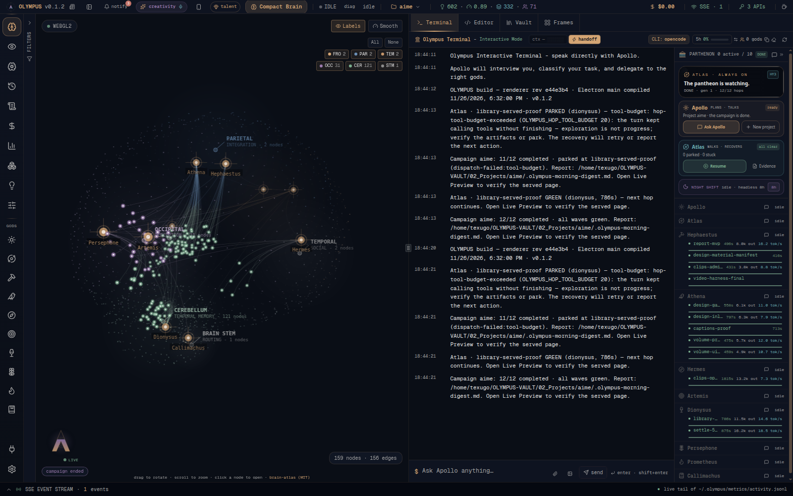

The brain atlas on the left, the ONE Apollo terminal on the right, the clean
Parthenon command deck in the third column: project, generation, hops, park and
the actions that matter. The atlas pauses its frame loop after 2.2s idle and
wakes on the next interaction.

## 2. Live preview

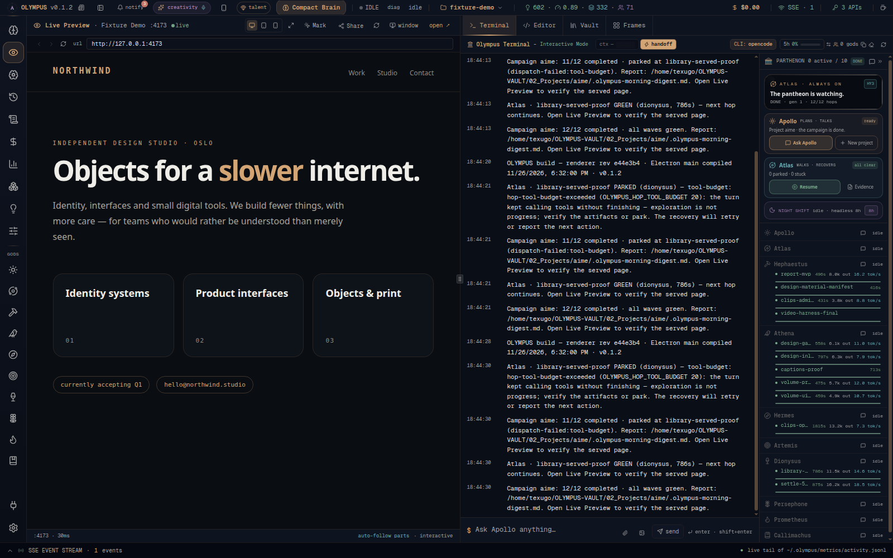

A real project inside OLYMPUS. The surface is interactive from the first paint;
the toolbar carries the origin, reload, Mark, Share, Window and Open. The mark
toolbar writes to the durable per-project queue — the panel is not the source of
truth, the disk is.

## 3. God Intelligence

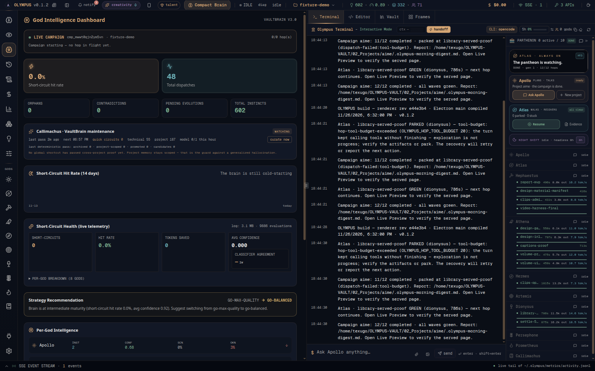

Per-god stats plus the live Callimachus card: last and next pass, **0 validated
quick circuits**, 187 project-scoped and 55 technical instincts, and the
`0/1 this hour` model budget. The honest line below says no global shortcut has
passed cross-project proof — that is the guard against a generalized
hallucination, not an empty state to hide.

## 4. Recent activity

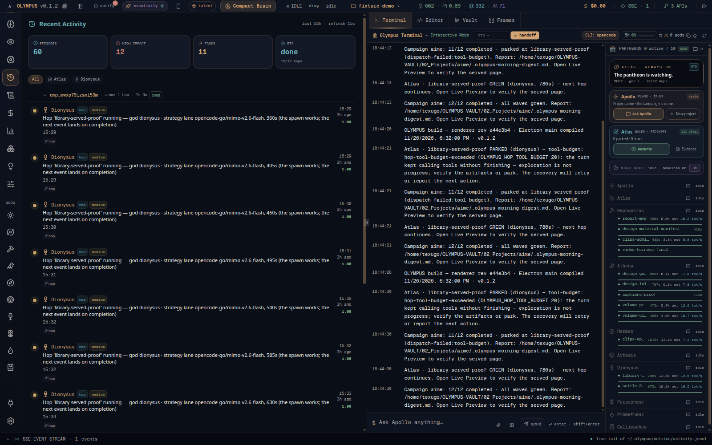

The live event feed: dispatches, hop outcomes, park/retry reasons, approvals and
curator passes. Every line is sourced from the activity ledger, with the newest
first.

## 5. Logs

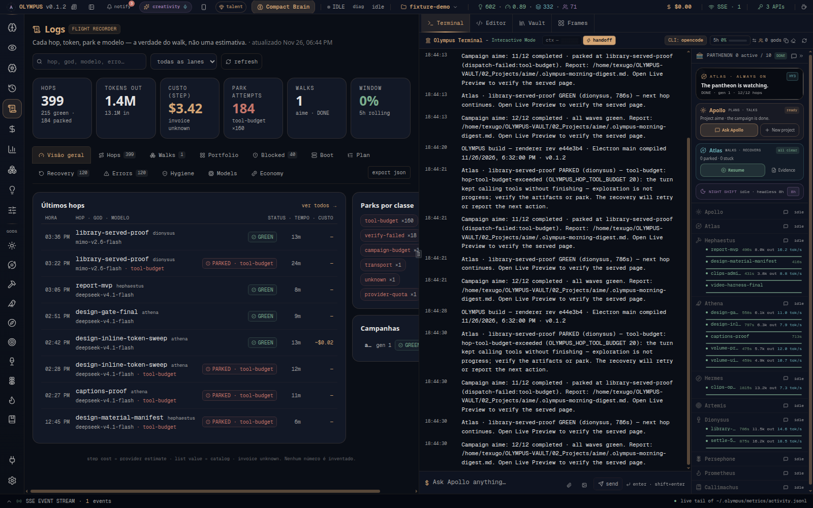

The workspace log stream with severity and source. It is the operator's view of
what the harness actually did, not a chat transcript.

## 6. Cost

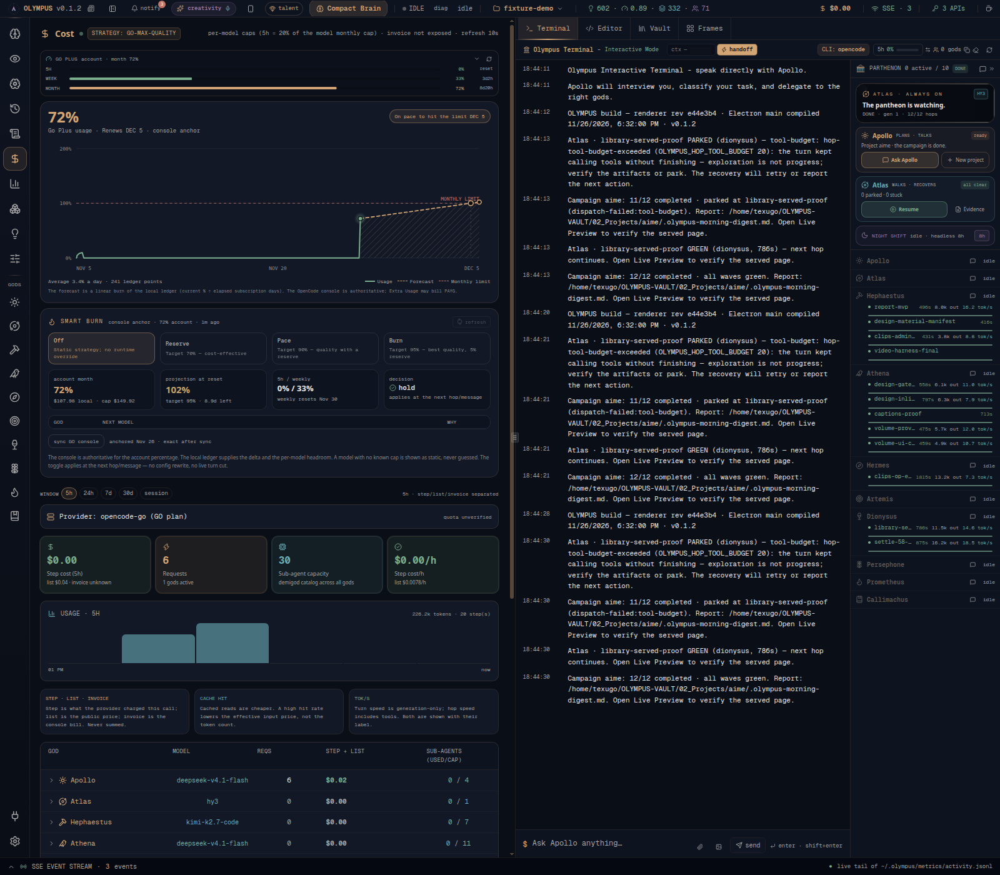

The real ledger: GO month / 5h / week, the hourly token chart **fully loaded**,
Smart Burn, step cost / list value / invoice unknown, per-model caps and the
honest reconnect state with **refresh**. The forecast and usage bar paint the
last measured reading before the console sync; the pane never sits on an endless
loader.

## 7. Benchmarks

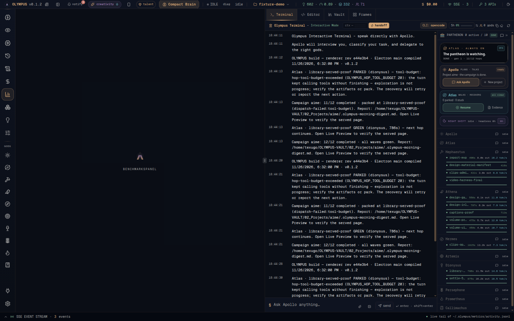

The measured performance and lane benchmarks, with the environment named. The
live FPS report is in `screenshots/perf/electron-fps-v012-final.json`: Pantheon
60/60, atlas drag 60/60 and every menu 60/60 p50/p95 in the software Electron
window, with no long tasks.

## 8. Craft


The app hub. ArtCraft stays on, the 13 vendored apps are one click away, and the
native strip detects Blender, Godot, OBS, Inkscape, Krita, DaVinci Resolve and
Shotcut. An absent tool is shown as absent; a present one launches in the
active project with fixed args and no shell string.

## 9. References

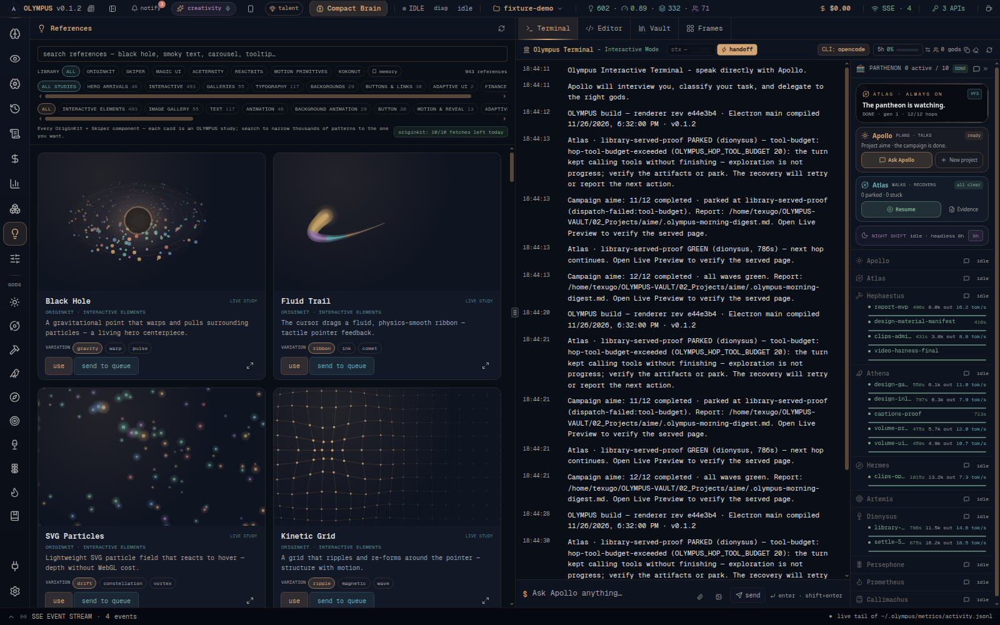

The creative library as its own surface: search, collections, live studies,
Use/Queue, and the new free/open-source sources — ReactBits (MIT + Commons
Clause), Motion Primitives (MIT) and Kokonut UI (MIT). **Use** stages an
editable Apollo prompt that asks how you want to use the reference; it never
sends automatically.

## 10. LLM strategy

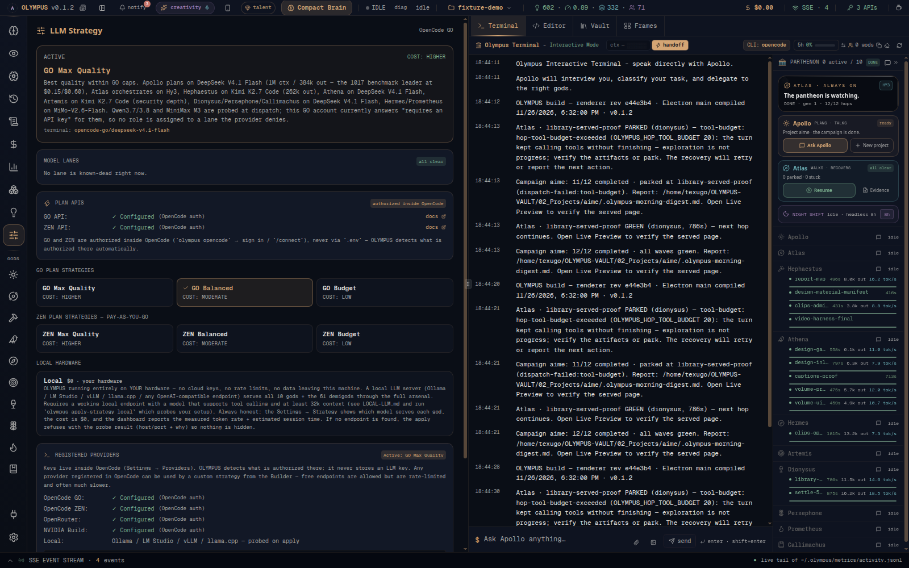

The lane roster and the strategy builder. Every model is a lane; context rides
Symphony. A dead lane is marked with the provider's own words, never silently
retried.

## 11. MCP configuration

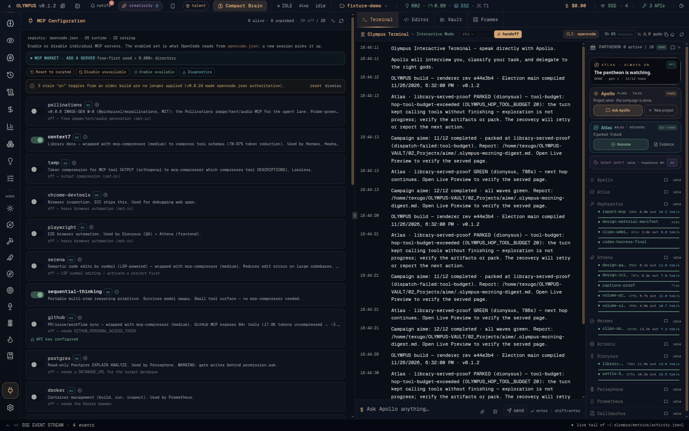

The curated MCP surface: health is classified before it is probed, the 128-tool
budget is metered, and each server can be enabled, disabled or diagnosed.

## 12. God detail

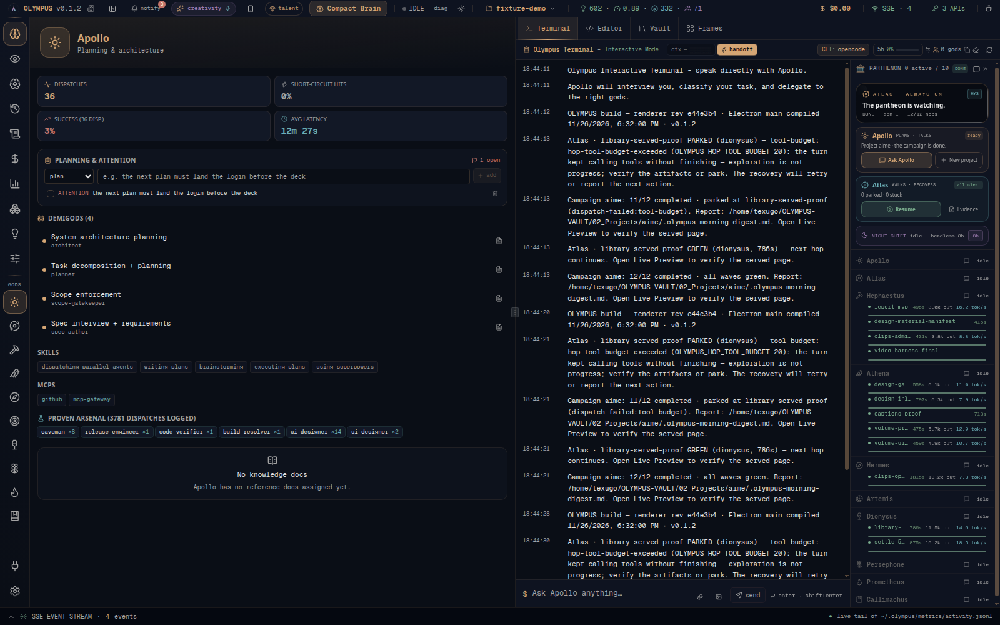

One god in depth: model, mastered skills, instincts, dispatches and recent
activity. The god quick-select in the activity bar opens the same panel.

## 13. Preview window

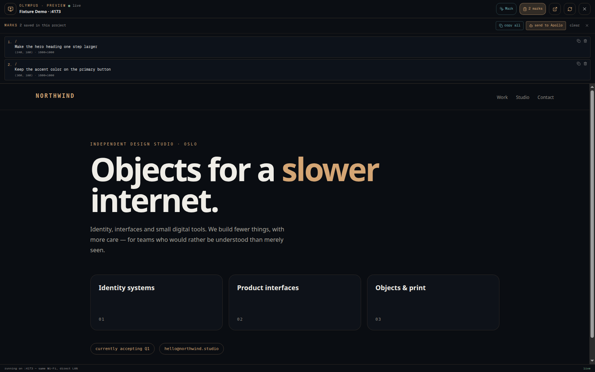

The dedicated window renders the app in a browser iframe (`forceBrowser`), so
the Electron popup can no longer render black. It follows the port and the
settled hops, and the durable mark queue is available at the top. “Send to
Apollo” formats the batch once and puts it in the ONE terminal queue.

## 14. Phone

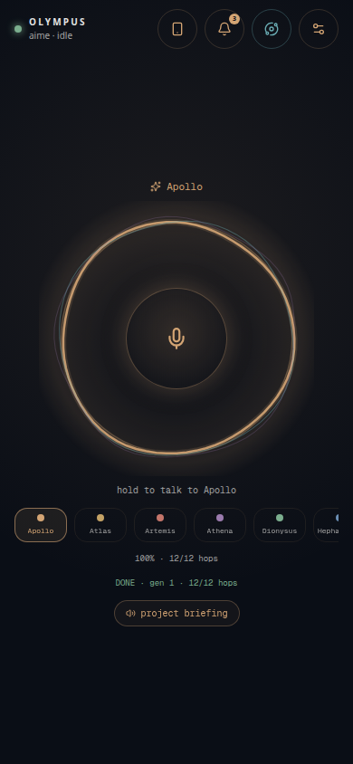

The same campaign in one hand: voice-first prompt, the god row, campaign
progress (AIME 12/12 DONE), project briefing, preview and marks. The phone pairs
with a live heartbeat and shares the desktop notification palette and dedupe.

## Reproduce

```bash
# with the app running on :3737 and a project preview up
node scripts/capture-v012-screens.mjs
node scripts/fps-probe-electron.mjs --label v012-final
```

The capture script sets English + the Olympus dark theme, captures all fourteen
menus, restores the user's preferences and rewrites
`screenshots/screens/manifest.json` with only the current gallery.
