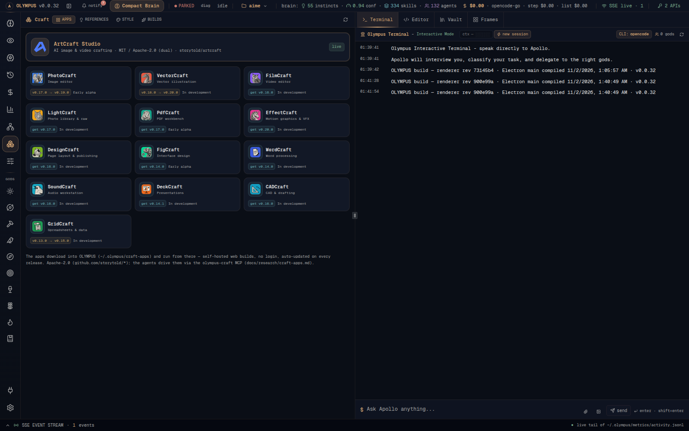
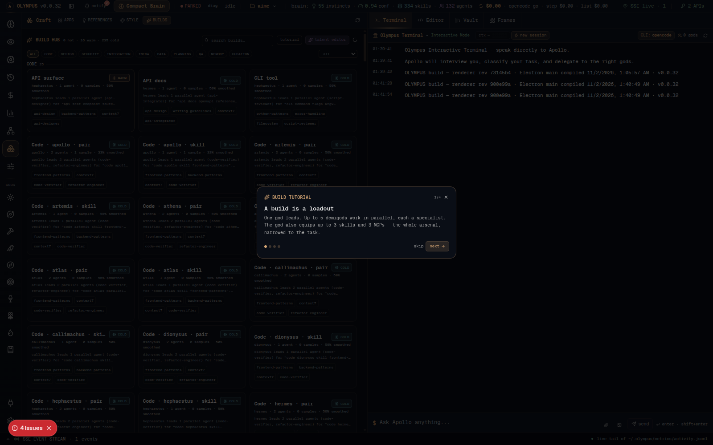
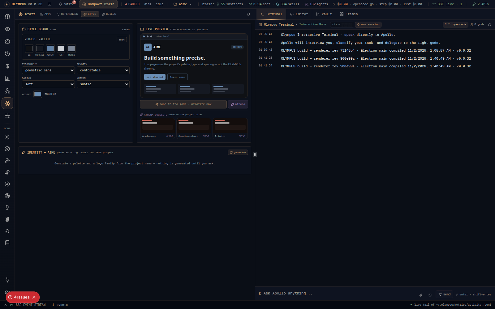
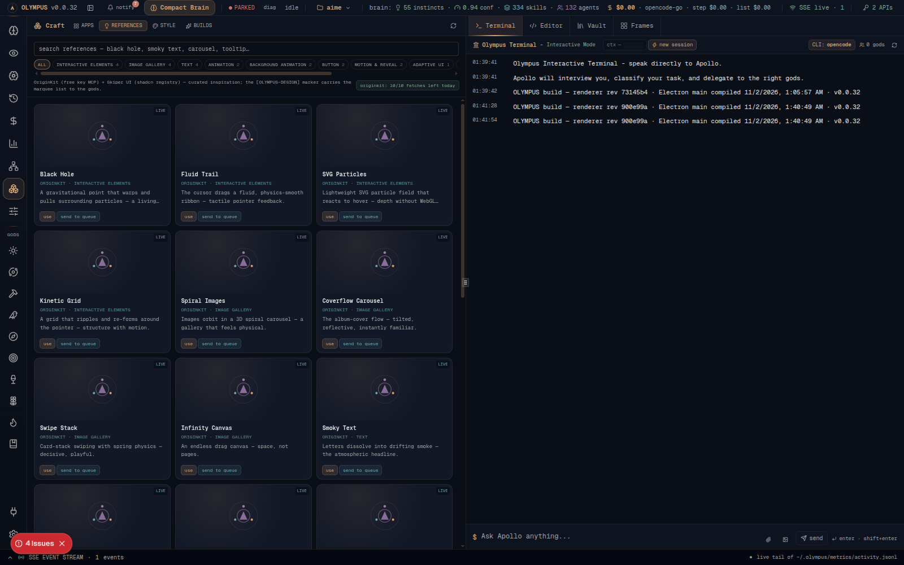
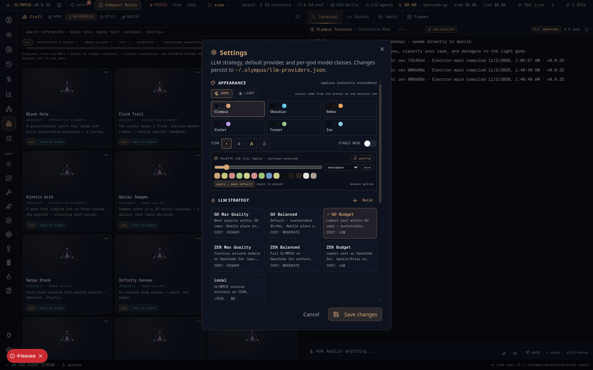

# OLYMPUS — UX tour (v0.0.32)

> Real screenshots from the running app: `npm run shots` (Electron, offscreen)
> captures them from `http://127.0.0.1:3737`. No mockups.

## 1. The Brain Atlas — where the work lives


The 3D/Canvas brain is the map of the project's intelligence: gods (gold),
instincts (green), knowledge (purple), skills (blue) and the project hub. It
follows the active theme (nodes are recolored by kind; the background, labels
and haze use the palette). Hover a node for its card, click to open the
document or the god. The bottom-left orbit is the live mark; campaign events
stream next to it.

## 2. Craft — the surfaces that build the product



The Craft dashboard gathers the vendored apps (ArtCraft Studio, PhotoCraft,
VectorCraft, …) and the design lanes. Each app runs inside OLYMPUS after a
one-click install; the ArtCraft Studio is the composition lane.

## 3. Builds — the loadout hub



**251 default builds** (51 curated + a matrix of every sector × every god ×
skill-led/agent-led), grouped by category and filterable by god. Every card
shows the god, the agents, the skills, the MCPs and the earned tier
(hot ≥ 80 % over 5 wins, warm ≥ 50 % over 2). Click a card to open the viewer;
**simulate** loads it into the talent carousel. The first visit gets a
four-step animated tutorial.

### The talent carousel

One sector per screen, swipe or use the arrows. Each slot opens the **whole
arsenal** (334 skills · 28 MCPs · 132 agents) with search and a custom value;
the caps are 3 skills / 3 MCPs / 5 parallel agents. Saving stores a user build
the brain learns from.

## 4. Style — the project's direction, not OLYMPUS's



The Style Board belongs to the open project. A neutral project palette starts
the direction; **edit** exposes the five colors, and the mock page updates
live. **Generate** produces six palettes and six logo marks from the project
name; **Athena suggests** three families from the project's seed and stacks.
**Send to the gods** enqueues the direction at maximum priority; **Athena**
asks for a refinement. Nothing is copied by hand.

## 5. References — real components, one click



The catalog is fixed (24/24 demo URLs) and searchable by category. Hover a card
to play the **real component** from the Originkit page (cropped to the demo area,
one iframe at a time); **use** carries the reference into the project's Style
Board, **send to queue** opens a high-priority Athena task.

## 6. Appearance — one palette for the whole machine



Twelve presets (six dark, six light pastel) plus the **palette lab**: a hue
slider, five harmonies, shuffle, and a full 14-key family generated with
contrast floors (text ≥ 7:1, dim ≥ 4.5:1, accent ≥ 3:1). The choice repaints
the app chrome, the terminal, the god icons, the brain, the loader, the splash,
the tray dot, the window icon and the Linux dock icon. **Stable mode** removes
decorative motion; the 60 FPS rule is a standing law.

## 7. Pattern Studio — watch the machine think

A star button in the status bar opens a full-screen artistic view: a drifting
particle field where every burst is a real hop, the themed mark in the center,
the gods' in-flight work on the left and the **voice orb** (plasma ring) with a
language selector on the right. One canvas, DPR capped, paused when hidden,
static in stable mode. The voice synthesis and full i18n arrive in a later
release; the surface is already here.

## 8. Notifications and the sleep contract

The bell lists every event with a link to the exact pane; **hibernate on lock**
is on by default, and **now** keeps the campaign while the window disappears.
The tray dot stays colored while the window is hidden.

## Running it

```bash
npm install
npm run dev        # Electron + Next on 127.0.0.1:3737
npm run shots      # re-capture these screenshots from the live app
```

The app is local-first: no account, no upload, no telemetry by default.
