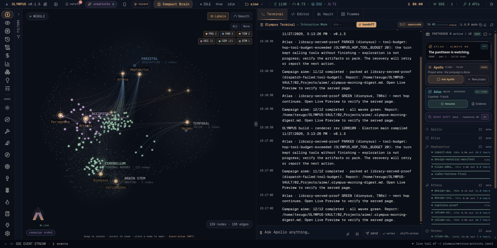
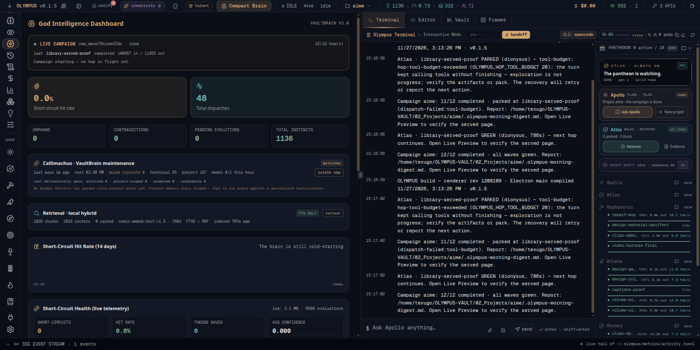
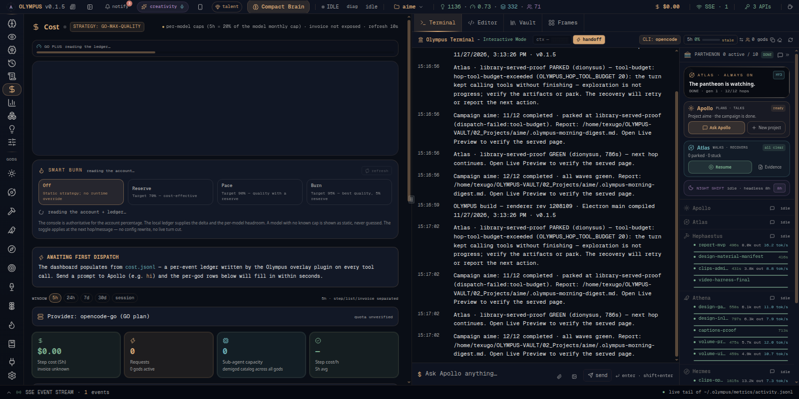
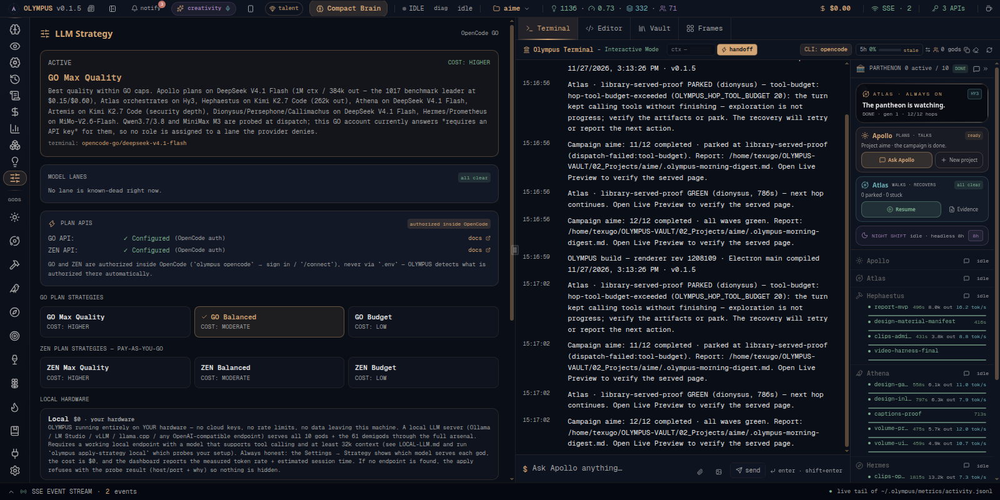
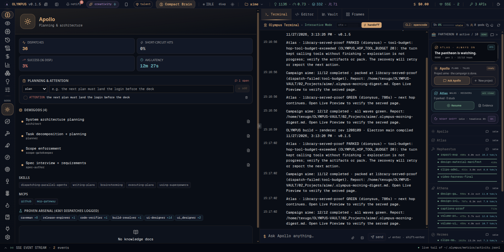
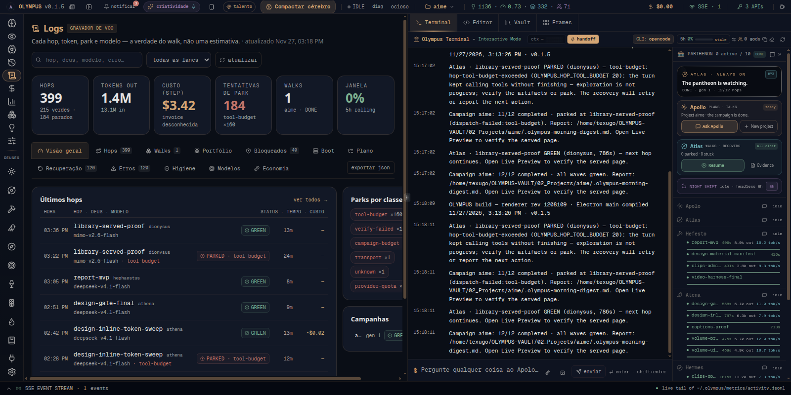

# OLYMPUS — UX tour (v0.1.5)

One clean screen per surface, captured from the running **v0.1.5** app at
1600×1000. The images live in [`screens/`](screens/) and the manifest is
[`screens/manifest.json`](screens/manifest.json); they are real captures, not
mockups.

The v0.1.5 front-end contract:

- the brain keeps its **full cloud** in Smooth, Balanced and Battery saver;
- a drag keeps the cloud, nodes and labels, then restores on release;
- the atlas **auto-rotates** in Smooth/Balanced and pauses only in Battery
  saver;
- the **Y/Z compass** is not rendered;
- the status bar carries the metric icons and values without the `brain:`
  prefix;
- the shell follows the selected language (activity bar, status bar, Compact
  Brain, notifications, Logs header, right-pane tabs; seven languages);
- **X hibernates** the window and keeps the campaign alive; minimize keeps the
  window open. Hibernate is also available in the notification panel.

## 1. The Pantheon

The brain atlas on the left, the Apollo terminal on the right, the Parthenon
command deck in the third column. The atlas shows the full point cloud and
auto-rotates; the status bar carries the instinct, confidence, skill and agent
metrics without a prefix.

## 2. God Intelligence

Per-god stats plus the live Callimachus card: last/next pass, the honest
quick-circuit count, project vs technical memory and the hourly model budget.
The local retrieval card shows chunks, vectors, cache entries and the
Build/Refresh action.

## 3. Cost

The real ledger, the fully loaded hourly chart and the three separate money
figures: step cost, list value and invoice unknown. Opening the pane paints its
own skeleton, never the full-surface loader.

## 4. LLM Strategy

The canonical strategy table: DeepSeek V4.1 Flash on Apollo, Hy3 on Atlas, the
verified lane roster, and the GO/Zen/Local cards. No stale Apollo GLM claim.

## 5. Logs

The flight recorder: hops, walks, models, economy, parks by class and the
window meter. The header and tabs follow the selected language.

## 6. God detail

Dispatches, demigods, skills, proven arsenal and references. The panel never
opens empty: the graph selection, the persistent god selection and the live god
are the fallback chain.

## 7. Português — the i18n proof

Switching the language updates the shell immediately: `notify` → `notificar`,
`Compact Brain` → `Compactar cérebro`, `Cost` → `Custo`, the Logs header and
tabs included. The same dictionary covers English, Português, Español,
Français, Deutsch, 日本語 and 中文.
