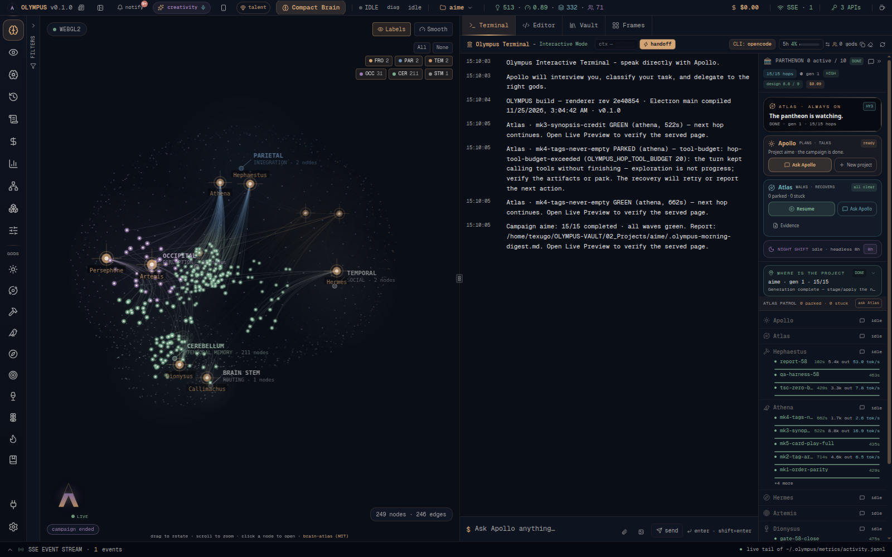
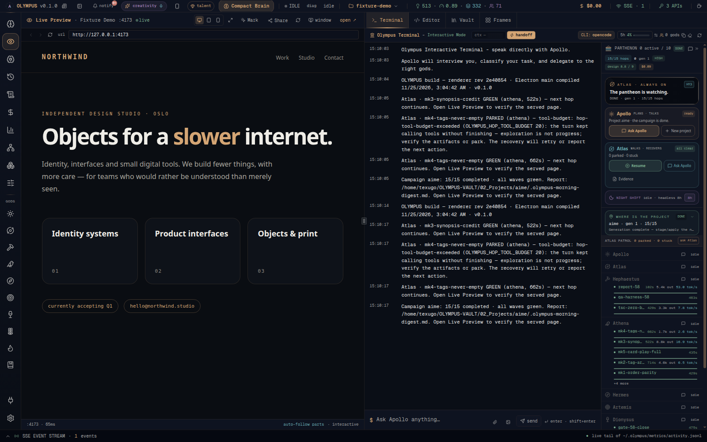
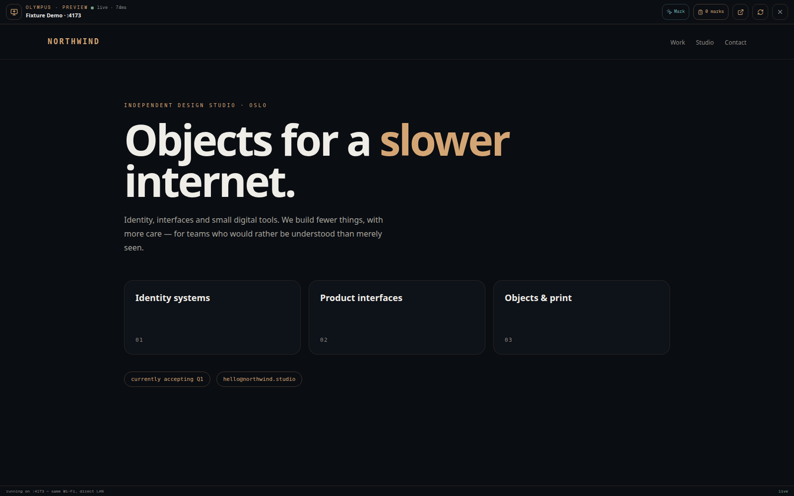
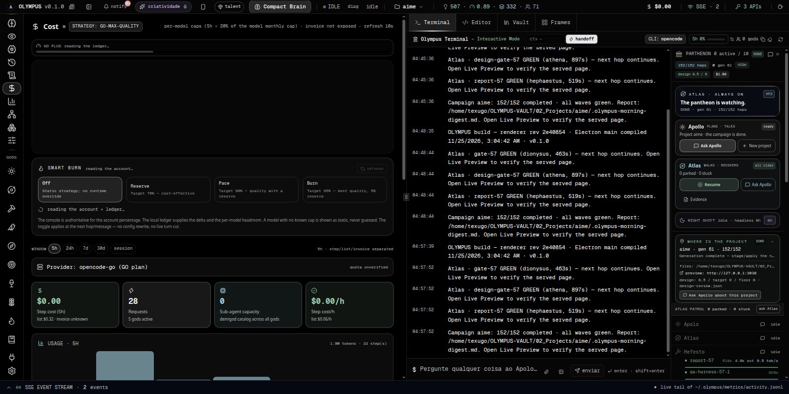
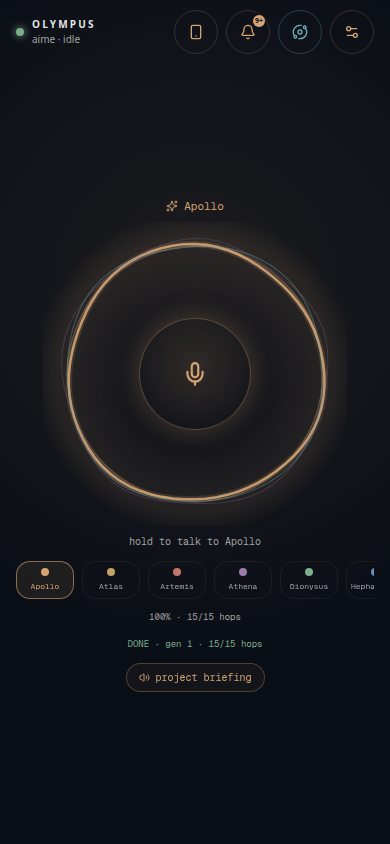

# OLYMPUS — UX tour (v0.1.0)

Five surfaces, captured from the running **v0.1.0** app at 1600×1000
(phone at 390×844). Every image in `screenshots/screens/` referenced here was
captured from the live app with `scripts/capture-v010-screens.mjs`; there are no
mockups.

The preview fixture is a tiny framing-friendly page because AIME sets
`frame-ancestors 'none'` by design. The shell, the Parthenon, the status brief,
the cost ledger, the mark queue and the phone are the real surfaces.

## 1. The Pantheon



The brain atlas on the left, the terminal on the right, the Parthenon command
deck in the third column. The status brief card answers “where is my project?”
from disk: project, generation, completed/total, current hop, park, preview URL
and design provenance.

## 2. Live preview



A real project inside OLYMPUS. The surface is interactive from the first paint;
the toolbar carries the origin, reload, Mark, Share, Window and Open. The mark
toolbar writes to the durable per-project queue — the panel is not the source of
truth, the disk is.

## 3. Preview window



The dedicated window renders the app in a browser iframe (`forceBrowser`), so
the Electron popup can no longer render black. It follows the port and the
settled hops, and the same durable mark queue is available at the top.

## 4. Cost



The real ledger: GO month / 5h / week, Smart Burn, step cost / list value /
invoice unknown, per-model caps and the honest reconnect state with **retry**.
A timeout keeps the last good reading; the pane never sits on an endless
loader.

## 5. Phone



The same campaign in one hand: voice-first prompt, the god row, campaign
progress, project briefing, preview and marks. The phone pairs with a live
heartbeat; the same notification palette and the same dedupe as the PC.

## Reproduce

```bash
# with the app running on :3737 and a project preview up
node scripts/capture-v010-screens.mjs
```

The script sets English + the Olympus dark theme, captures the five surfaces,
restores the user's preferences and rewrites
`screenshots/screens/manifest.json` with only the current gallery.
